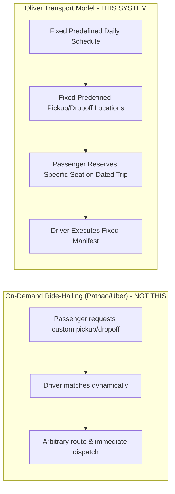

# 00 — Project Overview

## 1. Document Purpose
This document provides the foundational executive and operational summary for **Oliver Transport**, defining the commercial context, core business goals, operating boundaries, and service model. It establishes the baseline reference for all engineering, architectural, and business analysis decisions.

---

## 2. Scope
* **In Scope:** Initial commercial operation between Montreal and Toronto, Canada, utilizing a single 6-passenger shuttle vehicle, operating fixed daily schedules with cash-only settlement, self-service passenger reservations with instant confirmation, manual seat selection, and a dedicated rider/driver operational panel.
* **Out of Scope:** On-demand hailing, dynamic routing, customer-defined waypoints, online payment gateways, credit card processing, automatic refunds, administrative CMS panels, multi-vehicle dispatch, and live GPS map tracking.

---

## 3. Relevant Requirements

| ID | Requirement | Classification | Notes |
|---|---|---|---|
| REQ-01 | Scheduled intercity shuttle business model | **`[CONFIRMED]`** | Fixed stops, fixed schedule. Not an on-demand hailing service. |
| REQ-02 | Single vehicle fleet with 6 passenger seats | **`[CONFIRMED]`** | Front passenger seat (S1) + 5 rear passenger seats (S2-S6). Driver seat excluded. |
| REQ-03 | Two fixed daily operational routes | **`[CONFIRMED]`** | Route A: Montreal → Toronto; Route B: Toronto → Montreal. |
| REQ-04 | Three fixed physical locations | **`[CONFIRMED]`** | Metro Namur (Montreal), Yorkdale Mall (Toronto), Yonge Station (Toronto). |
| REQ-05 | **Flat `per_trip` Fare Model** | **`[CONFIRMED]`** | Fixed fare per passenger per trip, regardless of boarding and drop-off stops. |
| REQ-06 | **Support for Both Coupon Types** | **`[CONFIRMED]`** | Percentage-based (with optional max cap) and fixed-amount discounts. |
| REQ-07 | **Instant Booking Confirmation** | **`[CONFIRMED]`** | Immediately confirmed upon atomic transaction commit. No driver approval. |
| REQ-08 | **Manual Passenger Seat Selection** | **`[CONFIRMED]`** | Passenger chooses physical seat; zero silent auto-reassignment if taken. |
| REQ-09 | Cash-only settlement in MVP | **`[CONFIRMED]`** | Paid physically upon boarding/pickup. No online gateway in MVP. |
| REQ-10 | Dedicated Rider operational panel | **`[CONFIRMED]`** | Mobile-accessible dashboard for trip manifests and cash collection logging. |
| REQ-11 | Operational timezone `America/Toronto` | **`[CONFIRMED]`** | All schedules, deadlines, and logs strictly adhere to Eastern Time. |
| REQ-12 | Daily year-round operations (7 days/week) | **`[CONFIRMED]`** | Trips run every calendar day with independent seat inventory. |
| REQ-13 | Final Montreal arrival address for Route B | **`[CONFIRMED]`** | Station Métro Namur (Montreal). Exactly 3 stations in entire system. |
| REQ-14 | Promotional Fare ($55 CAD) Expiration Date | **`[PROPOSED]`** | Configured via `config/pricing.php`; runs indefinitely until toggled by operator. |
| REQ-15 | **Unified Login System with Role Redirection** | **`[CONFIRMED]`** | One shared `/login` page for all roles. Server-side post-login redirection based on role. |
| REQ-16 | **Mobile-First Design & iPhone Safari Priority** | **`[CONFIRMED]`** | Mobile-first layouts; optimized for iPhone Safari (100dvh, safe areas, 44 × 44 CSS pixels, 16px inputs). |
| REQ-17 | **Extremely Simple 9-Step Passenger Journey** | **`[CONFIRMED]`** | Frictionless 9-step booking flow on frontend backed by 16-step atomic backend transaction. |
| REQ-18 | **Official Logo & Brand Identity** | **`[CONFIRMED]`** | Honda Odyssey ("RAJIA"), Oliver Green (`#22C55E`), Dark Charcoal (`#111827`), phone `647-655-1884`. |
| REQ-19 | **Multiple Seats per Booking** | **`[CONFIRMED]`** | Passenger can book 1 to 6 seats in a single booking under 1 account. |
| REQ-20 | **No In-App Cancellation or Cutoff in MVP** | **`[CONFIRMED]`** | No self-service cancellation; no booking cutoff window prior to departure. |
| REQ-21 | **English-First Language Launch** | **`[CONFIRMED]`** | English UI for MVP launch; French localization deferred to Phase 2. |

---

## 4. Business Description & Commercial Model

### 4.1 Scheduled Shuttle vs. On-Demand Ride-Hailing
While inspired by consumer familiarity with ride-booking apps (e.g., Pathao, Uber), **Oliver Transport is strictly a scheduled intercity reservation service**.

Passengers cannot:
1. Propose arbitrary pickup or drop-off coordinates.
2. Negotiate or modify departure times.
3. Divert the route to custom stops.
4. Hail an immediate, on-demand vehicle.

### 4.2 Fleet & Seating Specifications
* **Vehicle Count:** Exactly one (1) dedicated commercial shuttle vehicle in MVP.
* **Passenger Capacity:** Exactly six (6) bookable passenger seats.
* **Driver Exclusion:** The vehicle contains a driver seat that is permanently excluded from booking inventory and visual selection.
* **Seat Allocation Architecture:** Visual seating diagram reflecting the physical cabin layout (Seat S1 beside the driver; Seats S2 through S6 in the rear passenger cabin). Passenger manually chooses their preferred seat.

### 4.3 Operational Routes & Stops

#### Route A: Montreal → Toronto (Morning Service)
* **Departure Location:** Metro Namur, Montreal, QC.
* **Departure Time:** Exactly **6:30 AM** (America/Toronto).
* **Intermediate Stop:** Yorkdale Mall, Toronto, ON (Drop-off only).
* **Final Destination:** Yonge Station, Toronto, ON (Drop-off only).

#### Route B: Toronto → Montreal (Afternoon Service)
* **First Pickup:** Yorkdale Mall, Toronto, ON at **12:15 PM** (America/Toronto).
* **Second Pickup:** Yonge Station, Toronto, ON at **1:15 PM** (America/Toronto).
* **Final Destination:** Montreal (Exact address pending client confirmation; Metro Namur proposed default).

---

## 5. Primary Business Goals

1. **Self-Service Online Booking:** Enable passengers to view schedules, select available travel dates, choose physical seats visually, and book instantly 24/7 via an **extremely simple 9-step booking journey**.
2. **Prevent Overbooking (Segment-Based Availability):** Guarantee that no two passengers can book the same seat on overlapping route segments, while maximizing vehicle utilization by allowing non-overlapping sequential segment seat reuse.
3. **Transparent Financial Management:** Snapshot base fares, promotional rates ($55 introductory vs. $65 regular CAD), and validated coupon discounts directly onto booking records under the strict `per_trip` model.
4. **Frictionless Rider Manifests:** Provide assigned drivers ("Riders") with real-time mobile manifests, boarding stops, contact details, and a streamlined tool to log physical cash collection.
5. **Mobile-First & iPhone Safari Accessibility:** Deliver flawless usability on mobile smartphones, with specific optimizations for iPhone Safari (viewport height, safe areas, touch ergonomics).
6. **Unified Secure Identity:** Provide a single shared login portal (`/login`) that seamlessly directs Passengers, Riders, and Operators to their dedicated environments.
7. **Architectural Extensibility:** Build a robust, scalable foundation capable of absorbing Phase 2 Admin Panels, Phase 3 Online Gateways, and Phase 4 multi-vehicle fleet scaling without re-architecting the core domain.
8. **Lean & Affordable MVP:** Deliver a high-quality, production-ready system within a 7-day implementation scope by maintaining strict MVP boundaries.

---

## 6. Business Rules

* **BR-OVR-01 (Daily Cadence):** Trips operate 7 days per week, 365 days per year, regardless of holidays, unless marked inactive by a system operator.
* **BR-OVR-02 (Timezone Strictness):** All dates, departure times, booking cutoffs, and trip logs must be evaluated and stored relative to `America/Toronto` (Eastern Time).
* **BR-OVR-03 (Instant Reservation):** Booking confirmations are generated instantly upon atomic database commitment. Driver approval is neither required nor supported.
* **BR-OVR-04 (Cash Settlement):** Booking confirmation reserves the seat but does not imply payment. Payment status remains `unpaid` until the Rider logs cash collection.
* **BR-OVR-05 (Per-Trip Fare Flatness):** Every permitted stop pair on a trip shares the identical per-trip base fare ($65 CAD regular / $55 CAD promo).
* **BR-OVR-06 (Unified Authentication):** All roles log in at `/login`. Post-login redirection is strictly role-governed.
* **BR-OVR-07 (Asset-Dependent Branding):** Logo and brand color tokens remain `[PENDING ASSET]` awaiting official vehicle photograph ingestion.

---

## 7. Technical Considerations

* **Host Platform:** Built on modern PHP 8.4 and Laravel 13 Monolith, utilizing Blade templating and Tailwind CSS v4.
* **Database Isolation:** All booking transactions must execute inside database transactions (`REPEATABLE-READ` or pessimistic row-level locking on `vehicle_seats`) to prevent race conditions during high-demand booking windows.
* **Timezone Handling:** Database stores timestamps in UTC; business domain logic evaluates all operational constraints against `America/Toronto`.
* **Mobile-First Standards:** Native dynamic viewport sizing (`100dvh`), `env(safe-area-inset-*)`, and minimum 44 × 44 CSS pixels touch targets (seat selector tiles target approximately 48 × 48 CSS pixels or larger) guided by iPhone Safari ergonomics.
* **Unified Authentication:** Single login route (`/login`) with role-based post-login redirection and server-side policy enforcement.

---

## 8. Related Documents
* [`01-project-scope.md`](./01-project-scope.md) — Scope boundaries and MVP constraints.
* [`02-business-requirements.md`](./02-business-requirements.md) — Detailed operational requirements and stop sequences.
* [`06-system-architecture.md`](./06-system-architecture.md) — Technical architecture design.
* [`08-booking-workflow.md`](./08-booking-workflow.md) — 16-step booking lifecycle.
* [`09-seat-management.md`](./09-seat-management.md) — Segment-based availability algorithms.
* [`10-coupon-and-pricing.md`](./10-coupon-and-pricing.md) — Per-trip fare model and coupon rules.
* [`13-ui-ux-guidelines.md`](./13-ui-ux-guidelines.md) — UI/UX design specifications and mobile guidelines.

---

## 9. Assumptions and Pending Decisions
* **Assumption (A-001):** The operational vehicle is a standard 7-seater passenger van (1 Driver + 1 Front Passenger + 5 Rear Passengers).
* **Pending Decision (PD-001):** Confirmation of the exact final drop-off location in Montreal for Route B (Metro Namur proposed). Status: **`[PENDING]`**
* **Pending Decision (PD-002):** Promotional launch fare ($55 CAD) expiration date. Status: **`[PENDING]`**
* **Pending Decision (PD-003):** Booking cutoff threshold before trip departure (30 minutes proposed). Status: **`[PROPOSED]`**
* **Pending Asset (PA-001):** Delivery of official vehicle photograph containing company logo to extract official vector logo and exact brand color hex tokens. Status: **`[PENDING ASSET]`**
