# 01 — Project Scope & Boundaries

## 1. Document Purpose
This document establishes the formal functional and technical boundaries for the **Oliver Transport Minimum Viable Product (MVP)**. It outlines what is strictly included in the initial launch, what is deferred to subsequent phases, and the delivery milestones necessary to meet a 7-day development window.

---

## 2. Scope Matrix

```mermaid
graph TD
    subgraph MVP["Phase 1: Minimum Viable Product (Current)"]
        direction TB
        M1["Fixed Montreal ↔ Toronto Shuttle Routes (3 Locations)"]
        M2["Single 6-Seat Vehicle Model (Driver Excluded)"]
        M3["Segment-Based Seat Reservation (Passenger Chooses Seat)"]
        M4["Instant Booking Engine (16-Step Atomic Transaction)"]
        M5["Configurable Per-Trip Fare ($65 / $55 CAD) & Both Coupon Types"]
        M6["Cash-Only Payment Tracking (Rider Collects Cash)"]
        M7["Passenger Dashboard & History (Digital Boarding Pass)"]
        M8["Rider Manifest & Cash Collection Panel"]
        M9["Public Marketing Pages (Responsive Tailwind v4)"]
    end

    subgraph Excluded["Phase 2 & Beyond (Strictly Excluded from MVP)"]
        direction TB
        E1["Admin CMS / Web Management Panel"]
        E2["Online Payment Gateways (Stripe/Moneris/PayPal)"]
        E3["Dynamic Route & Stop Creator"]
        E4["Live GPS Vehicle Tracking"]
        E5["Automated Electronic Refunds"]
        E6["Multi-Vehicle Fleet Scheduling"]
        E7["Native Mobile Apps (iOS/Android)"]
        E8["Paid SMS / WhatsApp Messaging (Twilio)"]
    end
```



---

## 3. Relevant Requirements

| ID | Feature / Component | Scope Classification | Delivery Target |
|---|---|---|---|
| SCOPE-01 | Passenger registration, authentication, and profile | **`[CONFIRMED]`** | Phase 1 (MVP) |
| SCOPE-02 | Public informational pages (Home, About, FAQ, Contact, Terms, Privacy) | **`[CONFIRMED]`** | Phase 1 (MVP) |
| SCOPE-03 | **Manual 6-seat vehicle reservation picker** (`choose` model) | **`[CONFIRMED]`** | Phase 1 (MVP) |
| SCOPE-04 | Segment-based seat availability calculation | **`[CONFIRMED]`** | Phase 1 (MVP) |
| SCOPE-05 | **Instant booking confirmation** (no driver pre-approval) | **`[CONFIRMED]`** | Phase 1 (MVP) |
| SCOPE-06 | **Strict `per_trip` fare model** ($65 regular / $55 promo CAD) | **`[CONFIRMED]`** | Phase 1 (MVP) |
| SCOPE-07 | **Both coupon types** (Percentage and Fixed-amount) | **`[CONFIRMED]`** | Phase 1 (MVP) |
| SCOPE-08 | Cash-only settlement and Rider cash logging | **`[CONFIRMED]`** | Phase 1 (MVP) |
| SCOPE-09 | Passenger personal dashboard and booking history | **`[CONFIRMED]`** | Phase 1 (MVP) |
| SCOPE-10 | Dedicated Rider trip manifest and stop list panel | **`[CONFIRMED]`** | Phase 1 (MVP) |
| SCOPE-11 | Bilingual (English/French) UI localization structure | **`[CONFIRMED]`** | Phase 1 English Launch; French deferred to Phase 2 |
| SCOPE-12 | Admin management interface (CMS) | **`[FUTURE]`** | Phase 2 |
| SCOPE-13 | Dynamic route, stop, and schedule builder | **`[FUTURE]`** | Phase 2 |
| SCOPE-14 | Online credit/debit card payment gateway (Stripe/Moneris) | **`[FUTURE]`** | Phase 3 |
| SCOPE-15 | Automated refund calculation and disbursement | **`[FUTURE]`** | Phase 3 |
| SCOPE-16 | Live GPS driver tracking and real-time mapping | **`[FUTURE]`** | Phase 4 |
| SCOPE-17 | Multi-vehicle fleet scheduling and dynamic vehicle assignment | **`[FUTURE]`** | Phase 4 |
| SCOPE-18 | **Unified Login System (`/login`) with Role Redirection** | **`[CONFIRMED]`** | Phase 1 (MVP) |
| SCOPE-19 | **Mobile-First Responsive Design & iPhone Safari Priority** | **`[CONFIRMED]`** | Phase 1 (MVP) |
| SCOPE-20 | **Extremely Simple 9-Step Passenger Booking Experience** | **`[CONFIRMED]`** | Phase 1 (MVP) |
| SCOPE-21 | **Official Logo & Brand Palette Architecture** | **`[CONFIRMED]`** | Phase 1 (MVP) — Confirmed from official vehicle decal |
| SCOPE-22 | **Multi-Seat Booking (1 to 6 Seats per Account)** | **`[CONFIRMED]`** | Phase 1 (MVP) |
| SCOPE-23 | **No In-App Cancellation or Cutoff Window in MVP** | **`[CONFIRMED]`** | Phase 1 (MVP) — Out-of-band phone/Facebook support only |

---

## 4. MVP Inclusions (Detailed Breakdown)

### 4.1 Passenger Experience
* **Authentication:** Email and password registration, login, logout, password reset, and session management.
* **Public Pages:** Modern responsive homepage with direct Montreal ↔ Toronto trip booking widget, "About Us", "Contact Us", "FAQ", "Terms & Conditions", and "Privacy Policy".
* **Booking Funnel:** 
  1. Direction selection (Montreal → Toronto OR Toronto → Montreal).
  2. Travel date selection (calendar with active trip validation).
  3. Predefined boarding and drop-off stop selection based on allowed route sequences.
  4. Visual seat picker displaying the realistic 6-seat vehicle cabin with multi-seat selection (passenger manually chooses 1 to 6 available seats).
  5. Optional coupon application (percentage or fixed-amount) with instant recalculation against total gross fare.
  6. Transparent fare summary breakdown (base fare × seat count, discount, final payable cash amount under `per_trip` model).
  7. Instant booking submission.
* **Passenger Dashboard:** List of upcoming trips, completed trips, booking reference codes (`OT-YYYY-XXXX`), allocated seat numbers, and payment statuses (`unpaid` / `paid`).

### 4.2 Rider (Driver) Experience
* **Unified Authentication:** Authenticates via the single shared `/login` portal. Role detection instantly redirects the driver to the Rider Dashboard, while preventing access to passenger booking workflows or administrative tools.
* **Trip Dashboard:** Immediate view of today's assigned trips (Route A morning departure and Route B afternoon departure).
* **Trip Manifest:** Ordered stop-by-stop passenger list detailing:
  * Passenger full name.
  * Contact phone number.
  * Assigned seat number (S1 to S6).
  * Specific boarding stop.
  * Specific drop-off stop.
  * Payment status (`unpaid` vs. `paid`).
* **Operational Actions:**
  * One-click "Mark Cash Collected" action per passenger.
  * Trip lifecycle triggers ("Start Trip", "Complete Trip").

### 4.3 Operator Management in MVP (No Admin Panel)
Because an administrative CMS is explicitly excluded from the MVP to safeguard the timeline and budget:
* Initial vehicles, routes, route stops, and recurring schedules are provisioned via structured database seeders and migrations.
* Promotional pricing ($55 CAD) and coupons are managed via configuration files (`config/pricing.php`) and secure database seeders or dedicated Artisan CLI commands (e.g., `php artisan coupon:create`).
* Rider accounts are provisioned via secure Artisan commands (e.g., `php artisan make:rider`).

---

## 5. Explicit Exclusions (Out of Scope for MVP)

1. **No Admin Panel:** No web interface for creating routes, editing schedules, adding vehicles, or auditing financial logs.
2. **No Dynamic Routing:** Passengers cannot enter street addresses, GPS coordinates, or custom waypoints.
3. **No Online Payment Gateway:** No Stripe, PayPal, Square, or Interac e-Transfer integrations. Zero merchant fees, card storage, or PCI-DSS compliance burdens in Phase 1.
4. **No Automated Refunds:** Because payment is cash-on-delivery, electronic refunds do not exist.
5. **No Live GPS Tracking:** No WebSockets, Pusher, Google Maps Geolocation tracking, or driver map markers.
6. **No Multi-Vehicle Dispatching:** The system models a single active vehicle and driver. Dynamic multi-van load balancing is deferred.
7. **No Paid Third-Party SMS/WhatsApp APIs:** Transaction notifications rely strictly on native database logs and default Laravel mailers.
8. **No In-App Cancellation System:** In MVP, no self-service passenger cancellation routes or dashboard controls are provided. Cancellations are handled out-of-band via phone/SMS (`647-655-1884`) or Facebook support.
9. **No Booking Cutoff Gate:** Bookings remain open up until departure time as long as vacant seats remain in the vehicle.

---

## 6. Phased Evolution Roadmap

```
+-------------------------------------------------------------------------+
| PHASE 1: MVP (Launch Ready)                                             |
| Fixed 3 locations, 2 daily routes, 1 vehicle (6 seats), cash-only,     |
| instant booking, segment-based seat allocation, Rider manifest.        |
+-------------------------------------------------------------------------+
                                    |
                                    v
+-------------------------------------------------------------------------+
| PHASE 2: Administrative Control & Governance                            |
| Web-based Admin CMS, dynamic route/stop management, dynamic schedules, |
| coupon manager UI, rider management, manual booking intervention.       |
+-------------------------------------------------------------------------+
                                    |
                                    v
+-------------------------------------------------------------------------+
| PHASE 3: Commercial Scaling & Online Payments                           |
| Stripe / Apple Pay / Google Pay, automated cancellation/refund rules,   |
| Twilio SMS / WhatsApp dispatch alerts, automated email confirmations.  |
+-------------------------------------------------------------------------+
                                    |
                                    v
+-------------------------------------------------------------------------+
| PHASE 4: Fleet Scale & Mobile Ecosystem                                 |
| Multi-vehicle fleet dispatching, live GPS telematics, native iOS and   |
| Android apps, multi-city intercity network expansion.                   |
+-------------------------------------------------------------------------+
```

---

## 7. 7-Day MVP Implementation Plan (Budget & Milestones)

To deliver this commercial application within a 7-day engineering sprint, work must be sequenced with zero scope creep:

* **Day 1: Foundation & Data Architecture**
  * Database migrations: `locations`, `routes`, `route_stops`, `vehicles`, `vehicle_seats`, `schedules`, `trips`, `bookings`, `booking_seats`, `coupons`, `coupon_usages`, `payments`.
  * Model relationships, seeders, and factory setup.
  * Role and permission structure (Passenger vs. Rider).
* **Day 2: Domain Services & Core Engine**
  * `SeatAvailabilityService`: Ordered stop sequence segment-based availability algorithm with pessimistic row locking.
  * `PricingService` & `CouponService`: Per-trip fare resolution and safe decimal discount math for percentage and fixed coupons.
  * `BookingService`: 16-step atomic transaction-safe booking reservation logic.
  * Comprehensive Pest unit and integration tests for segment overlaps and concurrency.
* **Day 3: Authentication & Public Marketing Pages**
  * User registration, login, logout, password reset.
  * Responsive homepage, About, Contact, FAQ, Terms, and Privacy views.
  * Brand styling integration (dark green/neon accents, Tailwind CSS v4).
* **Day 4: Passenger Booking Funnel & Visual Seat Picker**
  * Interactive booking form: Route selection, date picker, stop sequence selectors.
  * Visual 6-seat vehicle cabin UI component (manual seat choice).
  * Real-time coupon validation endpoint and fare breakdown.
  * Instant booking submission executing the 16-step transaction.
* **Day 5: Passenger Dashboard & Booking History**
  * Passenger portal: Upcoming trips, past booking history, booking details view.
  * Printable / mobile-friendly digital boarding voucher with QR/Reference Code.
* **Day 6: Rider Panel & Operational Actions**
  * Unified Rider authentication via shared `/login` with dynamic role redirect to `/rider/dashboard` and server-side `RoleMiddleware`.
  * Rider dashboard: Today's assigned trips (Route A & Route B).
  * Passenger manifest table with contact numbers and seat assignments.
  * One-click cash payment collection logging.
* **Day 7: End-to-End QA, Polish & Production Preparation**
  * Comprehensive feature test suite execution.
  * Concurrency and double-booking stress testing under row locks.
  * Timezone verification (`America/Toronto`).
  * Final cross-browser and mobile responsive testing.

---

## 8. Business Rules
* **BR-SCP-01 (Scope Enforcement):** No engineering hours may be spent on excluded features (e.g., building an admin interface) during the initial 7-day implementation sprint.
* **BR-SCP-02 (Database Readiness):** Even though administrative interfaces are deferred to Phase 2, the underlying database schema must be fully normalized to support dynamic routes and multiple vehicles without structural refactoring.

---

## 9. Related Documents
* [`00-project-overview.md`](./00-project-overview.md) — High-level project summary.
* [`02-business-requirements.md`](./02-business-requirements.md) — Specific business parameters.
* [`08-booking-workflow.md`](./08-booking-workflow.md) — 16-step booking lifecycle.
* [`16-testing-strategy.md`](./16-testing-strategy.md) — Test verification plan.
* [`19-future-roadmap.md`](./19-future-roadmap.md) — Detailed future roadmap.
