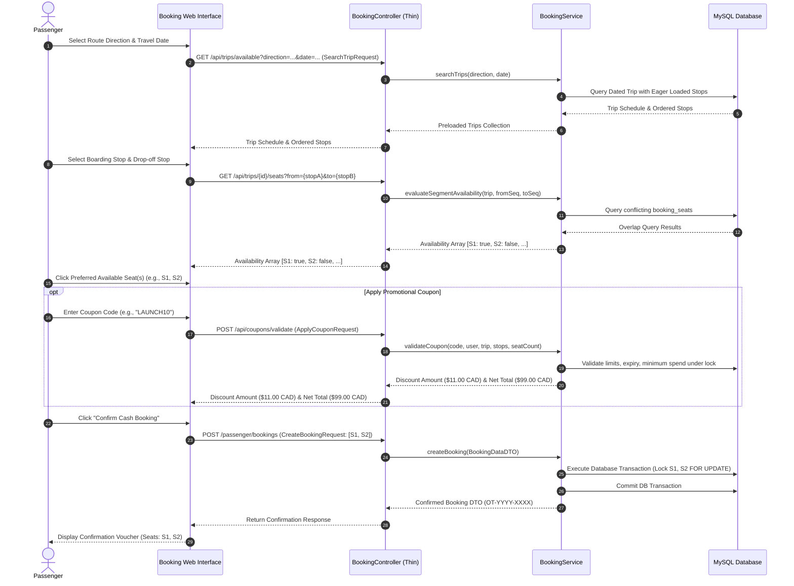

# 03 — Functional Requirements

## 1. Document Purpose
This document provides a comprehensive functional catalog for the Oliver Transport platform. It details all user-facing interactions, system capabilities, background operations, and business logic across the Passenger Module, Rider Module, and Core Processing Services.

---

## 2. Scope
* **In Scope:** All interactive capabilities required for MVP operations across Guest users, authenticated Passengers, and authenticated Riders.
* **Out of Scope:** Administrative CMS interfaces, automated payment gateway callbacks, self-service refund portals, dynamic fleet routing algorithms, and external marketing integrations.

---

## 3. Relevant Requirements

| Module | ID | Requirement Description | Classification |
|---|---|---|---|
| **Passenger Auth** | FR-PA-01 | User registration with name, email, phone number, and password | **`[CONFIRMED]`** |
| | FR-PA-02 | Secure user login, session management, and logout | **`[CONFIRMED]`** |
| | FR-PA-03 | Password reset via standard email verification token | **`[CONFIRMED]`** |
| | FR-PA-04 | User profile viewing and contact number editing | **`[CONFIRMED]`** |
| **Public Web** | FR-PW-01 | Responsive marketing homepage featuring direct booking widget | **`[CONFIRMED]`** |
| | FR-PW-02 | Informational static pages: About, Contact, FAQ, Terms, Privacy | **`[CONFIRMED]`** |
| | FR-PW-03 | English UI for MVP launch (French localization deferred to Phase 2) | **`[CONFIRMED]`** |
| **Booking Funnel** | FR-BF-01 | Route selection restricted to Montreal → Toronto or Toronto → Montreal | **`[CONFIRMED]`** |
| | FR-BF-02 | Date selection constrained to dates with active scheduled trips | **`[CONFIRMED]`** |
| | FR-BF-03 | Boarding and drop-off station selection based on strict forward route sequence | **`[CONFIRMED]`** |
| | FR-BF-04 | Interactive visual 6-seat vehicle cabin layout display | **`[CONFIRMED]`** |
| | FR-BF-05 | Real-time seat availability calculation across selected journey segment | **`[CONFIRMED]`** |
| | FR-BF-06 | **Manual passenger seat choice** (zero silent auto-assignment if taken) | **`[CONFIRMED]`** |
| | FR-BF-07 | **Both coupon types** (percentage and fixed-amount) with server validation | **`[CONFIRMED]`** |
| | FR-BF-08 | Transparent fare summary breakdown under strict **`per_trip`** fare model (fare × seat count - discount) | **`[CONFIRMED]`** |
| | FR-BF-09 | **Instant booking confirmation** executing atomic database transaction | **`[CONFIRMED]`** |
| | FR-BF-10 | **Multi-Seat Selection (1 to 6 Seats per Account)** | **`[CONFIRMED]`** |
| | FR-BF-11 | **No Booking Cutoff Gate in MVP** (bookings open until departure) | **`[CONFIRMED]`** |
| | FR-BF-12 | **Out-of-Band Cancellation Only** (phone/SMS `647-655-1884` or Facebook; no in-app cancel) | **`[CONFIRMED]`** |
| **Passenger Portal**| FR-PP-01 | Personal dashboard showing upcoming confirmed reservations | **`[CONFIRMED]`** |
| | FR-PP-02 | Historic bookings repository (Completed reservations) | **`[CONFIRMED]`** |
| | FR-PP-03 | Booking detail voucher view with Reference Code (`OT-YYYY-XXXX`) and seat number(s) | **`[CONFIRMED]`** |
| **Rider Portal** | FR-RP-01 | Unified login (`/login`) with role redirection to Rider dashboard & server barrier | **`[CONFIRMED]`** |
| | FR-RP-02 | Assigned trip list filtered to current date's operational runs | **`[CONFIRMED]`** |
| | FR-RP-03 | Passenger manifest ordered by route stop sequence | **`[CONFIRMED]`** |
| | FR-RP-04 | Visibility of passenger name, phone, seat number(s), and payment status | **`[CONFIRMED]`** |
| | FR-RP-05 | One-click action to record cash payment collection per passenger booking | **`[CONFIRMED]`** |
| | FR-RP-06 | Operational buttons to transition Trip status: Scheduled → In Progress → Completed | **`[CONFIRMED]`** |
| | FR-RP-07 | Strict prohibition against riders altering routes, stops, schedules, or prices | **`[CONFIRMED]`** |
| **UI/UX & Mobile** | FR-UI-01 | Mobile-first architecture with iPhone Safari priority (100dvh, safe areas, 44 × 44 CSS pixels, 16px inputs) | **`[CONFIRMED]`** |
| | FR-UI-02 | Extremely simple 9-step passenger booking customer journey | **`[CONFIRMED]`** |
| | FR-UI-03 | Official logo and brand palette from vehicle decal & posters | **`[CONFIRMED]`** |

---

## 4. Passenger Module Specification

### 4.1 Authentication & Profile
1. **Registration:**
   * Fields: Full Name (`string`, max: 255), Email Address (`unique:users`), Phone Number (`string`, Canadian/E.164 format), Password (`min:8`, confirmed).
   * Automatically creates user record with default `passenger` role.
2. **Session Security:**
   * Session state stored securely in the `sessions` database table.
   * "Remember Me" persistent token support.
3. **Profile Management:**
   * Passenger can view personal profile, update contact phone number, and change password.

### 4.2 Step-by-Step Passenger Booking Funnel
The booking funnel consists of a frictionless, multi-step sequential workflow:

---

## 5. Rider Module Specification

### 5.1 Rider Access & Security
* Riders access the platform via the unified login page at `/login`.
* Upon successful authentication, the system automatically redirects users with `role === 'rider'` to `/rider/dashboard`.
* Route protection is strictly enforced by `RoleMiddleware` (`auth` + role check `role === 'rider'`). If an unauthorized role attempts access, the system responds with `HTTP 403 Forbidden`.
* Riders cannot view trips assigned to other drivers or any administrative settings.

### 5.2 Rider Dashboard & Manifest
1. **Dashboard View (`/rider/dashboard`):**
   * Displays the current date, assigned vehicle information, and two daily scheduled cards:
     * **Morning Trip:** Montreal → Toronto (06:30 AM).
     * **Afternoon Trip:** Toronto → Montreal (12:15 PM / 1:15 PM).
2. **Trip Manifest View (`/rider/trips/{trip}`):**
   * Preloaded via `RiderService` with mandatory eager loading (`with(['user:id,name,phone', 'bookingSeats.vehicleSeat', 'payment'])`) to eliminate N+1 database queries.
   * Summary KPI header: Total Booked Seats (e.g., 5/6), Total Cash Expected (e.g., $275.00 CAD), Total Cash Collected (e.g., $165.00 CAD).
   * **Stop-by-Stop Passenger Table:**
     * Grouped by Boarding Hub in strict sequence order.
     * Columns: Seat ID (S1–S6), Passenger Name, Phone Number (clickable `tel:` link), Destination Hub, Fare Amount, Payment Badge (`UNPAID` red vs. `PAID` green), Collection Button ("Collect Cash").
3. **Operational Trip Controls:**
   * Button **"Start Trip"**: Calls `RiderService::startTrip()` to transition trip status from `scheduled` to `in_progress`.
   * Button **"Complete Trip"**: Calls `RiderService::completeTrip()` after stops have elapsed; transitions trip to `completed`.
4. **Cash Payment Recording:**
   * Clicking "Mark Cash Collected" dispatches `CollectCashPaymentRequest` to `PaymentService::recordCashCollection()`, executing a transaction updating `payments.status` to `paid` and recording `payments.collected_by = rider_id` and `payments.collected_at = NOW()`.

---

## 6. Core Processing Engines

### 6.1 Schedule & Trip Instantiation Engine
* Scheduled Artisan command `trips:generate --days=14` runs daily via the Laravel scheduler.
* Evaluates active `schedules` templates and generates corresponding `trips` records for upcoming operating dates.
* Ensures a continuous 14-day rolling booking window for public reservations.

### 6.2 Segment-Based Availability Engine
* Accepts `(trip_id, boarding_stop_id, dropoff_stop_id)`.
* Computes active seat conflicts by comparing query sequence ranges with existing active confirmed bookings:
  $$\text{Overlap} \iff (\text{Existing.from} < \text{Requested.to}) \land (\text{Requested.from} < \text{Existing.to})$$
* Returns exact real-time availability for seats S1 through S6.

### 6.3 Pricing & Discount Engine
* Determines active base fare under the strict `per_trip` model ($55 CAD promotional if active, otherwise $65 CAD regular).
* Evaluates coupon conditions: validity date, maximum global usages, passenger usage count, minimum booking spend.
* Calculates percentage or fixed discount safely using integer cents arithmetic.

---

## 7. Business Rules

* **BR-FUN-01 (Instant Confirmation):** Every validated booking request commits instantly. The system does not queue bookings in a `pending_approval` state.
* **BR-FUN-02 (Atomic Reservation):** Core database mutations (validations under lock, booking creation, seat segment reservation, coupon usage recording, and cash payment creation) must execute within a single atomic database transaction. Failure of any transactional step causes a 100% rollback of all database state. Pre-transaction checks and post-commit actions execute outside the database transaction boundary.
* **BR-FUN-03 (Separation of Booking and Payment):** A booking status of `confirmed` denotes a guaranteed seat reservation; its payment status remains `unpaid` until cash is physically collected.
* **BR-FUN-04 (Role Sandboxing):** Riders cannot create passenger bookings; passengers cannot view rider manifests or driver controls.
* **BR-FUN-05 (No Silent Seat Substitution):** If the passenger's selected seat becomes unavailable during checkout, the system must abort and prompt the user to choose another seat.

---

## 8. Technical Considerations

* **Rate Limiting:** Protect public booking submission endpoints (`throttle:10,1`) to prevent brute-force seat reservation attacks.
* **Transaction Isolation:** Use `SELECT ... FOR UPDATE` on `vehicle_seats` during booking creation to guarantee zero double-booking under concurrent traffic.

---

## 9. Related Documents
* [`05-user-roles-and-permissions.md`](./05-user-roles-and-permissions.md) — Role definitions.
* [`08-booking-workflow.md`](./08-booking-workflow.md) — 16-step booking lifecycle.
* [`09-seat-management.md`](./09-seat-management.md) — Mathematical specification of segment availability.
* [`10-coupon-and-pricing.md`](./10-coupon-and-pricing.md) — Per-trip pricing rules and coupon engine.
