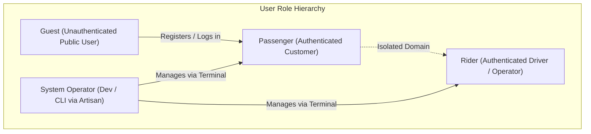

# 05 — User Roles and Permissions

## 1. Document Purpose
This document defines the identity architecture, user role hierarchy, access control policies, and permission matrix governing Oliver Transport. It provides the security framework to ensure complete isolation between passenger capabilities, rider operational tools, and background administrative governance.

---

## 2. Scope
* **In Scope:** Role definitions, authorization boundaries, and policy enforcement for Guest users, authenticated Passengers, authenticated Riders, and CLI-managed System Operators during MVP.
* **Out of Scope:** Multi-tenant organization hierarchies, granular dynamic permission toggles, and web-based administrative user management interfaces (deferred to Phase 2).

---

## 3. Relevant Requirements

| ID | Role / Security Requirement | Classification | Description |
|---|---|---|---|
| ROL-01 | Separate Passenger and Rider role identities | **`[CONFIRMED]`** | Role separation enforced at authentication and middleware layers. |
| ROL-02 | Role-based portal sandboxing | **`[CONFIRMED]`** | Riders cannot access passenger booking endpoints; passengers cannot access rider manifests. |
| ROL-03 | Insecure Direct Object Reference (IDOR) prevention | **`[CONFIRMED]`** | Strict ownership policies on all booking and trip data. |
| ROL-04 | Exclusion of web Admin Panel in MVP | **`[CONFIRMED]`** | System Operator capabilities executed exclusively via Artisan CLI / database seeders. |
| ROL-05 | Rider account provisioning mechanism | **`[PROPOSED]`** | Dedicated Artisan command (`php artisan make:rider`) for operator onboarding. |
| ROL-06 | Customer contact privacy protection | **`[CONFIRMED]`** | Passenger phone numbers exposed to Riders solely for operational pickup coordination. |

---

## 4. Role Hierarchy & Definitions



### 4.1 Guest (Unauthenticated Visitor)
* **Description:** An anonymous user visiting the public website.
* **Capabilities:** Browses marketing pages (Home, About, FAQ, Contact, Terms, Privacy), inspects scheduled routes and station stops, previews real-time seat availability on dated trips.
* **Boundaries:** Cannot submit a booking reservation without authenticating or completing registration.

### 4.2 Passenger (Authenticated Customer)
* **Description:** A registered traveler using self-service booking.
* **Capabilities:** 
  * Selects travel dates and route sequences.
  * Selects cabin seats visually.
  * Applies promotional coupon codes.
  * Instantly confirms cash reservations.
  * Views personal dashboard containing upcoming, completed, and cancelled bookings.
  * Manages personal contact phone number and account password.
* **Boundaries:** Cannot view other passengers' bookings, cannot modify trips, cannot access driver manifests.

### 4.3 Rider (Authenticated Driver / Fleet Operator)
* **Description:** A commercial driver responsible for operating the shuttle van on scheduled trips.
* **Capabilities:**
  * Logs in via the unified login page (`/login`) and is automatically redirected to `/rider/dashboard`.
  * Views assigned trips for the current operating date.
  * Inspects the stop-by-stop passenger manifest (passenger names, contact phone numbers, assigned seats, boarding/drop-off stations).
  * Records physical cash payment collection per passenger.
  * Updates trip operational status (`scheduled` → `in_progress` → `completed`).
* **Boundaries:** Cannot alter fixed routes, cannot change departure times, cannot modify fares, cannot create coupons, cannot access trips assigned to other drivers.

### 4.4 System Operator (CLI / Back-Office Engineering)
* **Description:** Technical administrator managing system operations during the MVP phase in the absence of a web CMS.
* **Capabilities:**
  * Generates upcoming dated trips (`php artisan trips:generate`).
  * Provisions Rider accounts (`php artisan make:rider`).
  * Seeds or updates promotional coupons in the database.
  * Executes database backups and system maintenance.
* **Interface:** Secure SSH / Artisan CLI only.

---

## 5. Comprehensive Permission Matrix

| System Action / Resource | Guest | Passenger | Rider | System Operator (CLI) |
|---|:---:|:---:|:---:|:---:|
| View Public Marketing Pages | Yes | Yes | Yes | Yes |
| View Scheduled Routes & Stops | Yes | Yes | Yes | Yes |
| Query Real-Time Seat Availability | Yes | Yes | Yes | Yes |
| Register Account / Log In | Yes | Yes | Yes | Yes |
| Reserve / Book Seat | No | **Yes** | No | No |
| Apply Promotional Coupon | No | **Yes** | No | No |
| View Own Bookings & Vouchers | No | **Yes** | No | No |
| Cancel Own Booking | No | *Pending Client Decision* | No | Yes (CLI) |
| View Other Passengers' Bookings | No | No | No | Yes (DB) |
| View Assigned Daily Trips | No | No | **Yes** | Yes (CLI) |
| View Passenger Manifest & Phone Numbers | No | No | **Yes (Assigned Trips Only)** | Yes (DB) |
| Mark Cash Payment Collected | No | No | **Yes** | Yes (CLI) |
| Start / Complete Trip Run | No | No | **Yes** | Yes (CLI) |
| Modify Route or Stop Configuration | No | No | No | **Yes (Migrations/Seeds)** |
| Create / Deactivate Promotional Coupons | No | No | No | **Yes (DB / Artisan)** |
| Provision Rider Accounts | No | No | No | **Yes (Artisan)** |

---

## 6. Implementation Architecture

### 6.1 Role Representation in Data Model
To maintain simplicity and high performance without unnecessary packages in MVP, the role is represented as an indexed `string` column on the `users` table:

```sql
ALTER TABLE users ADD COLUMN role VARCHAR(20) NOT NULL DEFAULT 'passenger' AFTER password;
ALTER TABLE users ADD INDEX idx_users_role (role);
```

Supported Role Values:
* `'passenger'` (Default upon self-registration)
* `'rider'` (Provisioned exclusively by operators)
* `'operator'` (System administrator)

### 6.2 Unified Authentication & Dynamic Post-Login Redirection
All user roles authenticate through a single endpoint (`GET /login` / `POST /login`). Post-login redirection is handled deterministically by evaluating the authenticated user's role:

```php
// app/Http/Controllers/Auth/AuthenticatedSessionController.php
public function store(LoginRequest $request): RedirectResponse
{
    $request->authenticate();
    $request->session()->regenerate();

    $user = $request->user();

    return match ($user->role) {
        'rider' => redirect()->intended(route('rider.dashboard')),
        'operator' => redirect()->intended(route('operator.dashboard')),
        default => redirect()->intended(route('passenger.dashboard')),
    };
}
```

### 6.3 Middleware Enforcement & Sandboxing
1. **`RoleMiddleware` (`App\Http\Middleware\EnsureUserHasRole`):**
   * Inspects `auth()->user()->role`.
   * Rejects unauthorized access with `HTTP 403 Forbidden` if an authenticated user attempts to access routes restricted to another role (e.g., a Passenger attempting to open `/rider/dashboard`).
2. **Route Group Sandboxing:**
   * Passenger routes: protected by `['auth', 'role:passenger']`.
   * Rider routes: protected by `['auth', 'role:rider']`.
   * Operator routes: protected by `['auth', 'role:operator']`.

### 6.4 Laravel Authorization Policies
* **`BookingPolicy`:**
  ```php
  public function view(User $user, Booking $booking): bool
  {
      return $user->id === $booking->user_id;
  }
  ```
* **`TripPolicy`:**
  ```php
  public function viewManifest(User $user, Trip $trip): bool
  {
      return $user->role === 'rider' && $trip->rider_id === $user->id;
  }
  
  public function collectCash(User $user, Trip $trip): bool
  {
      return $user->role === 'rider' && $trip->rider_id === $user->id;
  }
  ```

---

## 7. Rider Provisioning Workflow (MVP)

Because there is no Admin Panel in MVP, Rider accounts are created safely using a dedicated Laravel Artisan command:

```bash
php artisan make:rider "John Doe" john.driver@olivertransport.ca "+15145550199"
```

* **Command Action:**
  1. Validates unique email and phone number.
  2. Generates a secure random password (or prompts for input).
  3. Inserts user record with `role = 'rider'`.
  4. Outputs temporary credentials securely to the terminal operator.

---

## 8. Business Rules

* **BR-ROL-01 (Role Immutability):** Users cannot modify their own role. Role escalation attempts via form manipulation are strictly blocked by mass-assignment protection (`$fillable` exclusion).
* **BR-ROL-02 (Rider Booking Sandboxing):** Riders cannot submit seat bookings while authenticated under a Rider profile. If a Rider wishes to travel as a customer, they must register a distinct passenger account.
* **BR-ROL-03 (Strict Isolation of Driver Manifests):** A Rider assigned to Trip A cannot view, query, or collect cash on Trip B.

---

## 9. Related Documents
* [`03-functional-requirements.md`](./03-functional-requirements.md) — Functional interactions per role.
* [`07-database-design.md`](./07-database-design.md) — Schema definitions for `users`.
* [`11-rider-management.md`](./11-rider-management.md) — Rider panel specifications.
* [`15-security-guidelines.md`](./15-security-guidelines.md) — Security and IDOR protection.

