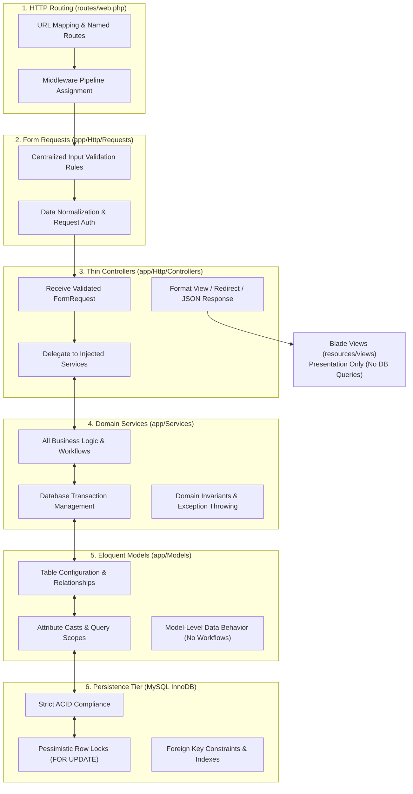
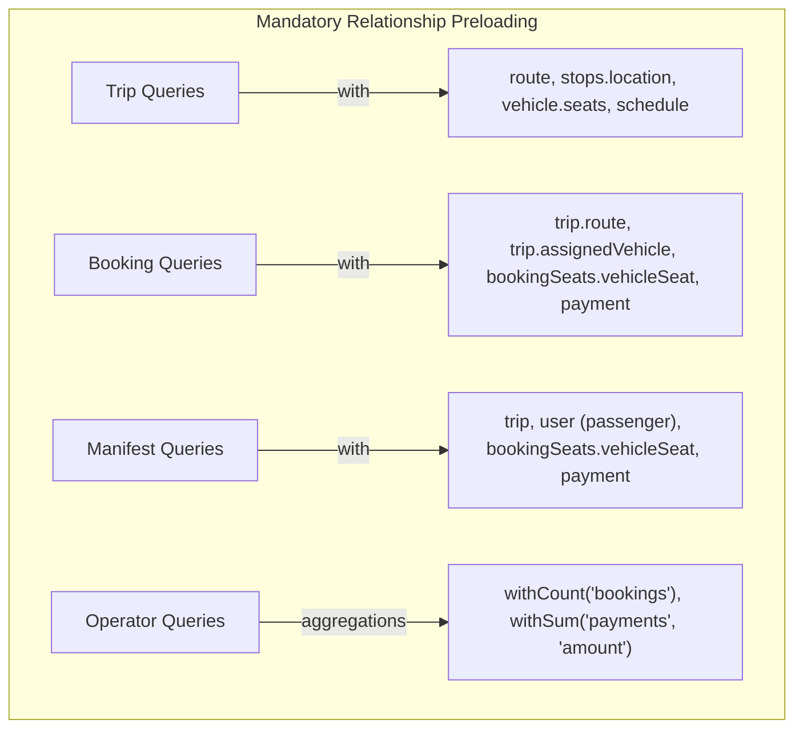
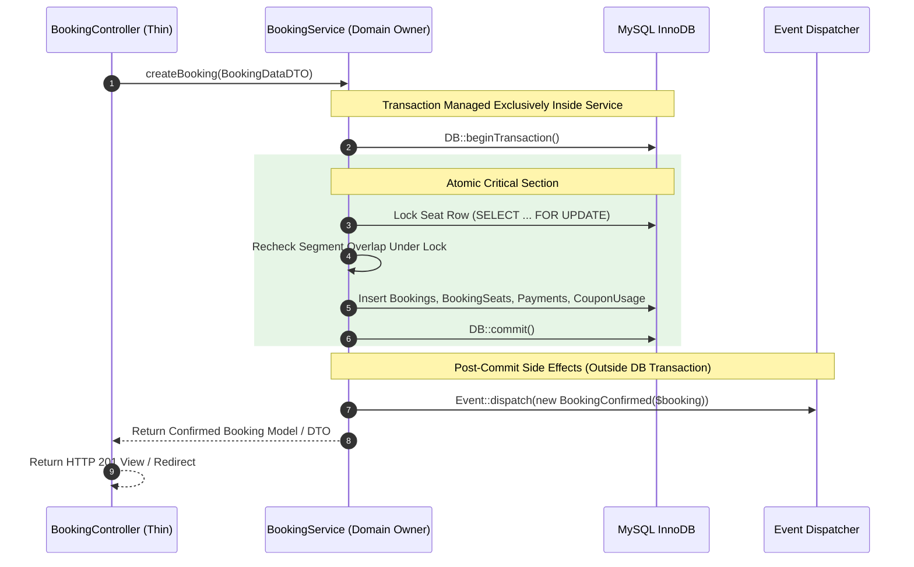

# 06 — System Architecture

## 1. Document Purpose
This document specifies the layered service-oriented architecture, component boundaries, domain services, request lifecycle, transaction management, and performance standards for **Oliver Transport**. It establishes mandatory implementation guidelines ensuring the application remains clean, maintainable, decoupled, and performant on its verified technical foundation (Laravel 13, PHP 8.4, Blade, Tailwind CSS v4, MySQL).

---

## 2. Scope
* **In Scope:** Layered Laravel architecture (Routes, Controllers, Form Requests, Services, Models, Database), thin controller discipline, centralized Form Request validation, dedicated Domain Services, Eloquent model responsibilities, mandatory eager loading and N+1 query prevention, database transaction ownership, exception handling, and project directory structure.
* **Out of Scope:** Distributed microservices, decoupled SPA client frameworks (Vue/React/Angular), GraphQL APIs, and repository pattern abstractions.

---

## 3. Relevant Requirements

| ID | Architectural Requirement | Classification | Specification Notes |
|---|---|---|---|
| ARC-01 | **Layered Laravel Monolith** | **`[CONFIRMED]`** | Strict separation: Routes → Middleware → Form Requests → Controllers → Services → Models → Database. |
| ARC-02 | **Thin Controllers Discipline** | **`[CONFIRMED]`** | Controllers coordinate HTTP input/output only; zero business logic, zero DB queries, zero transaction management. |
| ARC-03 | **Centralized Form Requests** | **`[CONFIRMED]`** | Dedicated `FormRequest` classes for input validation, type normalization, and request authorization. |
| ARC-04 | **Service-Oriented Domain Logic** | **`[CONFIRMED]`** | 100% of business logic, domain invariants, pricing math, and workflows reside in dedicated Service classes. |
| ARC-05 | **Mandatory Eager Loading & N+1 Prevention** | **`[CONFIRMED]`** | Strict use of `with()`, `load()`, `loadMissing()`, and `withCount()`; `Model::preventLazyLoading()` in dev/test. |
| ARC-06 | **Service-Owned Database Transactions** | **`[CONFIRMED]`** | Database transaction management (`DB::beginTransaction()`, `commit()`, `rollBack()`) resides strictly within Services. |
| ARC-07 | **Blade-First Server Rendering** | **`[CONFIRMED]`** | Fast initial page loads, zero client hydration lag, optimal SEO; zero database queries executed from Blade views. |
| ARC-08 | **Dependency Injection** | **`[CONFIRMED]`** | Controllers receive services and dependencies via constructor or method injection; no manual `new Service()` instantiation. |
| ARC-09 | **Pragmatic Design Without Overengineering** | **`[CONFIRMED]`** | Direct Eloquent models utilized by services; generic repository interfaces and unnecessary DTO factories strictly avoided. |
| ARC-10 | **Post-Commit Event & Notification Dispatch** | **`[CONFIRMED]`** | External notifications and domain events fire strictly *after* successful transaction commit. |

---

## 4. Layered Architecture: 6 Core Components

The application enforces a strict unidirectional flow of data and control across six foundational tiers:



### Component Responsibility Matrix

| Component | Responsibility ("MUST") | Prohibition ("MUST NOT") |
|---|---|---|
| **1. Routes** | Define URL endpoints and HTTP methods; reference controller action tuples (`[Controller::class, 'method']`); apply middleware; use semantic route names. | **No** business logic; **no** database queries (`DB::...` or Eloquent); **no** complex inline closures. |
| **2. Form Requests** | Validate incoming input types, formats, and boundaries; normalize/prepare input; verify request-level authorization. | **No** multi-step domain workflows; **no** database transactions; **no** duplicate rules across controllers. |
| **3. Controllers** | Type-hint validated Form Requests; call service methods via dependency injection; return Blade views, redirects, or JSON responses. | **No** business logic; **no** direct database queries; **no** booking/pricing/seat math; **no** transaction management. |
| **4. Services** | Implement all business rules and workflows; coordinate Eloquent models; manage database transactions; handle concurrency/locks; throw domain exceptions. | **No** HTTP request/session manipulation; **no** presentation formatting; **no** direct HTML/Blade rendering. |
| **5. Models** | Define table mapping, relational associations (`belongsTo`, `hasMany`), attribute casts, accessors/mutators, and reusable query scopes. | **No** multi-step booking, pricing, or payment workflows; **no** fat service methods; **no** transaction control. |
| **6. Database** | Guarantee data integrity, relational constraints (`RESTRICT`, `CASCADE`), atomic commits, and pessimistic row locking via InnoDB. | N/A (Relational persistence engine). |

---

## 5. Domain Service Layer Architecture

All business logic lives in dedicated, single-responsibility service classes within `app/Services/`:

```mermaid
graph LR
    subgraph CoreServices["Domain Services (app/Services)"]
        AuthSvc["AuthenticationService<br/>(Session & Role Redirection)"]
        PaxSvc["PassengerService<br/>(Profiles & Booking History)"]
        TripSvc["TripService<br/>(Rolling Schedule Generation & Manifests)"]
        SeatSvc["SeatAvailabilityService<br/>(Segment Interval Overlap Math)"]
        PricingSvc["PricingService<br/>(Authoritative Per-Trip Fare Resolution)"]
        CouponSvc["CouponService<br/>(Percentage & Fixed Discount Engine)"]
        BookingSvc["BookingService<br/>(16-Step Lifecycle & Transaction Coordination)"]
        PaymentSvc["PaymentService<br/>(Cash Collection Lifecycle & Auditing)"]
        RiderSvc["RiderService<br/>(Trip Operations & Stop Progression)"]
        NotificationSvc["NotificationService<br/>(Post-Commit Dispatching)"]
    end
```



### 5.1 Service Catalog & Responsibilities

| Service Class | Namespace | Primary Responsibilities |
|---|---|---|
| **`AuthenticationService`** | `App\Services\Auth` | Coordinates credential verification, session regeneration, account status enforcement, and determines post-login role redirection targets. |
| **`PassengerService`** | `App\Services\Passenger` | Manages passenger profile updates, phone formatting, account registration, and queries customer booking history with eager-loaded relations. |
| **`TripService`** | `App\Services\Trip` | Instantiates rolling 14-day trip runs from schedule templates, validates trip operating states, and compiles ordered stop manifests. |
| **`SeatAvailabilityService`** | `App\Services\Seat` | Evaluates segment interval overlap algorithm $(B_A < D_B) \land (B_B < D_A)$ to determine real-time seat vacancy for S1–S6 across requested sequence intervals. |
| **`PricingService`** | `App\Services\Pricing` | Authoritatively resolves active per-trip base fares ($55 promo or $65 regular CAD). Guarantees historical pricing snapshot immutability on bookings. |
| **`CouponService`** | `App\Services\Coupon` | Validates coupon active dates, minimum spend, global usage caps, and per-user limits under pessimistic lock. Calculates safe integer-cents discounts. |
| **`BookingService`** | `App\Services\Booking` | Orchestrates the 16-step operational lifecycle: pre-transaction validation, opens database transaction, acquires row locks on requested seats (1 to 6 seats), creates booking, multi-seat allocation, and payment records, and commits. |
| **`PaymentService`** | `App\Services\Payment` | Manages cash payment records, transitions status from `unpaid` to `paid` under lock, binds collecting rider ID and timestamp, and audits collection variances. |
| **`RiderService`** | `App\Services\Rider` | Powers driver manifest views with eager-loaded passengers and seats, coordinates trip status progression (`scheduled` → `in_progress` → `completed`). |
| **`NotificationService`** | `App\Services\Notification` | Dispatches post-commit transactional emails and logs system notifications strictly after database transactions have successfully committed. |

---

## 6. Centralized Form Request Validation Strategy

Incoming user input must be validated via dedicated `FormRequest` classes before reaching controller actions:

### 6.1 Form Request Catalog

| Form Request Class | Target Controller Action | Key Validation & Normalization Rules |
|---|---|---|
| **`LoginRequest`** | `AuthenticatedSessionController@store` | `email` (required, email), `password` (required, string), `remember` (boolean). Rate-limited via throttle key. |
| **`RegisterPassengerRequest`** | `RegisterController@store` | `name` (required, max:255), `email` (required, unique:users), `phone` (required, Canadian/E.164 regex), `password` (required, confirmed, min:8). |
| **`SearchTripRequest`** | `TripSearchController@index` | `direction` (required, in:montreal_to_toronto,toronto_to_montreal), `date` (required, date_format:Y-m-d, after_or_equal:today). |
| **`CreateBookingRequest`** | `Passenger\BookingController@store` | `trip_id` (required, exists:trips,id), `vehicle_seat_ids` (required, array, min:1, max:6, distinct, exists:vehicle_seats,id), `boarding_stop_id` (required), `dropoff_stop_id` (required), `coupon_code` (nullable, string, max:30), `idempotency_key` (required, uuid). |
| **`ApplyCouponRequest`** | `CouponController@validate` | `code` (required, string, alpha_num), `trip_id` (required, exists:trips,id), `seat_count` (required, integer, min:1, max:6). |
| **`CollectCashPaymentRequest`** | `Rider\TripManifestController@collectCash` | `booking_id` (required, exists:bookings,id), `amount_collected` (required, numeric, min:0). |
| **`AssignRiderRequest`** | `Operator\TripController@assignRider` | `rider_id` (required, exists:users,id,role:rider), `trip_id` (required, exists:trips,id). |

### 6.2 Separation of Concerns: Form Requests vs. Domain Services
* **Form Requests:** Validate request structure, data types, formats, string lengths, and basic request-level authorization (`$this->user()->role === 'passenger'`).
* **Domain Services:** Enforce business eligibility and invariants (e.g., whether a trip has departed, whether a seat has an overlapping booking segment, whether a coupon has reached its global limit, whether a user has exceeded their booking quota).

---

## 7. Mandatory Eager Loading & N+1 Query Elimination

To maintain response times within the defined NFR budgets ($\le 150\text{ ms}$ for availability, $\le 200\text{ ms}$ for manifests), **N+1 query patterns are strictly prohibited**.

### 7.1 Mandatory Eager Loading Specifications



1. **Trip Listings & Search (`TripSearchController`):**
   ```php
   $trips = Trip::query()
       ->with(['route.stops.location', 'assignedVehicle', 'scheduleTemplate'])
       ->whereDate('trip_date', $searchDate)
       ->get();
   ```
2. **Passenger Booking History (`PassengerDashboardController`):**
   ```php
   $bookings = Booking::query()
       ->with(['trip.route', 'bookingSeats.vehicleSeat', 'payment'])
       ->where('user_id', auth()->id())
       ->latest()
       ->paginate(10);
   ```
3. **Rider Trip Manifest (`Rider\TripManifestController`):**
   ```php
   $manifest = Booking::query()
       ->with([
           'user:id,name,phone', 
           'bookingSeats.vehicleSeat:id,seat_number', 
           'payment:id,booking_id,amount,status,collected_at'
       ])
       ->where('trip_id', $trip->id)
       ->where('status', 'confirmed')
       ->orderBy('boarding_sequence')
       ->get();
   ```
4. **Operator Dashboards & Analytics:**
   * Never load full models merely to count related records.
   * Use `withCount()` and query aggregations:
     ```php
     $trips = Trip::query()
         ->withCount('bookings')
         ->withSum(['payments as cash_collected' => fn($q) => $q->where('status', 'paid')], 'amount')
         ->whereDate('trip_date', today())
         ->get();
     ```

### 7.2 Strict Rules for Views and Blade Templates
* **Prohibition:** Under no circumstances may a Blade template execute database queries (e.g., calling `$trip->bookings()->count()`, `$booking->user->name` when `user` was not preloaded, or `App\Models\Trip::all()`).
* **Column Selection:** When fetching large rosters, select only the required columns (`user:id,name,phone`) to minimize memory footprints.
* **Pagination:** Public and passenger listing endpoints must paginate results (`paginate(10)` or `paginate(15)`).

### 7.3 Development Safeguards & Testing
* **Prevent Lazy Loading in Non-Production:**
  Configure in `app/Providers/AppServiceProvider.php`:
  ```php
  public function boot(): void
  {
      Model::preventLazyLoading(! app()->isProduction());
  }
  ```
  If any developer inadvertently introduces a lazy-loaded query during development or test execution, Laravel immediately throws an `Illuminate\Database\LazyLoadingViolationException`.
* **Pest N+1 Query Count Assertions:**
  Core listing routes and manifests must include Pest query-count benchmarks (e.g., verifying that rendering a manifest with 6 passengers executes $\le 4$ SQL queries regardless of passenger volume).

---

## 8. Database Transactions & Concurrency Ownership

Database transaction management belongs exclusively in the relevant Domain Service classes. Controllers and Form Requests must never invoke `DB::beginTransaction()`, `DB::commit()`, or `DB::rollBack()`.



### Transaction Ownership Guidelines
* **`BookingService`:** Owns the atomic reservation transaction (Steps 5–16 of the booking operational lifecycle).
* **`PaymentService`:** Owns the cash collection transaction (locking payment row, validating expected amount, marking `status = 'paid'`, setting `collected_by` and `collected_at`).
* **`CouponService`:** Owns atomic coupon usage increments when invoked within transactional booking flows.
* **Post-Commit Separation:** Mail delivery, SMS/push triggers, and webhook dispatches must execute *after* successful commit (`DB::afterCommit(...)` or standard event listeners). External services must never be called while holding database row locks.

---

## 9. Recommended Project Directory Structure

```text
app/
├── Http/
│   ├── Controllers/
│   │   ├── Auth/
│   │   │   ├── AuthenticatedSessionController.php
│   │   │   └── RegisterController.php
│   │   ├── Passenger/
│   │   │   ├── BookingController.php
│   │   │   ├── DashboardController.php
│   │   │   └── ProfileController.php
│   │   ├── Rider/
│   │   │   ├── DashboardController.php
│   │   │   └── TripManifestController.php
│   │   └── Operator/
│   │       ├── DashboardController.php
│   │       └── TripController.php
│   ├── Requests/
│   │   ├── Auth/
│   │   │   ├── LoginRequest.php
│   │   │   └── RegisterPassengerRequest.php
│   │   ├── Booking/
│   │   │   ├── CreateBookingRequest.php
│   │   │   └── CancelBookingRequest.php
│   │   ├── Coupon/
│   │   │   └── ApplyCouponRequest.php
│   │   ├── Payment/
│   │   │   └── CollectCashPaymentRequest.php
│   │   └── Trip/
│   │       ├── AssignRiderRequest.php
│   │       └── SearchTripRequest.php
│   └── Middleware/
│       └── EnsureUserHasRole.php
├── Models/
│   ├── Booking.php
│   ├── BookingSeat.php
│   ├── Coupon.php
│   ├── CouponUsage.php
│   ├── Location.php
│   ├── Payment.php
│   ├── Route.php
│   ├── RouteStop.php
│   ├── Schedule.php
│   ├── Trip.php
│   ├── User.php
│   ├── Vehicle.php
│   └── VehicleSeat.php
├── Services/
│   ├── Auth/
│   │   └── AuthenticationService.php
│   ├── Booking/
│   │   └── BookingService.php
│   ├── Coupon/
│   │   └── CouponService.php
│   ├── Notification/
│   │   └── NotificationService.php
│   ├── Passenger/
│   │   └── PassengerService.php
│   ├── Payment/
│   │   └── PaymentService.php
│   ├── Pricing/
│   │   └── PricingService.php
│   ├── Rider/
│   │   └── RiderService.php
│   ├── Seat/
│   │   └── SeatAvailabilityService.php
│   └── Trip/
│       └── TripService.php
├── Exceptions/
│   ├── CouponValidationException.php
│   ├── DuplicateBookingSubmissionException.php
│   ├── InvalidRouteSequenceException.php
│   ├── SeatUnavailableException.php
│   └── UnauthorizedTripAccessException.php
├── Policies/
│   ├── BookingPolicy.php
│   └── TripPolicy.php
└── Notifications/
    └── BookingConfirmedNotification.php

routes/
├── web.php
└── console.php

resources/
├── views/
│   ├── auth/
│   ├── passenger/
│   ├── rider/
│   ├── operator/
│   └── layouts/
└── css/
    └── app.css
```

---

## 10. Additional Architectural Rules

1. **Dependency Injection:** Controllers must declare service dependencies via constructor or method injection (`public function store(CreateBookingRequest $request, BookingService $bookingService)`). Never instantiate services using `new BookingService()`.
2. **No Repository Pattern Overhead:** Eloquent models are queried directly by Domain Services. Introducing generic repositories or abstract interfaces adds boilerplate without architectural value for this MVP.
3. **Dedicated Domain Exceptions:** Services must throw strongly typed domain exceptions (e.g., `SeatUnavailableException`, `CouponValidationException`) rather than returning ambiguous booleans or nulls. Controllers catch these exceptions and translate them to HTTP responses (`409`, `422`, `403`).
4. **No Direct Database Queries in Blade:** Views receive pre-computed, pre-eager-loaded models or view models. Eloquent relationship calls inside loops are strictly blocked by `Model::preventLazyLoading()`.
5. **Single Responsibility Services:** If a service grows excessively large, responsibilities must be split logically (e.g., `SeatAvailabilityService` is distinct from `BookingService`).

---

## 11. Related Documents
* [`03-functional-requirements.md`](./03-functional-requirements.md) — Functional specifications per module.
* [`04-non-functional-requirements.md`](./04-non-functional-requirements.md) — Performance, NFRs, and eager loading benchmarks.
* [`07-database-design.md`](./07-database-design.md) — Relational schema, indexes, and foreign keys.
* [`08-booking-workflow.md`](./08-booking-workflow.md) — 16-step operational lifecycle and transaction boundaries.
* [`14-routes-and-navigation.md`](./14-routes-and-navigation.md) — Route definitions, controller mappings, and Form Requests.
* [`15-security-guidelines.md`](./15-security-guidelines.md) — Authorization policies, IDOR prevention, and mass-assignment protection.
* [`16-testing-strategy.md`](./16-testing-strategy.md) — Pest test suite covering services, Form Requests, and N+1 prevention.
* [`decisions/ADR-003-modular-monolith-blade-stack.md`](./decisions/ADR-003-modular-monolith-blade-stack.md) — Architectural decision record codifying the service-oriented monolith.
