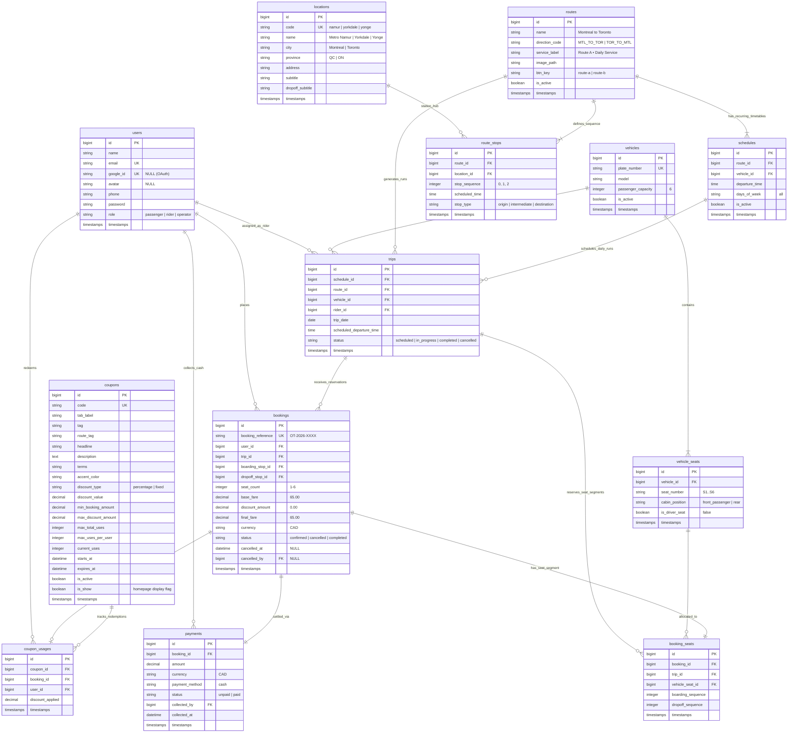

# 07 — Database Design

## 1. Document Purpose
This document provides the complete relational database design, data dictionary, integrity constraints, indexing strategy, and Entity-Relationship (ER) diagram for **Oliver Transport**. It defines the persistence foundation optimized for MySQL (InnoDB engine) running within Laravel 13.

---

## 2. Scope
* **In Scope:** Full relational schema for identity, vehicles, seats, routes, stations, schedules, dated trips, segment-based reservations, coupons, cash payments, and cancellation audit logs for the MVP.
* **Out of Scope:** Multi-tenant database sharding, dynamic GPS coordinate telemetry tables, and third-party payment gateway transaction webhook logs.

---

## 3. Relevant Requirements

| ID | Data Architecture Requirement | Classification | Specification Notes |
|---|---|---|---|
| DBD-01 | Normalized Relational Schema (3NF) | **`[CONFIRMED]`** | Clean normalization preventing data redundancy while capturing snapshots where required. |
| DBD-02 | Segment-Based Reservation Entity | **`[CONFIRMED]`** | Explicit `booking_seats` linking `booking`, `trip`, `vehicle_seat`, and stop sequence range. |
| DBD-03 | Historical Price Preservation | **`[CONFIRMED]`** | Snapshot fields on `bookings` (`base_fare`, `discount_amount`, `final_fare`, `currency`). |
| DBD-04 | Strict Decimal Currency Precision | **`[CONFIRMED]`** | Stored as `DECIMAL(10, 2)` (CAD). Integer-cents arithmetic in application. |
| DBD-05 | Cash Payment Auditability | **`[CONFIRMED]`** | `payments` entity tracking collection status, amount, collecting rider ID, and timestamp. |
| DBD-06 | Concurrency Indexing | **`[CONFIRMED]`** | B-Tree indexes on foreign keys, stop sequences, and seat availability lookup keys. |
| DBD-07 | Cancellation Audit Trail | **`[CONFIRMED]`** | `bookings.cancelled_at` and `bookings.cancelled_by` preserve audit records. |

---

## 4. Entity-Relationship Diagram (ERD)



---

## 5. Detailed Data Dictionary

### 5.1 Identity & Access

#### Table: `users`
* **Purpose:** Stores authenticated user identities across Passengers, Riders, and Operators.

| Column | Type | Nullable | Default | Description & Constraints |
|---|---|:---:|---|---|
| `id` | `BIGINT UNSIGNED` | No | Auto Inc | Primary Key |
| `name` | `VARCHAR(255)` | No | | Full passenger or rider name |
| `email` | `VARCHAR(255)` | No | | Unique customer email address (`UNIQUE`) |
| `google_id` | `VARCHAR(255)` | Yes | `NULL` | Google OAuth 2.0 subject identifier (`UNIQUE`) |
| `avatar` | `VARCHAR(255)` | Yes | `NULL` | Google profile avatar URL |
| `phone` | `VARCHAR(30)` | No | `''` | Contact telephone number (empty string default for OAuth registrations) |
| `email_verified_at`| `TIMESTAMP` | Yes | `NULL` | Verification timestamp |
| `password` | `VARCHAR(255)` | No | | Bcrypt password hash (Cost 12) |
| `role` | `VARCHAR(20)` | No | `'passenger'` | User role: `'passenger'`, `'rider'`, `'operator'` (Indexed) |
| `remember_token` | `VARCHAR(100)` | Yes | `NULL` | Persistent session token |
| `created_at` | `TIMESTAMP` | Yes | `NULL` | Standard timestamp |
| `updated_at` | `TIMESTAMP` | Yes | `NULL` | Standard timestamp |

* **Indexes:** `PRIMARY KEY (id)`, `UNIQUE KEY users_email_unique (email)`, `UNIQUE KEY users_google_id_unique (google_id)`, `INDEX idx_users_role (role)`.

---

### 5.2 Fleet & Seating

#### Table: `vehicles`
* **Purpose:** Models the commercial shuttle fleet (single 6-passenger van in MVP).

| Column | Type | Nullable | Default | Description & Constraints |
|---|---|:---:|---|---|
| `id` | `BIGINT UNSIGNED` | No | Auto Inc | Primary Key |
| `plate_number` | `VARCHAR(20)` | No | | Vehicle license plate (`UNIQUE`) |
| `model` | `VARCHAR(100)` | No | | Vehicle description (e.g., "Ford Transit Passenger") |
| `passenger_capacity`| `TINYINT UNSIGNED`| No | `6` | Total bookable passenger seats excluding driver |
| `is_active` | `BOOLEAN` | No | `1` | Operational status toggle |
| `created_at` | `TIMESTAMP` | Yes | `NULL` | Standard timestamp |
| `updated_at` | `TIMESTAMP` | Yes | `NULL` | Standard timestamp |

#### Table: `vehicle_seats`
* **Purpose:** Predefined physical seats configured inside the vehicle.

| Column | Type | Nullable | Default | Description & Constraints |
|---|---|:---:|---|---|
| `id` | `BIGINT UNSIGNED` | No | Auto Inc | Primary Key |
| `vehicle_id` | `BIGINT UNSIGNED` | No | | Foreign Key → `vehicles(id)` |
| `seat_number` | `VARCHAR(10)` | No | | Cabin label: `'S1'`, `'S2'`, `'S3'`, `'S4'`, `'S5'`, `'S6'` |
| `cabin_position`| `VARCHAR(20)` | No | | Cabin physical zone: `'front_passenger'`, `'rear'` |
| `is_driver_seat`| `BOOLEAN` | No | `0` | Always `0` for bookable passenger seats; `1` for driver |
| `created_at` | `TIMESTAMP` | Yes | `NULL` | Standard timestamp |
| `updated_at` | `TIMESTAMP` | Yes | `NULL` | Standard timestamp |

* **Constraints & Indexes:** `UNIQUE KEY vehicle_seat_unique (vehicle_id, seat_number)`, `FOREIGN KEY (vehicle_id) REFERENCES vehicles(id) ON DELETE CASCADE`.

---

### 5.3 Geographic Hubs, Routes & Stops

#### Table: `locations`
* **Purpose:** Predefined physical stations (Metro Namur, Yorkdale Mall, Yonge Station).

| Column | Type | Nullable | Default | Description & Constraints |
|---|---|:---:|---|---|
| `id` | `BIGINT UNSIGNED` | No | Auto Inc | Primary Key |
| `code` | `VARCHAR(50)` | Yes | `NULL` | Station identifier slug (e.g. `'namur'`, `'yorkdale'`, `'yonge'`) (`UNIQUE`) |
| `name` | `VARCHAR(100)` | No | | Station name (e.g., "Metro Namur") |
| `city` | `VARCHAR(100)` | No | | "Montreal" or "Toronto" |
| `province` | `VARCHAR(10)` | No | | "QC" or "ON" |
| `address` | `VARCHAR(255)` | Yes | `NULL` | Specific street address or landmark |
| `subtitle` | `VARCHAR(255)` | Yes | `NULL` | Marketing & timetable descriptor for booking UI |
| `created_at` | `TIMESTAMP` | Yes | `NULL` | Standard timestamp |
| `updated_at` | `TIMESTAMP` | Yes | `NULL` | Standard timestamp |

#### Table: `routes`
* **Purpose:** Defines the two directional corridors.

| Column | Type | Nullable | Default | Description & Constraints |
|---|---|:---:|---|---|
| `id` | `BIGINT UNSIGNED` | No | Auto Inc | Primary Key |
| `name` | `VARCHAR(100)` | No | | "Montreal → Toronto" or "Toronto → Montreal" |
| `direction_code` | `VARCHAR(20)` | No | | `'MTL_TO_TOR'` or `'TOR_TO_MTL'` (`UNIQUE`) |
| `is_active` | `BOOLEAN` | No | `1` | Operational toggle |
| `created_at` | `TIMESTAMP` | Yes | `NULL` | Standard timestamp |
| `updated_at` | `TIMESTAMP` | Yes | `NULL` | Standard timestamp |

#### Table: `route_stops`
* **Purpose:** Maps ordered stop sequences to routes with operational times.

| Column | Type | Nullable | Default | Description & Constraints |
|---|---|:---:|---|---|
| `id` | `BIGINT UNSIGNED` | No | Auto Inc | Primary Key |
| `route_id` | `BIGINT UNSIGNED` | No | | Foreign Key → `routes(id)` |
| `location_id` | `BIGINT UNSIGNED` | No | | Foreign Key → `locations(id)` |
| `stop_sequence`| `TINYINT UNSIGNED`| No | | Ordered integer index: `0`, `1`, `2` |
| `scheduled_time`| `TIME` | Yes | `NULL` | Predefined pickup/departure time |
| `stop_type` | `VARCHAR(20)` | No | | `'origin'`, `'intermediate'`, `'destination'` |
| `created_at` | `TIMESTAMP` | Yes | `NULL` | Standard timestamp |
| `updated_at` | `TIMESTAMP` | Yes | `NULL` | Standard timestamp |

* **Constraints & Indexes:** `UNIQUE KEY route_stop_seq_unique (route_id, stop_sequence)`, `INDEX idx_route_stops_lookup (route_id, location_id)`.

---

### 5.4 Timetables & Daily Trips

#### Table: `schedules`
* **Purpose:** Recurring timetable templates.

| Column | Type | Nullable | Default | Description & Constraints |
|---|---|:---:|---|---|
| `id` | `BIGINT UNSIGNED` | No | Auto Inc | Primary Key |
| `route_id` | `BIGINT UNSIGNED` | No | | Foreign Key → `routes(id)` |
| `vehicle_id` | `BIGINT UNSIGNED` | No | | Foreign Key → `vehicles(id)` |
| `departure_time`| `TIME` | No | | E.g., `06:30:00` |
| `days_of_week` | `VARCHAR(50)` | No | `'all'` | Operating days (`'all'`, `'mon-sun'`) |
| `is_active` | `BOOLEAN` | No | `1` | Schedule active toggle |
| `created_at` | `TIMESTAMP` | Yes | `NULL` | Standard timestamp |
| `updated_at` | `TIMESTAMP` | Yes | `NULL` | Standard timestamp |

#### Table: `trips`
* **Purpose:** Concrete dated operational runs with independent seat availability.

| Column | Type | Nullable | Default | Description & Constraints |
|---|---|:---:|---|---|
| `id` | `BIGINT UNSIGNED` | No | Auto Inc | Primary Key |
| `schedule_id` | `BIGINT UNSIGNED` | No | | Foreign Key → `schedules(id)` ON DELETE RESTRICT |
| `route_id` | `BIGINT UNSIGNED` | No | | Foreign Key → `routes(id)` ON DELETE RESTRICT |
| `vehicle_id` | `BIGINT UNSIGNED` | No | | Foreign Key → `vehicles(id)` ON DELETE RESTRICT |
| `rider_id` | `BIGINT UNSIGNED` | Yes | `NULL` | Foreign Key → `users(id)` ON DELETE SET NULL (Assigned driver) |
| `trip_date` | `DATE` | No | | Calendar operating date (`YYYY-MM-DD`) |
| `scheduled_departure_time`| `TIME`| No | | Local departure time (America/Toronto) |
| `status` | `VARCHAR(20)` | No | `'scheduled'` | `'scheduled'`, `'in_progress'`, `'completed'`, `'cancelled'` |
| `created_at` | `TIMESTAMP` | Yes | `NULL` | Standard timestamp |
| `updated_at` | `TIMESTAMP` | Yes | `NULL` | Standard timestamp |

* **Constraints & Indexes:** `UNIQUE KEY trip_schedule_date_unique (schedule_id, trip_date)`, `INDEX idx_trips_date_route (trip_date, route_id)`, `INDEX idx_trips_rider_date (rider_id, trip_date)`.

---

### 5.5 Bookings & Segment Allocations

#### Table: `bookings`
* **Purpose:** Core reservation record capturing passenger details, financial snapshots, and cancellation audit trails.

| Column | Type | Nullable | Default | Description & Constraints |
|---|---|:---:|---|---|
| `id` | `BIGINT UNSIGNED` | No | Auto Inc | Primary Key |
| `booking_reference`| `VARCHAR(20)` | No | | Public unique code (e.g., `'OT-2026-X8K2'`, `UNIQUE`) |
| `user_id` | `BIGINT UNSIGNED` | No | | Foreign Key → `users(id)` ON DELETE RESTRICT (Passenger) |
| `trip_id` | `BIGINT UNSIGNED` | No | | Foreign Key → `trips(id)` ON DELETE RESTRICT |
| `boarding_stop_id` | `BIGINT UNSIGNED`| No | | Foreign Key → `route_stops(id)` ON DELETE RESTRICT |
| `dropoff_stop_id` | `BIGINT UNSIGNED` | No | | Foreign Key → `route_stops(id)` ON DELETE RESTRICT |
| `seat_count` | `TINYINT UNSIGNED`| No | `1` | Number of passenger seats reserved in this booking (1 to 6) |
| `base_fare` | `DECIMAL(10, 2)`| No | | Historical snapshot of gross base fare (CAD, `per_trip * seat_count`) |
| `discount_amount`| `DECIMAL(10, 2)`| No | `0.00` | Discount deducted via promo/coupon |
| `final_fare` | `DECIMAL(10, 2)`| No | | Net cash amount payable |
| `currency` | `VARCHAR(3)` | No | `'CAD'` | Currency ISO code |
| `status` | `VARCHAR(20)` | No | `'confirmed'` | `'confirmed'`, `'cancelled'`, `'completed'` |
| `cancelled_at` | `DATETIME` | Yes | `NULL` | Cancellation timestamp audit |
| `cancelled_by` | `BIGINT UNSIGNED`| Yes | `NULL` | Foreign Key → `users(id)` ON DELETE SET NULL |
| `created_at` | `TIMESTAMP` | Yes | `NULL` | Standard timestamp |
| `updated_at` | `TIMESTAMP` | Yes | `NULL` | Standard timestamp |

* **Indexes:** `PRIMARY KEY (id)`, `UNIQUE KEY bookings_reference_unique (booking_reference)`, `INDEX idx_bookings_user (user_id)`, `INDEX idx_bookings_trip (trip_id)`.

#### Table: `booking_seats`
* **Purpose:** **Critical segment-based reservation record**. Binds a seat to a specific trip and stop sequence interval.

| Column | Type | Nullable | Default | Description & Constraints |
|---|---|:---:|---|---|
| `id` | `BIGINT UNSIGNED` | No | Auto Inc | Primary Key |
| `booking_id` | `BIGINT UNSIGNED` | No | | Foreign Key → `bookings(id)` ON DELETE CASCADE |
| `trip_id` | `BIGINT UNSIGNED` | No | | Foreign Key → `trips(id)` ON DELETE RESTRICT |
| `vehicle_seat_id`| `BIGINT UNSIGNED`| No | | Foreign Key → `vehicle_seats(id)` ON DELETE RESTRICT |
| `boarding_sequence`| `TINYINT UNSIGNED`| No | | Sequence index of pickup station |
| `dropoff_sequence` | `TINYINT UNSIGNED`| No | | Sequence index of drop-off station |
| `created_at` | `TIMESTAMP` | Yes | `NULL` | Standard timestamp |
| `updated_at` | `TIMESTAMP` | Yes | `NULL` | Standard timestamp |

* **Indexes & Query Optimization:**
  * `INDEX idx_segment_availability (trip_id, vehicle_seat_id, boarding_sequence, dropoff_sequence)`
  * Allows instantaneous conflict checks:
    ```sql
    SELECT COUNT(*) FROM booking_seats bs
    JOIN bookings b ON bs.booking_id = b.id
    WHERE bs.trip_id = ?
      AND bs.vehicle_seat_id = ?
      AND b.status = 'confirmed'
      AND (bs.boarding_sequence < ? AND ? < bs.dropoff_sequence);
    ```

---

### 5.6 Discounts & Coupons

#### Table: `coupons`
* **Purpose:** Stores discount voucher rules supporting both percentage and fixed-amount discounts.

| Column | Type | Nullable | Default | Description & Constraints |
|---|---|:---:|---|---|
| `id` | `BIGINT UNSIGNED` | No | Auto Inc | Primary Key |
| `code` | `VARCHAR(50)` | No | | Case-insensitive unique coupon code (`UNIQUE`) |
| `tab_label` | `VARCHAR(100)` | Yes | `NULL` | Interactive tab label (e.g. "🔥 $10 OFF Launch Special") |
| `tag` | `VARCHAR(100)` | Yes | `NULL` | Voucher category badge (e.g. "Active Launch Special") |
| `route_tag` | `VARCHAR(150)` | Yes | `NULL` | Corridor eligibility tag (e.g. "Montreal ↔ Toronto Corridor") |
| `headline` | `VARCHAR(255)` | Yes | `NULL` | Marketing headline |
| `description` | `TEXT` | Yes | `NULL` | Marketing copy & promotion details |
| `terms` | `VARCHAR(255)` | Yes | `NULL` | Redemption conditions and cash settlement note |
| `accent_color` | `VARCHAR(20)` | Yes | `'#22C55E'` | Voucher brand accent hex color |
| `discount_type` | `VARCHAR(20)` | No | | `'percentage'` (e.g., 10%) or `'fixed'` (e.g., $10.00 CAD) |
| `discount_value`| `DECIMAL(10, 2)`| No | | Percentage rate (e.g., `10.00`) or CAD dollar amount |
| `min_booking_amount`| `DECIMAL(10, 2)`| No | `0.00` | Minimum fare required to apply |
| `max_discount_amount`| `DECIMAL(10, 2)`| Yes | `NULL` | Ceiling for percentage discounts |
| `max_total_uses`| `INT UNSIGNED` | Yes | `NULL` | Global redemption cap (`NULL` = unlimited) |
| `max_uses_per_user`| `INT UNSIGNED` | No | `1` | Maximum redemptions per individual passenger |
| `current_uses` | `INT UNSIGNED` | No | `0` | Active counter of redemptions |
| `starts_at` | `DATETIME` | Yes | `NULL` | Activation timestamp |
| `expires_at` | `DATETIME` | Yes | `NULL` | Expiration timestamp |
| `is_active` | `BOOLEAN` | No | `1` | Administrative toggle |
| `created_at` | `TIMESTAMP` | Yes | `NULL` | Standard timestamp |
| `updated_at` | `TIMESTAMP` | Yes | `NULL` | Standard timestamp |

#### Table: `coupon_usages`
* **Purpose:** Audit ledger recording every coupon redemption.

| Column | Type | Nullable | Default | Description & Constraints |
|---|---|:---:|---|---|
| `id` | `BIGINT UNSIGNED` | No | Auto Inc | Primary Key |
| `coupon_id` | `BIGINT UNSIGNED` | No | | Foreign Key → `coupons(id)` ON DELETE RESTRICT |
| `booking_id` | `BIGINT UNSIGNED` | No | | Foreign Key → `bookings(id)` ON DELETE CASCADE |
| `user_id` | `BIGINT UNSIGNED` | No | | Foreign Key → `users(id)` ON DELETE RESTRICT |
| `discount_applied`| `DECIMAL(10, 2)`| No | | Exact CAD discount deducted |
| `created_at` | `TIMESTAMP` | Yes | `NULL` | Standard timestamp |
| `updated_at` | `TIMESTAMP` | Yes | `NULL` | Standard timestamp |

* **Indexes:** `INDEX idx_coupon_user (coupon_id, user_id)`, `INDEX idx_coupon_booking (booking_id)`.

---

### 5.7 Cash Settlement

#### Table: `payments`
* **Purpose:** Cash payment records linked 1-to-1 with bookings.

| Column | Type | Nullable | Default | Description & Constraints |
|---|---|:---:|---|---|
| `id` | `BIGINT UNSIGNED` | No | Auto Inc | Primary Key |
| `booking_id` | `BIGINT UNSIGNED` | No | | Foreign Key → `bookings(id)` ON DELETE RESTRICT (`UNIQUE`) |
| `amount` | `DECIMAL(10, 2)`| No | | Cash amount payable (equals `bookings.final_fare`) |
| `currency` | `VARCHAR(3)` | No | `'CAD'` | Currency ISO code |
| `payment_method`| `VARCHAR(20)` | No | `'cash'` | Settled strictly in cash for MVP |
| `status` | `VARCHAR(20)` | No | `'unpaid'` | Payment state: `'unpaid'` or `'paid'` |
| `collected_by` | `BIGINT UNSIGNED`| Yes | `NULL` | Foreign Key → `users(id)` ON DELETE SET NULL (Collecting Rider) |
| `collected_at` | `DATETIME` | Yes | `NULL` | Physical collection timestamp |
| `created_at` | `TIMESTAMP` | Yes | `NULL` | Standard timestamp |
| `updated_at` | `TIMESTAMP` | Yes | `NULL` | Standard timestamp |

* **Indexes:** `UNIQUE KEY payment_booking_unique (booking_id)`, `INDEX idx_payments_status (status)`, `INDEX idx_payments_collected_by (collected_by)`.

---

## 6. Business Rules & Integrity Constraints

* **BR-DBD-01 (Orphan Prevention):** Foreign key constraints must enforce relational integrity. Deleting a passenger or trip with existing bookings is strictly blocked (`ON DELETE RESTRICT`).
* **BR-DBD-02 (Sequence Ordering):** Domain service validation and database checks must ensure `booking_seats.boarding_sequence < booking_seats.dropoff_sequence`.
* **BR-DBD-03 (Single Active Cash Payment):** Each booking has exactly one payment record (`payment_booking_unique`). Booking status changes do not alter payment records unless explicitly handled by service logic.
* **BR-DBD-04 (Cancellation Audit Trail):** Cancelling a booking updates `status = 'cancelled'`, sets `cancelled_at = NOW()`, and records `cancelled_by = user_id`.
* **BR-DBD-05 (Relationship Preloading):** Models must define explicit relationships to support mandatory eager loading (`with()`); queries inside loops or Blade templates are strictly prohibited.

---

## 7. Eloquent Model Relationships & Mandatory Eager Loading Strategy

To eliminate N+1 queries across the platform, Eloquent models define explicit relationships that are eager-loaded before rendering presentation views:

| Eloquent Model | Key Relationships | Mandatory Eager Loading Usage |
|---|---|---|
| **`Trip`** | `belongsTo(Route::class)`<br/>`belongsTo(Vehicle::class, 'vehicle_id')`<br/>`belongsTo(Schedule::class, 'schedule_id')`<br/>`belongsTo(User::class, 'rider_id')`<br/>`hasMany(Booking::class)`<br/>`hasManyThrough(RouteStop::class, Route::class)` | Preloaded with `['route.stops.location', 'assignedVehicle', 'scheduleTemplate']` on public trip searches and schedule timetables. |
| **`Booking`** | `belongsTo(User::class)`<br/>`belongsTo(Trip::class)`<br/>`belongsTo(RouteStop::class, 'boarding_stop_id')`<br/>`belongsTo(RouteStop::class, 'dropoff_stop_id')`<br/>`hasMany(BookingSeat::class)`<br/>`hasOne(Payment::class)`<br/>`hasOne(CouponUsage::class)` | Preloaded with `['trip.route', 'bookingSeats.vehicleSeat', 'payment']` on passenger dashboards and `['user:id,name,phone', 'bookingSeats.vehicleSeat', 'payment']` on rider manifests. |
| **`BookingSeat`** | `belongsTo(Booking::class)`<br/>`belongsTo(Trip::class)`<br/>`belongsTo(VehicleSeat::class)` | Preloaded alongside `Booking` to provide seat numbers without extra queries. Indexed on `(trip_id, vehicle_seat_id, boarding_sequence, dropoff_sequence)`. |
| **`Payment`** | `belongsTo(Booking::class)`<br/>`belongsTo(User::class, 'collected_by')` | Preloaded on manifests and dashboards. Indexed on `(booking_id)` and `(status)`. |
| **`Route`** | `hasMany(RouteStop::class)`<br/>`hasMany(Trip::class)` | Preloaded with `['stops.location']` to ensure ordered station sequences are available in-memory. |
| **`Vehicle`** | `hasMany(VehicleSeat::class)`<br/>`hasMany(Trip::class)` | Preloaded with `['seats']` during vehicle assignment or cabin visualization. |

---

## 8. Related Documents
* [`06-system-architecture.md`](./06-system-architecture.md) — Service interaction with models.
* [`08-booking-workflow.md`](./08-booking-workflow.md) — 16-step transaction lifecycle.
* [`09-seat-management.md`](./09-seat-management.md) — Technical details of segment query execution.
* [`10-coupon-and-pricing.md`](./10-coupon-and-pricing.md) — Pricing rules and coupon limits.
