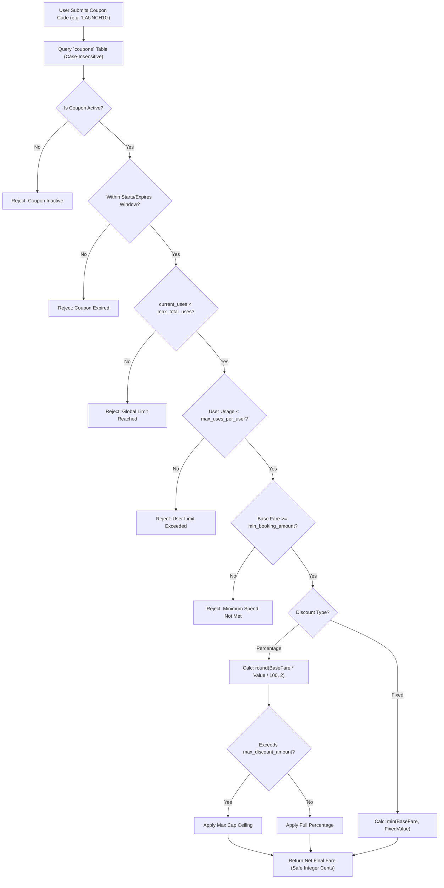

# 10 — Coupon and Pricing System

## 1. Document Purpose
This document specifies the fare architecture, promotional rate configurations, discount calculation engine, and coupon validation rules for Oliver Transport. It defines the business rules governing commercial transactions and the technical implementation of monetary calculations in Canadian Dollars (CAD).

---

## 2. Scope
* **In Scope:** Strictly `per_trip` fare model, regular fare ($65 CAD), introductory promotional fare ($55 CAD), percentage and fixed-amount coupon processing, historical pricing snapshots, and CLI-based coupon provisioning for MVP.
* **Out of Scope:** Per-segment or distance-based pricing algorithms, dynamic surge pricing, multi-currency conversions, automated credit card gateway fees, and web-based administrative coupon builders (deferred to Phase 2).

---

## 3. Relevant Requirements

| ID | Pricing / Coupon Requirement | Classification | Specification Notes |
|---|---|---|---|
| PRC-01 | **Strict `per_trip` Fare Model** | **`[CONFIRMED]`** | Fixed base fare per passenger per trip, regardless of stops traveled. |
| PRC-02 | Regular Standard Fare: CAD $65.00 | **`[CONFIRMED]`** | Standard baseline rate per passenger per trip. |
| PRC-03 | Introductory Promotional Fare: CAD $55.00 | **`[CONFIRMED]`** | Promotional launch rate per passenger per trip. |
| PRC-04 | Exclusion of Distance-Based Pricing | **`[CONFIRMED]`** | Montreal → Yorkdale, Montreal → Yonge, and Yorkdale → Yonge all share the identical trip base fare. |
| PRC-05 | Historical Pricing Snapshot | **`[CONFIRMED]`** | `base_fare`, `discount_amount`, and `final_fare` saved on each booking. |
| PRC-06 | **Support for Both Coupon Types** | **`[CONFIRMED]`** | Percentage-based (with optional max cap) AND fixed-amount discounts. |
| PRC-07 | Server-Side Coupon Validation Engine | **`[CONFIRMED]`** | Client inputs never trusted; limits evaluated under transaction locks. |
| PRC-08 | Operator-Managed Coupons (No Admin Panel) | **`[CONFIRMED]`** | Provisioned via Artisan CLI / database seeders in MVP. |
| PRC-09 | Expiry Date for Promotional $55 Launch Fare | **`[PENDING]`** | Configured via `config/pricing.php`; expiration date awaiting client confirmation. |
| PRC-10 | Zero Coupon Stacking by Default | **`[PROPOSED]`** | Exactly one (1) coupon code per booking transaction. |

---

## 4. Authoritative Fare Model: PER TRIP

### 4.1 Strict Per-Trip Rule
The pricing architecture is strictly **`per_trip`**:
* **Per Passenger, Per Trip:** Fare is calculated on a per-seat, per-trip basis.
* **Independent of Stops Traveled:** The fare does **NOT** vary based on the number of intermediate stops traveled.
  * Montreal → Yorkdale Mall = **Full Trip Base Fare** ($55.00 promo / $65.00 regular CAD).
  * Montreal → Yonge Station = **Full Trip Base Fare** ($55.00 promo / $65.00 regular CAD).
  * Yorkdale Mall → Yonge Station = **Full Trip Base Fare** ($55.00 promo / $65.00 regular CAD).
* **Zero Distance or Per-Segment Pricing:** The application must not implement distance-based or per-segment mileage pricing.

### 4.2 Configurable Pricing Design
Pricing rules are centralized in `config/pricing.php` and evaluated by `PricingService`:

```php
return [
    'currency' => 'CAD',
    'regular_fare' => 65.00,
    'promotional_fare' => 55.00,
    'promotions' => [
        'launch_discount' => [
            'is_active' => true,
            'fare' => 55.00,
            'starts_at' => '2026-11-01 00:00:00',
            'expires_at' => null, // Pending client confirmation; toggleable
        ],
    ],
];
```

### 4.3 Pricing Precedence Hierarchy
When `PricingService::resolveBaseFare()` executes:
1. **Active Promotional Rate:** If `launch_discount.is_active === true` and current timestamp $\in [\text{starts\_at}, \text{expires\_at}]$, base fare = **CAD $55.00**.
2. **Standard Base Rate:** Otherwise, base fare = **CAD $65.00**.

### 4.4 Historical Price Preservation
Every booking record stores an immutable financial snapshot:
* `bookings.seat_count`: Number of passenger seats reserved (1 to 6).
* `bookings.base_fare`: Total gross base fare (`effective_rate * seat_count`) at booking time.
* `bookings.discount_amount`: Total CAD deducted via validated coupon.
* `bookings.final_fare`: Net cash amount due upon boarding (`base_fare - discount_amount`).
* `bookings.currency`: `'CAD'`.

### 4.5 Multi-Seat Booking Pricing & Discount Rules
When a passenger reserves multiple seats (e.g. 2 to 6 seats) under 1 account:
1. **Gross Base Fare:** Computed as `base_fare = unit_rate * seat_count` (e.g. 2 seats @ $55.00 CAD promo = $110.00 CAD gross).
2. **Percentage Coupon:** Applied against the entire gross base fare (e.g. 10% off $110.00 = $11.00 discount; Net Fare = $99.00 CAD), subject to `max_discount_amount`.
3. **Fixed Coupon:** Deducted once from the total gross base fare (e.g. $10.00 off $110.00 = $10.00 discount; Net Fare = $100.00 CAD). Net fare cannot be negative ($\ge \$0.00$).

---

## 5. Authoritative Coupon Model: BOTH DISCOUNT TYPES

The platform supports **both** mathematical discount mechanisms, operating seamlessly with the `per_trip` fare model:



### 5.1 Percentage-Based Discounts (`percentage`)
* **Example:** `10%` off.
* **Math:** $\text{Discount} = \text{ROUND}(\text{BaseFare} \times \frac{\text{DiscountValue}}{100}, 2)$.
* **Optional Maximum Cap:** If `max_discount_amount` is defined (e.g., $15.00 CAD), the discount is capped at that amount.

### 5.2 Fixed-Amount Discounts (`fixed`)
* **Example:** `CAD $10.00` off.
* **Math:** $\text{Discount} = \text{MIN}(\text{BaseFare}, \text{DiscountValue})$.
* **Zero Floor Guard:** The discount amount cannot exceed the eligible fare. Final net fare can never be negative ($\text{FinalFare} \ge \$0.00$).

### 5.3 Clarification on "Both"
> [!NOTE]
> In this architecture, **"Both" refers strictly to the two mathematical discount types** (Percentage-based and Fixed-amount). It does **not** refer to coupon stacking, multiple route coverages, or dual-currency capabilities.

### 5.4 Common Coupon Rules & Capabilities

| Attribute | Database Column | Purpose & Validation Rule |
|---|---|---|
| **Unique Code** | `code` | Case-insensitive unique string (e.g., `SAVE10`, `WELCOME`). |
| **Discount Type** | `discount_type` | `'percentage'` or `'fixed'`. |
| **Discount Value** | `discount_value` | Percentage rate (e.g., `10.00`) or CAD dollar amount. |
| **Minimum Spend** | `min_booking_amount`| Minimum base fare required for eligibility (default: `$0.00`). |
| **Maximum Discount Cap**| `max_discount_amount`| Maximum dollar deduction allowed for percentage coupons. |
| **Global Usage Limit** | `max_total_uses` | Maximum total redemptions permitted across platform. |
| **Per-User Limit** | `max_uses_per_user` | Maximum redemptions permitted per individual passenger (default: `1`). |
| **Active Date Bounds** | `starts_at`, `expires_at`| Strict activation and expiration datetime stamps in `America/Toronto`. |
| **Active Toggle** | `is_active` | Emergency manual disable toggle. |
| **Redemption Ledger** | `coupon_usages` | Audit table recording `coupon_id`, `booking_id`, `user_id`, and `discount_applied`. |

---

## 6. Coupon Transaction Safety & Concurrency

### 6.1 Lock Acquisition During Booking
To prevent concurrent users from exceeding `max_total_uses` during high-demand campaigns:
1. In Step 9 of the booking transaction, the coupon row is locked:
   ```sql
   SELECT * FROM coupons WHERE code = :code FOR UPDATE;
   ```
2. `current_uses` is re-checked against `max_total_uses` under lock.
3. If valid, `current_uses` is incremented, and an audit record is created in `coupon_usages`.
4. If the overall booking transaction fails or rolls back, the increment and usage record are automatically rolled back.

### 6.2 Monetary Precision Standards
All financial calculations standardise on integer cents:

```php
// Standardizing on integer cents for rounding safety:
$baseCents = (int) round($baseFare * 100);

if ($coupon->discount_type === 'percentage') {
    $discountCents = (int) round($baseCents * ($coupon->discount_value / 100));
    
    if ($coupon->max_discount_amount) {
        $maxCents = (int) round($coupon->max_discount_amount * 100);
        $discountCents = min($discountCents, $maxCents);
    }
} else {
    $discountCents = (int) round($coupon->discount_value * 100);
}

// Floor guard: discount cannot exceed base fare
$discountCents = min($discountCents, $baseCents);
$finalCents    = $baseCents - $discountCents;

$finalFare      = number_format($finalCents / 100, 2, '.', '');
$discountAmount = number_format($discountCents / 100, 2, '.', '');
```

---

## 7. Service Boundaries & Form Request Validation

* **`ApplyCouponRequest` (`app/Http/Requests/Coupon/ApplyCouponRequest.php`):** Validates input structure (`code` is required, alphanumeric, max:30; `trip_id` exists in `trips`).
* **`PricingService` (`app/Services/Pricing/PricingService.php`):** Owns authoritative resolution of base fares, promotional window evaluation from configuration, and historical snapshot generation.
* **`CouponService` (`app/Services/Coupon/CouponService.php`):** Owns domain coupon validation (checking active dates, per-user limits, and global caps under pessimistic lock), decimal-safe discount calculations, and atomic usage increments.
* **Thin `CouponController`:** Receives `ApplyCouponRequest`, calls `CouponService::validateAndCalculateDiscount()`, and returns JSON response for the booking widget.

---

## 8. Operator Management in MVP (No Admin Panel)

Because an administrative web interface is deferred to Phase 2, system operators manage coupons via dedicated Artisan commands and database seeders:

```bash
# Create a 10% coupon with a limit of 100 redemptions:
php artisan coupon:create --code=LAUNCH10 --type=percentage --value=10 --max-uses=100 --per-user=1

# Create a fixed $10 CAD coupon:
php artisan coupon:create --code=SAVE10 --type=fixed --value=10.00 --expires="2026-12-31"

# Deactivate a coupon immediately:
php artisan coupon:disable LAUNCH10
```

---

## 8. Business Rules

* **BR-PRC-01 (Strict Flat Per-Trip Fare):** Intermediate stops (e.g. Yorkdale → Yonge Station) share the full per-trip fare. Distance-based discounts are strictly prohibited.
* **BR-PRC-02 (No Stacking):** Exactly one (1) coupon code may be applied per booking transaction.
* **BR-PRC-03 (Zero Minimum Floor):** Net fare can never be negative; maximum discount cannot exceed the base fare.
* **BR-PRC-04 (Failed Booking Rollback):** An aborted or failed booking transaction must never consume a coupon usage count.
* **BR-PRC-05 (CAD Currency Only):** All operations are denominated strictly in Canadian Dollars (`CAD`).

---

## 9. Related Documents
* [`06-system-architecture.md`](./06-system-architecture.md) — Service interaction architecture.
* [`07-database-design.md`](./07-database-design.md) — Schema for `coupons` and `coupon_usages`.
* [`08-booking-workflow.md`](./08-booking-workflow.md) — 16-step booking transaction integration.
* [`16-testing-strategy.md`](./16-testing-strategy.md) — Coupon unit and feature test cases.
