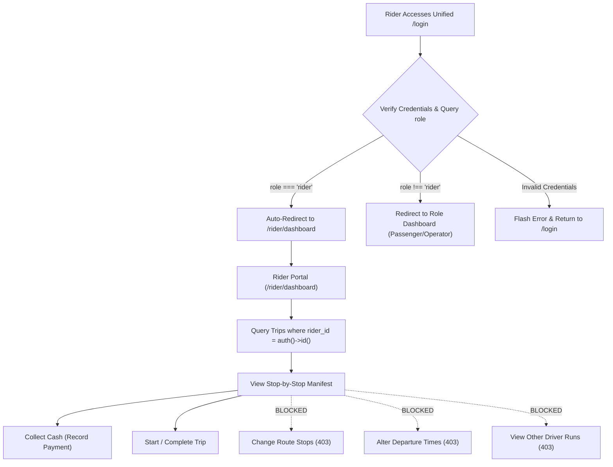

# 11 — Rider Management & Operational Manifests

## 1. Document Purpose
This document specifies the operational capabilities, user interfaces, security restrictions, and workflow tools designed for Oliver Transport commercial drivers ("Riders"). It details the dedicated Rider Panel, stop-by-stop passenger manifests, trip status transitions, and cash payment collection logging under the unified shared authentication system.

---

## 2. Scope
* **In Scope:** Mobile-first web panel for authenticated drivers, assigned trip lists, passenger manifests, contact coordination, and cash collection recording for MVP.
* **Out of Scope:** Automated GPS telemetry streaming, turn-by-turn navigation mapping, automated rider payout calculations, and driver-initiated route diversions.

---

## 3. Relevant Requirements

| ID | Rider Requirement | Classification | Specification Notes |
|---|---|---|---|
| RDM-01 | **Unified Shared Login Entry** | **`[CONFIRMED]`** | Riders authenticate via the shared `/login` page and are auto-redirected to `/rider/dashboard`. |
| RDM-02 | Assigned Trip Visibility | **`[CONFIRMED]`** | Riders can only access trips where `trip.rider_id === auth()->id()`. |
| RDM-03 | Stop-by-Stop Passenger Manifest | **`[CONFIRMED]`** | Ordered by stop sequence; lists passenger names, seats, and stops. |
| RDM-04 | Passenger Contact Phone Number Access | **`[CONFIRMED]`** | Displayed with one-click `tel:` links for pickup coordination. |
| RDM-05 | One-Click Cash Payment Logging | **`[CONFIRMED]`** | Records collection timestamp and logs collecting rider ID. |
| RDM-06 | Trip Lifecycle Status Triggers | **`[CONFIRMED]`** | Allows updating trip status: `scheduled` → `in_progress` → `completed`. |
| RDM-07 | Strict Prohibition of Route/Schedule Alterations | **`[CONFIRMED]`** | Riders cannot change stops, departure times, fares, or coupons. |
| RDM-08 | Rider Cancellation Authority | **`[PENDING]`** | Awaiting client decision on whether riders can cancel no-show passengers. |

---

## 4. Rider Authentication & Access Security



* **Authentication Entry:** Single shared login page at `/login` (zero separate rider login pages).
* **Role Redirection:** Upon successful password verification, `Auth\LoginController` detects `role === 'rider'` and immediately redirects the user to `/rider/dashboard`.
* **Session Guard:** Enforced via `RoleMiddleware` checking `auth()->user()->role === 'rider'`.
* **IDOR Protection:** `TripPolicy` enforces that riders cannot inspect or manipulate any trip where `trip.rider_id !== auth()->id()`.

---

## 5. Rider Dashboard (`/rider/dashboard`)

The Rider Dashboard is optimized specifically for mobile smartphones (with special focus on iPhone Safari) mounted in the vehicle cabin:

### 5.1 Dashboard Header
* Date display formatted in `America/Toronto` (e.g., *"Tuesday, November 10, 2026"*).
* Vehicle Plate Badge (e.g., *"Vehicle: Oliver Van 1 (QC 123-ABC)"*).
* Driver Welcome & Logout button.

### 5.2 Daily Assigned Trip Cards
Displays the two daily operational runs assigned to the driver:

1. **Morning Run (Route A: Montreal → Toronto):**
   * Scheduled Departure: **6:30 AM** from Metro Namur.
   * Booked Seats KPI: e.g., *"5 of 6 Seats Booked"*.
   * Status Badge: `SCHEDULED` (Blue) or `IN PROGRESS` (Yellow) or `COMPLETED` (Green).
   * Primary Action: **"Open Passenger Manifest"**.

2. **Afternoon Run (Route B: Toronto → Montreal):**
   * Scheduled Pickups: **12:15 PM** (Yorkdale) & **1:15 PM** (Yonge Station).
   * Booked Seats KPI: e.g., *"6 of 6 Seats Booked (FULL)"*.
   * Status Badge: `SCHEDULED`.
   * Primary Action: **"Open Passenger Manifest"**.

---

## 6. Passenger Manifest Specification (`/rider/trips/{trip}`)

The manifest is organized sequentially by route stops to match the physical journey progression:

```
+-------------------------------------------------------------------------+
| TRIP #101: MONTREAL -> TORONTO (6:30 AM)               STATUS: SCHEDULED|
| Total Passengers: 5 | Cash Expected: $275.00 | Cash Collected: $165.00  |
+-------------------------------------------------------------------------+
| [ACTION BUTTON: START TRIP]                                              |
+-------------------------------------------------------------------------+

STOP 0: METRO NAMUR, MONTREAL (PICKUP @ 6:30 AM)
-------------------------------------------------------------------------
SEAT | PASSENGER NAME   | PHONE        | DROP-OFF HUB | FARE   | STATUS  | ACTION
-----+------------------+--------------+--------------+--------+---------+-----------
S1   | Alice Tremblay   | 514-555-0101 | Yorkdale     | $55.00 | PAID    | [Collected]
S2   | Bob Miller       | 514-555-0102 | Yonge Stn    | $55.00 | UNPAID  | [COLLECT CASH]
S3   | Charles Gagnon   | 514-555-0103 | Yonge Stn    | $55.00 | UNPAID  | [COLLECT CASH]
S4   | David Roy        | 514-555-0104 | Yorkdale     | $55.00 | PAID    | [Collected]

STOP 1: YORKDALE MALL, TORONTO (DROP-OFF / PICKUP)
-------------------------------------------------------------------------
(Passengers Dropping Off: Alice Tremblay [S1], David Roy [S4])
(Passengers Boarding: Emma Stone [S1] -> Drop-off: Yonge Stn | UNPAID)

STOP 2: YONGE STATION, TORONTO (FINAL DESTINATION)
-------------------------------------------------------------------------
(Passengers Dropping Off: Bob Miller, Charles Gagnon, Emma Stone)
```

### 6.1 Manifest Data Elements & Mandatory Eager Loading
To eliminate N+1 database queries when rendering the stop-by-stop passenger roster, `RiderService` preloads all related passenger, seat, and payment records before view generation:

```php
$manifestBookings = Booking::query()
    ->with([
        'user:id,name,phone',
        'bookingSeats.vehicleSeat:id,seat_number',
        'payment:id,booking_id,amount,status,collected_at'
    ])
    ->where('trip_id', $trip->id)
    ->where('status', 'confirmed')
    ->orderBy('boarding_sequence')
    ->get();
```

Data Elements Rendered:
1. **Seat Identifier:** Prominently highlights physical cabin seat (`S1` to `S6`).
2. **Passenger Name & Contact:** Full name with click-to-call phone link (`<a href="tel:+15145550101">`) with safe touch targets of minimum 44 × 44 CSS pixels.
3. **Drop-Off Destination:** Explicitly indicates where the traveler must be discharged.
4. **Payment Indicator:**
   * Red Badge: `UNPAID` (Action button: **"Collect Cash"**).
   * Green Badge: `PAID` (Displays collection confirmation timestamp).

---

## 7. Trip Operational Controls & Cash Logging

### 7.1 Cash Payment Collection Action
When a passenger physically boards and tenders cash:
1. Rider taps the green button **"Collect Cash"** beside the passenger's name.
2. System displays a confirmation modal: *"Confirm collection of $55.00 CAD cash from Bob Miller?"*.
3. Upon confirmation, a POST request is sent to `/rider/trips/{trip}/payments/{payment}/collect`, validated by `CollectCashPaymentRequest`.
4. The thin `CashCollectionController` delegates to `PaymentService::recordCashCollection()`, executing a service-owned database transaction:
   ```php
   // app/Services/Payment/PaymentService.php
   return DB::transaction(function () use ($paymentId, $riderId) {
       $payment = Payment::where('id', $paymentId)->lockForUpdate()->firstOrFail();
       if ($payment->status === 'paid') {
           throw new PaymentAlreadyCollectedException();
       }
       $payment->update([
           'status' => 'paid',
           'collected_by' => $riderId,
           'collected_at' => now(),
       ]);
       return $payment;
   });
   ```
5. The row badge updates instantly to `PAID` without full-page reload via Alpine.js / DOM update.

### 7.2 Trip Status Lifecycle Actions
* **Start Trip:** Rider taps "Start Trip" upon departing origin. Trip status updates to `in_progress`.
* **Complete Trip:** Rider taps "Complete Trip" upon discharging all passengers at the final terminus. Trip status updates to `completed`.

### 7.3 Rider Assignment & Provisioning (Operator CLI)
Because an administrative web interface is deferred to Phase 2, driver onboarding and trip assignments are managed by system operators using Artisan CLI commands:
* **Provision Driver Account:**
  ```bash
  php artisan make:rider "John Doe" john.driver@olivertransport.ca "+15145550199"
  ```
* **Assign Driver to Dated Trip:**
  ```bash
  php artisan trip:assign-rider --trip=101 --rider=5
  ```

---

## 8. Explicit Restrictions & Security Boundaries

To maintain operational integrity and prevent fraud:
* **No Schedule Modifications:** Riders cannot alter scheduled departure or pickup times.
* **No Route Alterations:** Riders cannot add, remove, or reorder station stops.
* **No Fare Adjustments:** Riders cannot discount fares, modify base rates, or issue coupons.
* **No Access to Unassigned Data:** Riders cannot view passenger rosters or financial manifests for trips assigned to other drivers.
* **No Administrative Privileges:** Riders have zero access to system user management or database configurations.

---

## 9. Business Rules

* **BR-RDM-01 (Strict Ownership):** A Rider can only access and record cash collections for trips explicitly linked via `trips.rider_id`.
* **BR-RDM-02 (Immutable Cash Logs):** Once a cash payment is marked `paid` by a rider, it cannot be reverted to `unpaid` without operator database intervention.
* **BR-RDM-03 (Phone Privacy):** Passenger phone numbers are displayed strictly for pickup logistics and must not be used for unsolicited marketing.
* **BR-RDM-04 (Shared Authentication):** Riders must log in exclusively via `/login`; no separate driver login page is supported.

---

## 10. Related Documents
* [`05-user-roles-and-permissions.md`](./05-user-roles-and-permissions.md) — Role definitions and redirection logic.
* [`07-database-design.md`](./07-database-design.md) — Schema for `trips` and `payments`.
* [`12-payment-and-cancellation.md`](./12-payment-and-cancellation.md) — Cash payment lifecycle.
* [`14-routes-and-navigation.md`](./14-routes-and-navigation.md) — Unified authentication routes.
* [`15-security-guidelines.md`](./15-security-guidelines.md) — IDOR and data isolation policies.
