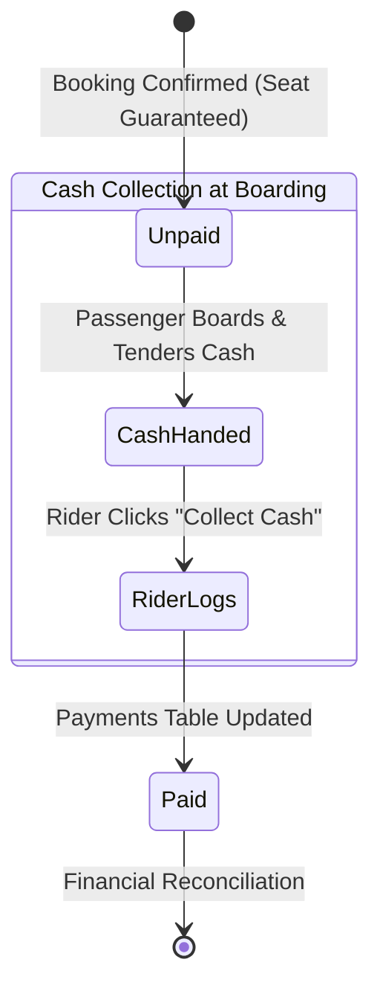

# 12 — Payment and Cancellation Policy

## 1. Document Purpose
This document specifies the payment architecture and records the pending cancellation and refund policies for Oliver Transport. It details the operational mechanics of the **cash-only** settlement model for the MVP, clarifies the strict separation between booking reservations and payment fulfillment, and provides a structured evaluation of client decisions required for cancellations.

---

## 2. Scope
* **In Scope:** Cash payment lifecycle, in-person cash collection logging by assigned riders, financial audit trails, cancellation audit records, and proposed default cancellation mechanics for MVP.
* **Out of Scope:** Online payment gateways (Stripe, Moneris, PayPal), automated credit card refunds, chargeback dispute workflows, and merchant account settlement.

---

## 3. Relevant Requirements

| ID | Financial / Cancellation Requirement | Classification | Specification Notes |
|---|---|---|---|
| PAY-01 | Cash-Only Settlement in MVP | **`[CONFIRMED]`** | In-person cash payment upon boarding. Zero online gateways. |
| PAY-02 | Independent Booking vs. Payment Status | **`[CONFIRMED]`** | Booking confirmation guarantees seat; payment remains `unpaid` until collected. |
| PAY-03 | In-Person Collection Logging by Rider | **`[CONFIRMED]`** | Rider records physical collection; logs `collected_by` and `collected_at`. |
| PAY-04 | Exclusion of Automated Electronic Refunds | **`[CONFIRMED]`** | Electronic refunds do not exist in MVP. |
| PAY-05 | Passenger Cancellation Rights & Deadlines | **`[PENDING]`** | Awaiting client confirmation on cancellation cutoff rules. |
| PAY-06 | Cancellation Fee Policy | **`[PENDING]`** | Fees unenforceable on unpaid cash bookings; awaiting client guidance. |
| PAY-07 | Coupon Restoration upon Cancellation | **`[PROPOSED]`** | If cancelled before cutoff, restore coupon usage quota. |
| PAY-08 | Cancelled Seat Inventory Restoration | **`[PROPOSED]`** | Cancelled seats immediately return to available inventory pool. |
| PAY-09 | Cancellation Audit Logging | **`[CONFIRMED]`** | Capture `cancelled_at` and `cancelled_by` on the booking record. |

---

## 4. Cash-Only Payment Architecture



### 4.1 Payment Lifecycle Mechanics
1. **Initial Creation:**
   * When `BookingService` commits a reservation (Step 13 of the 16-step transaction), it creates an associated row in `payments`.
   * Default values: `status = 'unpaid'`, `payment_method = 'cash'`, `amount = final_fare`, `currency = 'CAD'`.
2. **Physical Collection:**
   * The passenger meets the shuttle van at the scheduled station.
   * Upon boarding, the passenger tenders exact cash ($55.00 or $65.00 CAD net fare) to the assigned driver ("Rider").
3. **Audit Recording:**
   * The Rider opens the mobile manifest and taps "Collect Cash".
   * System records:
     * `payments.status = 'paid'`
     * `payments.collected_by = auth()->id()` (Rider's user ID)
     * `payments.collected_at = Carbon::now()`
4. **Discrepancy / No-Show Handling:**
   * If a passenger fails to arrive or refuses payment, the payment remains `unpaid`, and the booking may be flagged by the driver or operator.

---

## 5. Separation of Booking and Payment States

A foundational architectural rule of Oliver Transport is the strict decoupling of **Booking Status** and **Payment Status**:

| Scenario | Booking Status | Payment Status | Commercial Meaning |
|---|:---:|:---:|---|
| **Immediate Confirmation** | `confirmed` | `unpaid` | Passenger holds guaranteed seat; cash due at boarding. |
| **Boarded & Paid** | `confirmed` | `paid` | Passenger is seated and cash has been collected by driver. |
| **Trip Concluded** | `completed` | `paid` | Journey concluded successfully; revenue accounted for. |
| **Cancelled Before Trip**| `cancelled` | `unpaid` | Passenger cancelled; seat released; zero revenue collected. |
| **No-Show Passenger** | `cancelled` *(or no_show)* | `unpaid` | Passenger failed to board; seat went empty; unpaid. |

---

## 6. Cancellation Policy Specifications [CONFIRMED: EXCLUDED FROM MVP]

The client has confirmed that **no in-app cancellation system is introduced in MVP**. 

* **No Self-Service Cancellation:** Passengers cannot cancel reservations online through their portal or via web routes.
* **Out-of-Band Support Only:** Any passenger who is unable to travel must contact the company out-of-band via phone/SMS at **647-655-1884** or message the official Facebook page (**Oliver Transport**).
* **Operator Backend Action:** An operator or support administrator can manually update a booking status to `cancelled` via database commands if required. When transitioned to `cancelled`, the associated `booking_seats` are automatically excluded from segment queries (`b.status = 'confirmed'`), releasing seat inventory immediately.

### 6.1 Confirmed Cancellation Matrix for MVP

| Policy Dimension | MVP Specification | Status |
|---|---|:---:|
| **Who Can Cancel?** | Handled out-of-band by Operator via phone/Facebook support. Zero passenger self-service UI. | **`[CONFIRMED]`** |
| **Cancellation Cutoff Deadline**| N/A in MVP (no automated self-service cancellation window). | **`[CONFIRMED]`** |
| **Post-Departure Cancel**| Strictly forbidden. | **`[CONFIRMED]`** |
| **Seat Inventory Release**| Immediate if marked `cancelled` in backend by Operator. | **`[CONFIRMED]`** |
| **Coupon Reversion** | Manual reversion in backend if an operator cancels a booking. | **`[CONFIRMED]`** |
| **Cancellation Fees** | No fee enforceable in cash-only model. | **`[CONFIRMED]`** |
| **Collected Cash Refunds**| Handled out-of-band manually. Zero in-app refund logic. | **`[CONFIRMED]`** |

---

## 7. Future Refund Roadmap (Phase 2 / Phase 3)

* **Phase 1 (MVP):** No electronic refund functionality is engineered.
* **Phase 3 (Online Payments):** When credit card processing (Stripe / Moneris) is introduced, the system will support automated partial or full electronic refunds tied to confirmed cancellation cutoff policies.

---

## 8. Layered Architecture Implementation Standards

In compliance with the system-wide service-oriented Laravel architecture, all payment collection and booking cancellation workflows strictly separate routing, validation, domain logic, and persistence.

### 8.1 Controller Purity & Form Requests

Controllers must remain thin presentation adapters that never execute direct database transactions, business logic, or manual validation:

1. **Cash Collection:**
   * Handled by `Rider\PaymentController@store`.
   * Validated by `CollectCashPaymentRequest` (validates booking ID, verifies requesting user is an authorized Rider assigned to the trip, prevents double collection).
   * Injects `PaymentService` and calls `PaymentService::recordCashCollection(Booking $booking, int $riderId)`.
   * Returns a redirect with a flash message or JSON response; zero transactional or database code in the controller.

2. **Booking Cancellation:**
   * Handled by `Passenger\BookingController@cancel` or `Operator\BookingController@cancel`.
   * Validated by `CancelBookingRequest` (validates booking ID, verifies passenger ownership or operator permissions, captures optional reason).
   * Injects `BookingService` and calls `BookingService::cancelBooking(Booking $booking, User $actor, ?string $reason)`.
   * Redirects with flash status; zero manual SQL or state-machine mutation in the controller.

```php
// app/Http/Controllers/Rider/PaymentController.php
namespace App\Http\Controllers\Rider;

use App\Http\Controllers\Controller;
use App\Http\Requests\CollectCashPaymentRequest;
use App\Models\Booking;
use App\Services\PaymentService;
use Illuminate\Http\RedirectResponse;

class PaymentController extends Controller
{
    public function store(CollectCashPaymentRequest $request, Booking $booking, PaymentService $paymentService): RedirectResponse
    {
        $paymentService->recordCashCollection($booking, $request->user()->id);

        return back()->with('success', "Cash collected for booking {$booking->booking_reference}.");
    }
}
```

### 8.2 Service-Owned Transaction Boundaries

All state transitions and financial audit trails are encapsulated inside service classes within atomic transactions:

* **`PaymentService::recordCashCollection(Booking $booking, int $riderId)`:**
  1. Opens atomic transaction (`DB::beginTransaction()`).
  2. Acquires row-level lock on `payments` record (`lockForUpdate()`).
  3. Asserts payment is currently `unpaid` (throws `DomainException` if already paid).
  4. Updates status: `payments.status = 'paid'`, `payments.collected_by = $riderId`, `payments.collected_at = now()`.
  5. Commits transaction (`DB::commit()`).
  6. Dispatches post-commit event `PaymentCollectedEvent`.

* **`BookingService::cancelBooking(Booking $booking, User $actor, ?string $reason)`:**
  1. Opens atomic transaction (`DB::beginTransaction()`).
  2. Acquires row-level locks on `bookings` and associated `coupon_usages` (`lockForUpdate()`).
  3. Asserts cancellation rules (cutoff deadline, booking status == `confirmed`).
  4. Updates `bookings.status = 'cancelled'`, `cancelled_at = now()`, `cancelled_by = $actor->id`, `cancellation_reason = $reason`.
  5. If a coupon was applied, reverts the usage count via `CouponService::revertUsage($booking->coupon_id)`.
  6. Commits transaction (`DB::commit()`).
  7. Releases seat inventory immediately (segment queries filter `b.status = 'confirmed'`).
  8. Dispatches post-commit event `BookingCancelledEvent` for SMS/email notifications via `NotificationService`.

### 8.3 Mandatory Eager Loading in Payment & Cancellation Views

To eliminate N+1 queries (`NFR-13`), all relationships accessed by views must be preloaded:
* **Rider Manifest Collection Modal:** Preload `['user:id,name,phone', 'bookingSeats.vehicleSeat:id,seat_number', 'payment']`.
* **Passenger Booking Details / Cancellation Modal:** Preload `['trip.route', 'trip.vehicle', 'bookingSeats.vehicleSeat', 'payment', 'coupon']`.

---

## 9. Business Rules

* **BR-PAY-01 (No Credit Card Processing):** In MVP, under no circumstances will passengers be prompted for card numbers, CVVs, or bank details.
* **BR-PAY-02 (Auditability):** Every transition of `payments.status` to `paid` must record the collecting Rider's user ID and timestamp.
* **BR-PAY-03 (Immediate Seat Availability on Cancellation):** When a booking status transitions to `cancelled`, its associated `booking_seats` records are excluded from the segment overlap query (`b.status = 'confirmed'`), immediately releasing inventory.
* **BR-PAY-04 (Audit Trail Logging):** Cancellation events must record `bookings.cancelled_at = NOW()` and `bookings.cancelled_by = auth()->id()`.

---

## 10. Related Documents
* [`06-system-architecture.md`](./06-system-architecture.md) — 6-layer architecture and Domain Service Catalog.
* [`07-database-design.md`](./07-database-design.md) — Table schemas for `payments` and `bookings`.
* [`08-booking-workflow.md`](./08-booking-workflow.md) — 16-step booking lifecycle.
* [`11-rider-management.md`](./11-rider-management.md) — Rider cash collection interface.
* [`decisions/ADR-002-cash-only-payment-lifecycle.md`](./decisions/ADR-002-cash-only-payment-lifecycle.md) — Architectural decision record on cash settlement.
