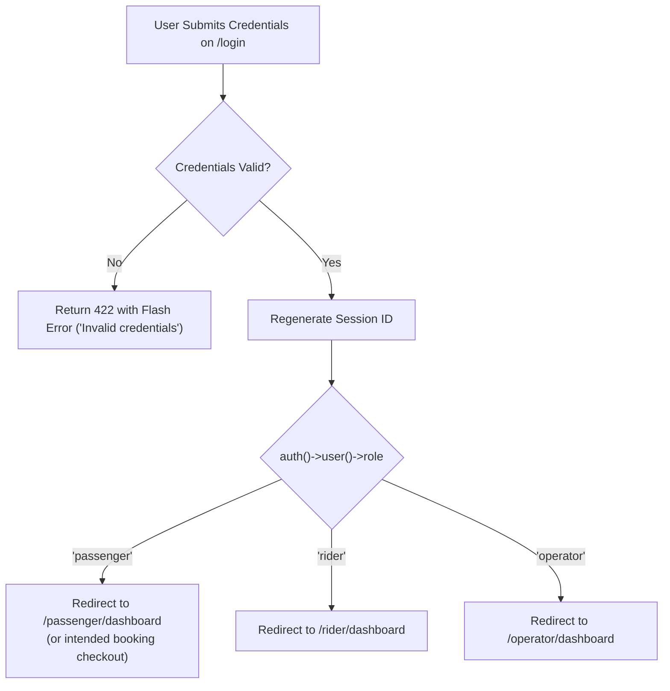

# 13 — UI/UX and Branding Guidelines

## 1. Document Purpose
This document provides the UI/UX design specifications, brand styling architecture, mobile-first responsive guidelines, component design, and accessibility standards for Oliver Transport. It establishes the design requirements for the unified shared authentication interface, the streamlined 9-step passenger booking experience, role-specific dashboards, and dedicated iPhone Safari optimization.

---

## 2. Scope
* **In Scope:** Brand styling architecture, CSS design token structure, official logo asset handling (`[PENDING ASSET]`), unified shared login UI (`/login`) with role redirection, mobile-first responsive architecture with explicit **iPhone Safari compatibility**, 9-step simplified passenger booking journey, visual 6-seat vehicle cabin component, role dashboards, and bilingual interface structure for MVP.
* **Out of Scope:** Native iOS/Android design kits (deferred to Phase 4), custom theme builders, and dynamic multi-color personalization.

---

## 3. Relevant Requirements

| ID | Design Requirement | Classification | Specification Notes |
|---|---|---|---|
| UI-01 | **Official Logo & Brand Palette Architecture** | **`[CONFIRMED — ASSET-DEPENDENT]`** | Logo is on client vehicle image. Color tokens structured; exact hex values and logo files marked **`[PENDING ASSET]`**. No guessed colors. |
| UI-02 | **Unified Shared Login UI (`/login`)** | **`[CONFIRMED]`** | One shared login page for Passenger, Rider, and Operator. Dynamic server-side role redirection after authentication. |
| UI-03 | **Mobile-First Responsive Design** | **`[CONFIRMED]`** | Viewport baseline 360px+. Single-column vertical stacks, sticky actions, zero horizontal scroll. |
| UI-04 | **iPhone Safari Priority Compatibility** | **`[CONFIRMED]`** | Dynamic viewport height (`100dvh`), safe-area insets, minimum 44 × 44 CSS pixels touch targets, 16px input font. |
| UI-05 | **Extremely Simple 9-Step Passenger Journey** | **`[CONFIRMED]`** | Streamlined 9-step booking experience from landing to boarding pass, backed by the 16-step backend transaction. |
| UI-06 | **Visual 6-Seat Vehicle Cabin Picker** | **`[CONFIRMED]`** | Realistic representation of cabin (front passenger S1 + rear rows S2–S6; driver seat permanently excluded). |
| UI-07 | **Manual Passenger Seat Choice (`choose` model)** | **`[CONFIRMED]`** | Passenger manually selects physical seat. System never silently auto-assigns an alternate seat on conflict (`HTTP 409`). |
| UI-08 | **Accessible Contrast & Visual Clarity (WCAG AA)** | **`[CONFIRMED]`** | 4.5:1 minimum contrast ratio for standard text; 3:1 for large text and interactive components. |
| UI-09 | **Language Launch: English First, French Later** | **`[CONFIRMED]`** | MVP launches with English UI; French translation deferred to Phase 2. Codebase uses translation-ready keys. |
| UI-10 | **Multi-Seat Visual Selection** | **`[CONFIRMED]`** | Interactive seat picker supports multi-seat selection (1 to 6 seats) under 1 passenger account. |

---

## 4. Brand Identity & Visual Palette Architecture

### 4.1 Confirmed Brand Identity & Vehicle Asset
* **Asset Source:** Confirmed from official client vehicle photographs and promotional posters (`docs/assets/oliver-transport-poster-en.jpg` and `docs/assets/oliver-transport-poster-fr.jpg`).
* **Commercial Vehicle:** Silver Honda Odyssey minivan, Ontario license plate **RAJIA**.
* **Official Logo Mark:**
  * "Oliver" featuring dark charcoal "Ol" and vibrant grass/lime green "iver" (with matching green dot above the 'i').
  * "TRANSPORT" in bold uppercase sans-serif underneath.
  * Subtitle text: "MONTREAL • TORONTO • MONTREAL".
* **Official Public Channels:**
  * Telephone / SMS / WhatsApp: **647-655-1884**
  * Official Facebook Page: **Oliver Transport** (Verified checkmark badge)

### 4.2 CSS Design Token Architecture (Tailwind CSS v4)
The application architecture defines CSS custom properties in `resources/css/app.css` that map directly into Tailwind v4 `@theme`:

```css
/* resources/css/app.css */
@theme {
  /* Confirmed Brand Tokens: Extracted from official vehicle branding & marketing posters */
  --color-brand-primary: var(--brand-primary, #0B0F17);       /* Deep Obsidian / Charcoal Base */
  --color-brand-surface: var(--brand-surface, #111827);       /* Dark Slate Panel Surface */
  --color-brand-surface-card: var(--brand-surface-card, #1F2937); /* Card Container Surface */
  --color-brand-accent: var(--brand-accent, #22C55E);         /* Oliver Electric Green (Vehicle Decal) */
  --color-brand-subaccent: var(--brand-subaccent, #16A34A);   /* Deep Emerald Accent */
  --color-brand-highlight: var(--brand-highlight, #FBBF24);   /* Gold Yellow (Departure / Price Tag) */
  --color-brand-alert: var(--brand-alert, #EF4444);           /* Action Red (Badge Highlight) */
  --color-brand-text: var(--brand-text, #FFFFFF);             /* High Contrast Crisp White Text */
  --color-brand-muted: var(--brand-muted, #9CA3AF);           /* Muted Secondary Text */
  --color-brand-border: var(--brand-border, #374151);         /* Container Border */
}
```

### 4.3 Asset Integration Procedure
1. Official marketing posters are stored in `docs/assets/oliver-transport-poster-en.jpg` and `docs/assets/oliver-transport-poster-fr.jpg`.
2. Public web logo assets are provisioned in `public/images/brand/logo.svg` and `public/images/brand/logo.png`.
3. The `--brand-*` CSS variables in `resources/css/app.css` apply the confirmed hex values globally across all Blade templates.

### 4.4 Typography & Iconography
* **Primary Typeface:** `Instrument Sans` (loaded via Bunny Fonts in `vite.config.js`).
* **Monospaced Numbers:** `font-mono` for booking references (`OT-YYYY-XXXX`), departure times, seat codes (`S1`–`S6`), and currency amounts.
* **Icon Set:** Clean, lightweight SVG icons (Heroicons) for bus, calendar, clock, map pin, checkmark, lock, and telephone.

---

## 5. Unified Login System (`/login`) & Role-Based UX

### 5.1 Single Shared Authentication Interface
Oliver Transport operates a **single, unified login interface** for all system users:
* **Route:** `GET /login` (handled by `App\Http\Controllers\Auth\AuthenticatedSessionController@create`).
* **Universal Form:** Single login form accepting `email` and `password`.
* **Prohibition:** There are **NO separate login pages** or separate URLs for Riders or Operators (legacy `/rider/login` is strictly removed).

```
+-------------------------------------------------------+
|                 [ OLIVER TRANSPORT LOGO ]             |
|                  Welcome to Oliver Transport          |
|            Sign in to access your bookings & trips    |
+-------------------------------------------------------+
|  Email Address                                        |
|  [ passenger@example.com / driver@olivertransport.ca ]|
|                                                       |
|  Password                                             |
|  [ •••••••••••••••••• ] [Show]                        |
|                                                       |
|  [X] Remember me                   Forgot Password?   |
|                                                       |
|  +-------------------------------------------------+  |
|  |                   SIGN IN                       |  |
|  +-------------------------------------------------+  |
|                                                       |
|  Don't have an account? Create Passenger Account      |
+-------------------------------------------------------+
```

### 5.2 Dynamic Post-Login Role-Based Redirection
Upon successful credential verification, the system executes server-side role inspection and redirects the user to their designated dashboard:



### 5.3 Server-Side Authorization Barrier & Tamper Handling
* Role redirection is backed by strict server-side middleware (`RoleMiddleware`).
* If a logged-in Passenger manually types `/rider/dashboard` into their browser, the server returns `HTTP 403 Forbidden` with a friendly error: *"Access Restricted: You do not have permissions to access the Rider Portal. Return to Passenger Dashboard."*
* If a Rider attempts to access `/passenger/bookings/create`, the server returns `HTTP 403 Forbidden`.
* Frontend navigation dynamically hides cross-role links.

---

## 6. Mobile-First Responsive Design & iPhone Safari Compatibility

Every interface in Oliver Transport is designed **mobile-first**, recognizing that passengers book on smartphones while on the go, and shuttle riders operate their manifests exclusively on mobile devices.

### 6.1 Priority Target: iPhone Safari (Implementation Guidance & Acceptance Criteria)
iPhone Safari is a primary commercial target. The following engineering standards provide implementation guidance for frontend development and define testing acceptance benchmarks for mobile quality assurance:

#### 1. Dynamic Viewport Height (`100dvh`)
Standard `100vh` in Safari is notoriously broken because it ignores the dynamic expanding/collapsing URL bar and bottom toolbar, causing buttons to be hidden offscreen.
* **Rule:** All full-height mobile wrappers and modals must use `min-h-[100dvh]` with fallback:
  ```css
  .app-viewport-container {
    min-height: 100vh;      /* Fallback for older browsers */
    min-height: 100dvh;     /* Standard dynamic viewport height for iOS Safari */
  }
  ```

#### 2. Safe-Area Insets for Notches and Home Indicators
Modern iPhones feature screen notches, Dynamic Islands, and bottom home indicator bars.
* **Rule:** All fixed/sticky headers, bottom navigation bars, and modals must incorporate `env(safe-area-inset-*)`:
  ```css
  /* Sticky bottom checkout bar / rider controls */
  .mobile-sticky-action-bar {
    padding-bottom: max(1rem, env(safe-area-inset-bottom));
    padding-left: max(1rem, env(safe-area-inset-left));
    padding-right: max(1rem, env(safe-area-inset-right));
  }
  
  /* Sticky top navigation bar */
  .mobile-sticky-header {
    padding-top: max(0.75rem, env(safe-area-inset-top));
  }
  ```

#### 3. iOS Auto-Zoom Prevention on Form Inputs
iPhone Safari automatically zooms in on any form input whose computed `font-size` is less than `16px`, disorienting the user and breaking the responsive layout.
* **Rule:** Every `<input>`, `<select>`, and `<textarea>` must have `font-size: 16px` (`text-base`) on mobile viewports:
  ```html
  <!-- Compliant input class -->
  <input class="w-full text-base sm:text-sm rounded-lg border-brand-border bg-brand-surface py-3 px-4 text-white">
  ```

#### 4. Touch Target Ergonomics (Apple Human Interface Guidelines)
* **Rule:** All general interactive controls (buttons, calendar days, checkboxes, links, and action triggers) must have a minimum clickable/tappable footprint of **44 × 44 CSS pixels**.
* **Seat Selection Tiles:** Target approximately **48 × 48 CSS pixels or larger** on mobile screens to ensure effortless single-finger tapping without accidental adjacent touches.

#### 5. Mobile Keyboard Optimization (`inputmode` & `type`)
* Email fields: `type="email" inputmode="email" autocomplete="email" autocapitalize="none" autocorrect="off"`.
* Telephone fields: `type="tel" inputmode="tel" autocomplete="tel"`.
* Numeric codes (coupons/OTP): `type="text" inputmode="text" autocapitalize="characters"`.

#### 6. Horizontal Overflow Prevention & Momentum Scrolling
* **Responsive Layout Design:** Prevent unintended horizontal overflow through flexible layouts, fluid grids, relative sizing, and proper flex wrapping.
* **Avoid Global Hidden Overflow:** Do not apply global `overflow-x: hidden` to the `body` or root container as a catch-all fix, because it risks clipping essential content, focus rings, or interactive controls, and can disrupt mobile viewport behavior.
* **Intentional Scrolling:** Allow intentional horizontal scrolling only for components that genuinely require it (e.g., wide passenger manifests on small displays), styled with `-webkit-overflow-scrolling: touch` for smooth iOS native momentum scrolling and clear visual scroll cues.
* **Device Testing:** Rigorously test tables, seat layouts, modals, forms, and navigation on small screens to confirm no content or interactive controls are clipped or unreachable.

#### 7. Touch Modals and Dialog Usability
* Modals on mobile devices must slide up as a bottom sheet drawer.
* Must include an explicit, large tap-to-close button (minimum 44 × 44 CSS pixels) in addition to backdrop-tap dismissal.
* Prevent background body scroll when a modal is open via `overflow: hidden` on `<body>`.

#### 8. Native Date/Time Fallback
* Standard HTML5 `<input type="date">` triggers iOS native wheel pickers cleanly.
* Must specify `min` and `max` date bounds to prevent selecting historical dates or dates beyond the 14-day booking horizon.

---

## 7. The Extremely Simple 9-Step Passenger Booking Experience

The customer experience is intentionally engineered to be **simple, intuitive, and require minimal unnecessary steps** `[CONFIRMED]`. *(Completing reservations in under 90 seconds is considered a proposed future UX usability benchmark subject to user testing and approval `[PROPOSED]`, not a confirmed requirement).*

```mermaid
flowchart LR
    S1["1. Open Site"] --> S2["2. Log In / Register"]
    S2 --> S3["3. Find Trip"]
    S3 --> S4["4. View Trip Info"]
    S4 --> S5["5. Select Stops"]
    S5 --> S6["6. Choose Seat Visually"]
    S6 --> S7["7. Review Fare & Coupon"]
    S7 --> S8["8. Confirm Booking"]
    S8 --> S9["9. View Boarding Pass"]
```



### Detailed Customer Journey Walkthrough

#### Step 1: Open Site
* Passenger opens `olivertransport.ca` on their mobile or desktop browser.
* Clean hero section immediately presents the Montreal ↔ Toronto daily shuttle proposition, fixed departure times (6:30 AM Mtl / 12:15 PM & 1:15 PM Tor), flat per-trip fare, and 6-seat passenger van convenience.

#### Step 2: Log In / Quick Register
* Passenger taps "Sign In" or begins directly on the booking widget.
* Unified `/login` allows instant access. New users complete a simple 4-field registration (Name, Phone, Email, Password) taking less than 30 seconds.

#### Step 3: Find Trip
* Passenger selects travel direction via a prominent dual-segment toggle:
  * `[ Montreal → Toronto ]` (Route A)
  * `[ Toronto → Montreal ]` (Route B)
* Passenger taps travel date from an interactive calendar (restricted to valid operating dates within the 14-day rolling window).

#### Step 4: View Trip Info
* Card expands displaying trip specifics:
  * Route departure time (e.g., *6:30 AM sharp* from Montreal).
  * Vehicle profile (*Executive 7-Passenger Shuttle Van, 6 Bookable Seats, Air Conditioned, Luggage Space*).
  * Predefined boarding stations.

#### Step 5: Select Stops
* Passenger selects their specific boarding and drop-off hubs from clean dropdowns or radio pills:
  * For Route A: Boarding is fixed at *Station Metro Namur (Montreal)*; Drop-off choice: *Yorkdale Mall* or *Yonge Station*.
  * For Route B: Boarding choice: *Yorkdale Mall (12:15 PM)* or *Yonge Station (1:15 PM)*; Drop-off: *Station Metro Namur (Montreal)*.

#### Step 6: Choose Seat Visually
* Visual vehicle cabin diagram renders dynamically.
* Passenger taps an available seat (Seat S1 beside driver, or Seats S2–S6 in rear cabin).
* Selected seat instantly illuminates in brand accent color with checkmark icon.
* *System Rule:* The passenger manually picks their seat. The system never silently auto-assigns.

#### Step 7: Review Fare & Coupon
* Transparent fare summary card displays:
  * Trip Base Fare: `$55.00 CAD` (Promotional) or `$65.00 CAD` (Regular).
  * Optional Coupon Code input: Passenger enters code (e.g., `LAUNCH10`) and taps "Apply" -> instant server recalculation.
  * Final Cash Payable on Board: `$55.00 CAD` (or discounted total).
  * Clear notice: *"No credit card needed today. Pay cash to driver upon boarding."*

#### Step 8: Confirm Booking
* Passenger taps high-visibility CTA: **"Confirm Reservation"**.
* Button enters disabled/loading state to prevent double taps.
* Dispatches payload with `idempotency_key` to server.
* Server executes the robust **16-step atomic database transaction** under pessimistic row lock.

#### Step 9: View Boarding Pass
* Instant redirect to confirmed Digital Boarding Voucher (`/passenger/bookings/{reference}`):
  * Unique Booking Reference: `OT-2026-X8K2`.
  * Reserved Seat: `Seat S1 (Front Passenger)`.
  * Pickup Station address, scheduled departure time, and map link.
  * Payment Badge: `Payment Due: $55.00 CAD Cash on Boarding`.
  * One-tap buttons: "Add to Calendar", "Download PDF Voucher", "Return to Dashboard".

---

## 8. Frontend Simplicity vs. Backend Robustness

The table below contrasts the **Extremely Simple 9-Step Passenger Experience** with the **16-Step Booking Operational Lifecycle and Transaction Boundaries** executing behind the scenes:

| Customer Journey Step (Frontend UX) | Backend Operational Execution & Transaction Boundaries |
|---|---|
| **Step 1: Open Site** | Evaluates active schedules and rolling 14-day trip window (`trips` table). |
| **Step 2: Log In / Register** | Authenticates session via universal `/login` with role inspection. |
| **Step 3: Find Trip** | Queries `trips` and `routes` filtered by date and active status. |
| **Step 4: View Trip Info** | Loads `route_stops`, scheduled times, and vehicle capacity metadata. |
| **Step 5: Select Stops** | Validates forward stop sequence constraint: $\text{Seq}(\text{board}) < \text{Seq}(\text{drop})$. |
| **Step 6: Choose Seat Visually** | Evaluates segment overlap query: $\text{Overlap} \iff (B_A < D_B) \land (B_B < D_A)$. Target approximately 48 × 48 CSS pixels or larger for seat tiles. |
| **Step 7: Review Fare & Coupon** | Validates coupon rules (expiry, spend, limits) and executes integer-cents arithmetic. |
| **Step 8: Confirm Booking** | **16-Step Operational Execution Across 3 Stages:**<br/>**Stage A: Pre-Transaction Checks (Outside DB Transaction):**<br/>1. Authenticate passenger session.<br/>2. Authorize role (`passenger`).<br/>3. Validate request format & parameters.<br/>4. Check client idempotency key in cache.<br/>**Stage B: Database Transaction (`DB::beginTransaction()` to `DB::commit()`):**<br/>5. Validate trip & schedule (departure cutoff check conditional on client approval).<br/>6. Validate stops & forward sequence.<br/>7. Validate seat belongs to vehicle & `is_driver_seat == 0`.<br/>8. `SELECT * FROM vehicle_seats WHERE id = ? FOR UPDATE` (Pessimistic Row Lock).<br/>9. Re-verify segment overlap under lock.<br/>10. Resolve applicable `per_trip` base fare.<br/>11. Re-validate & lock coupon row (if supplied).<br/>12. Calculate final net fare in integer cents.<br/>13. Insert `bookings` record (`OT-YYYY-XXXX`).<br/>14. Insert `booking_seats` segment allocation.<br/>15. Insert `payments` cash record (`status = 'unpaid'`) & record coupon usage.<br/>16. Commit database transaction (`DB::commit()`).<br/>**Stage C: Post-Commit Actions (Outside DB Transaction):**<br/>- Dispatch domain events (`BookingConfirmed`) after commit.<br/>- Deliver HTTP response / redirect. |
| **Step 9: View Boarding Pass** | Renders digital boarding pass with reference code and cash payment notice. |

---

## 9. Visual Seat Picker Component Specifications

```
                   +-----------------------+
                   |   [ FRONT BUMPER ]    |
                   +-----------------------+
                   |  ( ) DRIVER   [ S1 ]  |  <- S1: Front Passenger Window
                   |  (Excluded)           |
                   +-----------------------+
                   |      [ ENTRY ]        |
                   +-----------------------+
                   |  [ S2 ]       [ S3 ]  |  <- Row 2: Middle Cabin
                   +-----------------------+
                   |  [ S4 ] [ S5 ] [ S6 ] |  <- Row 3: Rear Cabin
                   +-----------------------+
                   |      [ LUGGAGE ]      |
                   +-----------------------+
```

### 9.1 Seat Tile Interactive States
1. **Available (Unoccupied):**
   * Visual: Dark emerald outline, subtle hover glow, cursor pointer.
   * Label: Seat code (`S1`), location subtitle (*"Front Window"*).
   * Tap Action: Sets active selection.
2. **Selected (Active):**
   * Visual: Filled with Brand Accent (`var(--color-brand-accent)`), dark contrasting text, checkmark icon.
   * Feedback: Toast below cabin: *"Selected: Seat S1 (Front Passenger Window) — $55.00 CAD"*.
3. **Unavailable (Reserved / Segment Overlap):**
   * Visual: Dark slate background (`#1E293B`), strikethrough, cursor not-allowed, opacity 40%.
   * Label: *"Reserved"*. Tap action disabled.
4. **Driver Seat:**
   * Visual: Steering wheel icon, permanently grayed out, labeled *"Driver (Not Bookable)"*. Click disabled.

### 9.2 Conflict Handling (`HTTP 409`)
If a concurrent passenger confirms the selected seat moments earlier:
* Server transaction throws `SeatUnavailableException` and aborts.
* Controller returns `HTTP 409 Conflict`.
* UI immediately displays friendly alert: *"Seat S1 was just booked by another traveler. Please choose another available seat."*
* The cabin picker automatically refreshes vacancy states.
* **The system NEVER silently reassigns the traveler to an alternate seat.**

---

## 10. Role-Specific Dashboards Under Unified Authentication

### 10.1 Passenger Dashboard (`/passenger/dashboard`)
* **Header:** Welcome message with passenger name, quick link to "Book New Trip".
* **Upcoming Reservations Card:**
  * Prominent booking reference card (`OT-2026-X8K2`).
  * Departure countdown timer (e.g., *"Departs in 2 days, 14 hours"*).
  * Travel direction, pickup station, scheduled departure time, and reserved seat number.
  * Payment Badge: `UNPAID — $55.00 CAD Cash on Boarding`.
  * Actions: "View Boarding Pass", "Print Voucher", "Cancel Reservation" *(if within deadline)*.
* **Booking History Table:** Past completed and cancelled trips with fare receipts.

### 10.2 Rider Mobile Dashboard (`/rider/dashboard`)
Designed specifically for drivers using smartphones mounted in the vehicle:
* **Today's Trips Overview:**
  * Card 1: Route A (Montreal → Toronto — Departs 06:30 AM). Status badge: `Scheduled`.
  * Card 2: Route B (Toronto → Montreal — Pickups 12:15 PM & 1:15 PM). Status badge: `Scheduled`.
* **Trip Manifest Screen (`/rider/trips/{id}`):**
  * Manifest Summary: Booked Seats (e.g., `5/6`), Expected Cash (`$275.00 CAD`), Cash Collected (`$165.00 CAD`).
  * **Passenger Roster (Stop-by-Stop Order):**
    * Seat Badge (`S1`), Passenger Full Name.
    * Click-to-Call Phone Button (`<a href="tel:..." class="min-h-[44px] min-w-[44px] flex items-center justify-center">` ensuring minimum 44 × 44 CSS pixels).
    * Boarding Hub & Drop-off Hub.
    * Payment Status Toggle: Red `UNPAID ($55 CAD)` -> Tap -> Modal confirm -> Green `PAID`.
  * Trip Controls: Prominent sticky buttons **"Start Trip"** and **"Complete Trip"**.

### 10.3 Operator Dashboard (`/operator/dashboard`)
* Accessible only to users with `role === 'operator'`.
* Displays daily passenger volume, active trip statuses, cash collection totals, and quick CLI command references.

---

## 11. Bilingual (English & French) Localization Structure

To serve travelers across Quebec and Ontario:
* Language switcher toggle (`EN` | `FR`) located in the header navigation.
* Strings stored in `lang/en/` and `lang/fr/`.
* Date and time formatting:
  * English: `Tuesday, March 10, 2026 at 6:30 AM` | `$55.00 CAD`
  * French: `Mardi 10 mars 2026 à 06 h 30` | `55,00 $ CAD`

---

## 12. Business Rules

* **BR-UI-01 (Clarity Over Decoration):** Trip departure times, pickup locations, seat identifiers, and payment instructions must always take visual precedence over decorative images.
* **BR-UI-02 (Mobile-First Touch Ergonomics):** General interactive controls must have a minimum footprint of 44 × 44 CSS pixels; seat selector tiles target approximately 48 × 48 CSS pixels or larger. Form inputs must maintain 16px font size on mobile viewports to prevent iOS Safari auto-zoom.
* **BR-UI-03 (Single Shared Authentication):** All users authenticate at `/login`. Separate login URLs for different roles are strictly prohibited.
* **BR-UI-04 (Zero Auto-Assignment):** If a chosen seat becomes unavailable, the UI must allow the user to choose another seat manually.
* **BR-UI-05 (Asset Dependence for Brand Tokens):** No mock or guessed branding elements may be committed. Exact colors and logo remain `[PENDING ASSET]` until the official vehicle image is ingested.

---

## 13. Related Documents
* [`00-project-overview.md`](./00-project-overview.md) — Executive summary.
* [`02-business-requirements.md`](./02-business-requirements.md) — Route and station definitions.
* [`08-booking-workflow.md`](./08-booking-workflow.md) — 16-step atomic transaction lifecycle.
* [`09-seat-management.md`](./09-seat-management.md) — Cabin seating layout and overlap math.
* [`14-routes-and-navigation.md`](./14-routes-and-navigation.md) — Route definitions and role access.
* [`decisions/ADR-004-pending-client-decisions-log.md`](./decisions/ADR-004-pending-client-decisions-log.md) — Registry of pending decisions and proposed defaults.
