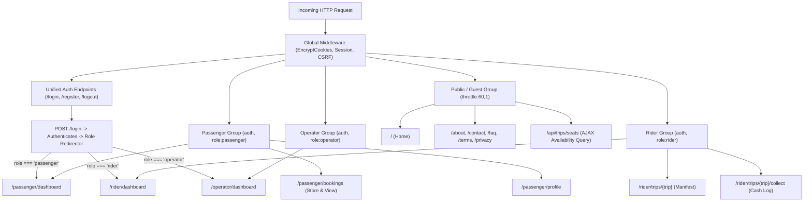

# 14 — Routes and Navigation Documentation

## 1. Document Purpose
This document defines the complete URL structure, HTTP methods, controller bindings, middleware pipelines, and authorization requirements for Oliver Transport. It provides the routing contract connecting frontend navigation with backend endpoints across Public, Passenger, Rider, and Operator domains.

---

## 2. Scope
* **In Scope:** Public marketing routes, unified shared authentication endpoints (`/login`), authenticated passenger routes, authenticated rider manifest routes, and operator access controls for MVP.
* **Out of Scope:** Multi-tenant vanity subdomains, dynamic CMS page builders, and third-party webhook receivers.

---

## 3. Relevant Requirements

| ID | Routing Requirement | Classification | Specification Notes |
|---|---|---|---|
| NAV-01 | RESTful Public Marketing Routes | **`[CONFIRMED]`** | Clean URLs for Home, About, Contact, FAQ, Terms, Privacy with semantic route names. |
| NAV-02 | **Unified Shared Login System** | **`[CONFIRMED]`** | Single login endpoint (`/login`) for Passenger, Rider, and Operator roles. |
| NAV-03 | **Role-Based Post-Login Redirection** | **`[CONFIRMED]`** | Automatic redirection to role dashboard upon successful authentication. |
| NAV-04 | Strict Middleware Pipeline Enforcement | **`[CONFIRMED]`** | `auth`, `role:passenger`, `role:rider`, `role:operator`, and `throttle` gates. |
| NAV-05 | CSRF and Rate Limiting Protection | **`[CONFIRMED]`** | Form submissions protected by CSRF tokens; endpoints rate-throttled. |
| NAV-06 | Server-Side URL Tamper Defense | **`[CONFIRMED]`** | Manual entry of unauthorized role URLs blocked with `HTTP 403 Forbidden`. |
| NAV-07 | **URL Mapping Only (No Logic in Routes)** | **`[CONFIRMED]`** | Routes map URLs to controllers and middleware only; zero closures, zero queries. |
| NAV-08 | **Blade-First Web Routing** | **`[CONFIRMED]`** | Standard Laravel web routes rendering Blade views; no SPA or complex API overhead. |

---

## 4. Routing Architecture & Middleware Groups

---

## 5. Complete Route Catalog

### 5.1 Public & Informational Routes (Guest / All Users)

| Method | URI Path | Route Name | Controller Action | Middleware | Description |
|---|---|---|---|---|---|
| `GET` | `/` | `home` | `Frontend\HomeController@index` | `web` | Marketing homepage with Hero, How It Works, Discount Coupons & Footer |
| `GET` | `/services` | `services` | `Frontend\ServicesController@index` | `web` | Daily Montreal ↔ Toronto routes, cabin amenities & charter services |
| `GET` | `/about` | `about` | `Frontend\AboutController@index` | `web` | About PickMeRoute, Honda Odyssey fleet & Why Choose Us |
| `GET` | `/contact` | `contact` | `Frontend\ContactController@index` | `web` | Contact details, phone, station hubs |
| `GET` | `/faq` | `faq` | `Frontend\FaqController@index` | `web` | Frequently asked customer questions |
| `GET` | `/terms` | `terms` | `PublicPageController@terms` | `web` | Terms and conditions |
| `GET` | `/privacy` | `privacy` | `PublicPageController@privacy` | `web` | Privacy policy and data protection |
| `POST` | `/locale/{lang}` | `locale.switch` | `LocaleController@switch` | `web` | Switch language between EN and FR |

---

### 5.2 Unified Shared Authentication Endpoints

> [!IMPORTANT]
> In accordance with confirmed client requirements, **all user roles (Passenger, Rider, Operator) authenticate through this single shared login interface**. Separate login URLs or forms are strictly prohibited.

| Method | URI Path | Route Name | Controller Action | Form Request Class | Middleware | Description |
|---|---|---|---|---|---|---|
| `GET` | `/login` | `login` | `Auth\AuthenticatedSessionController@create` | N/A | `web`, `guest` | Unified Shared Login Form |
| `POST` | `/login` | `login.store` | `Auth\AuthenticatedSessionController@store` | `LoginRequest` | `web`, `guest`, `throttle:5,1` | Authenticates and triggers role redirection |
| `GET` | `/auth/google` | `auth.google` | `Auth\GoogleAuthController@redirectToGoogle` | N/A | `web`, `guest`, `throttle:20,1` | Redirects guest to Google OAuth 2.0 consent screen |
| `GET` | `/auth/google/redirect` | `auth.google.redirect` | `Auth\GoogleAuthController@redirectToGoogle` | N/A | `web`, `guest`, `throttle:20,1` | Alias route redirecting guest to Google OAuth consent |
| `GET` | `/auth/google/callback` | `auth.google.callback` | `Auth\GoogleAuthController@handleGoogleCallback` | N/A | `web`, `guest`, `throttle:20,1` | Handles Google OAuth callback, links/creates user & redirects by role |
| `GET` | `/register` | `register` | `Auth\RegisterController@create` | N/A | `web`, `guest` | Passenger self-registration form |
| `POST` | `/register` | `register.store` | `Auth\RegisterController@store` | `RegisterPassengerRequest` | `web`, `guest`, `throttle:5,1` | Registers passenger and redirects |
| `POST` | `/logout` | `logout` | `Auth\AuthenticatedSessionController@destroy` | N/A | `web`, `auth` | Invalidates session and redirects to `/login` |

---

### 5.3 Public Booking Query & Validation Endpoints (AJAX)

| Method | URI Path | Route Name | Controller Action | Form Request Class | Middleware | Description |
|---|---|---|---|---|---|---|
| `GET` | `/api/trips/available` | `api.trips.available` | `TripSearchController@index` | `SearchTripRequest` | `web`, `throttle:60,1` | Returns scheduled trips for a date and direction |
| `GET` | `/api/trips/{trip}/seats`| `SeatAvailabilityController@index` | `SeatAvailabilityController@index` | N/A | `web`, `throttle:60,1` | Returns vacancy state of seats S1–S6 for segment |
| `POST`| `/api/coupons/validate` | `api.coupons.validate` | `CouponController@validate` | `ApplyCouponRequest` | `web`, `throttle:20,1` | Validates coupon code and returns discount |

---

### 5.4 Passenger Portal Routes (`/passenger/*`)

* **Base Middleware:** `web`, `auth`, `role:passenger`

| Method | URI Path | Route Name | Controller Action | Form Request Class | Description |
|---|---|---|---|---|---|
| `GET` | `/passenger/dashboard` | `passenger.dashboard` | `Passenger\DashboardController@index` | N/A | Overview of upcoming trips and active bookings |
| `GET` | `/passenger/bookings` | `passenger.bookings.index` | `Passenger\BookingController@index` | N/A | Complete history of upcoming and completed bookings |
| `POST` | `/passenger/bookings` | `passenger.bookings.store` | `Passenger\BookingController@store` | `CreateBookingRequest` | Submits new reservation (Triggers 16-step operational lifecycle) |
| `GET` | `/passenger/bookings/{booking}` | `passenger.bookings.show` | `Passenger\BookingController@show` | N/A | View confirmed booking voucher with reference code and seat info |
| `GET` | `/passenger/profile` | `passenger.profile.edit` | `Passenger\ProfileController@edit` | N/A | View personal profile and contact phone number |
| `PUT` | `/passenger/profile` | `passenger.profile.update` | `Passenger\ProfileController@update` | N/A | Update contact phone number or change password |

---

### 5.5 Rider Portal Routes (`/rider/*`)

* **Base Middleware:** `web`, `auth`, `role:rider`

| Method | URI Path | Route Name | Controller Action | Form Request Class | Description |
|---|---|---|---|---|---|
| `GET` | `/rider/dashboard` | `rider.dashboard` | `Rider\DashboardController@index` | N/A | Today's assigned shuttle trips and vehicle status |
| `GET` | `/rider/trips/{trip}` | `rider.trips.show` | `Rider\TripManifestController@show` | N/A | Full stop-by-stop passenger manifest for assigned trip |
| `POST` | `/rider/trips/{trip}/start` | `rider.trips.start` | `Rider\TripStatusController@start` | N/A | Transitions trip status from `scheduled` to `in_progress` |
| `POST` | `/rider/trips/{trip}/complete` | `rider.trips.complete` | `Rider\TripStatusController@complete` | N/A | Transitions trip status from `in_progress` to `completed` |
| `POST` | `/rider/trips/{trip}/payments/{payment}/collect` | `rider.payments.collect` | `Rider\TripManifestController@collectCash` | `CollectCashPaymentRequest` | Records physical cash collection; marks payment `paid` |

---

### 5.6 Operator Portal Routes (`/operator/*`)

* **Base Middleware:** `web`, `auth`, `role:operator`

| Method | URI Path | Route Name | Controller Action | Form Request Class | Description |
|---|---|---|---|---|---|
| `GET` | `/operator/dashboard` | `operator.dashboard` | `Operator\DashboardController@index` | N/A | High-level operations overview and system health |
| `GET` | `/operator/trips` | `operator.trips.index` | `Operator\TripController@index` | N/A | Inspection of upcoming dated trips and rider assignments |
| `POST` | `/operator/trips/{trip}/assign-rider` | `operator.trips.assign-rider` | `Operator\TripController@assignRider` | `AssignRiderRequest` | Assigns commercial driver to dated trip run |

---

## 6. Route-Level Authorization & Policy Binding

* **Server-Side Enforcement:**
  * If a Passenger attempts to access `/rider/*` or `/operator/*`, the `RoleMiddleware` intercepts the request and terminates with `HTTP 403 Forbidden`.
  * If a Rider attempts to access `/passenger/*` or `/operator/*`, the request terminates with `HTTP 403 Forbidden`.
  * If an unauthenticated user enters any protected URL, they are redirected to `/login`. Upon successful authentication, they are redirected to their authorized destination.
* **Booking Access (`BookingPolicy`):**
  * `can('view', $booking)`: Passenger can only view their own bookings (`booking.user_id === auth()->id()`).
  * `can('cancel', $booking)`: Passenger can only cancel their own bookings prior to departure cutoff.
* **Trip Access (`TripPolicy`):**
  * `can('viewManifest', $trip)`: Rider can only view manifests for trips where `trip.rider_id === auth()->id()`.
  * `can('collectCash', $trip)`: Rider can only log cash payments on trips where `trip.rider_id === auth()->id()`.

---

## 7. Business Rules

* **BR-NAV-01 (Single Shared Authentication Entry):** Exactly one shared login page (`/login`) must exist. Separate login pages for different roles are strictly prohibited.
* **BR-NAV-02 (Server-Side Gatekeeping):** Authorization must be validated server-side on every request. Client-side hiding of navigation links is never considered a security control.
* **BR-NAV-03 (Rate Limiting on Sensitive Endpoints):** Login submissions are restricted to 5 attempts per minute per IP; booking creation is restricted to 10 submissions per minute per user.
* **BR-NAV-04 (URL Mapping Only):** Routes must define URL endpoints, HTTP verbs, middleware, and controller action references only. Business logic, Eloquent queries, and complex closures inside route files are strictly prohibited.
* **BR-NAV-05 (Thin Controller Binding):** Every state-changing route maps to a thin controller that type-hints a dedicated Form Request and delegates domain execution to a service class.

---

## 8. Related Documents
* [`05-user-roles-and-permissions.md`](./05-user-roles-and-permissions.md) — Role definitions and redirection logic.
* [`08-booking-workflow.md`](./08-booking-workflow.md) — 16-step transaction lifecycle.
* [`11-rider-management.md`](./11-rider-management.md) — Rider panel actions.
* [`13-ui-ux-guidelines.md`](./13-ui-ux-guidelines.md) — UI/UX and mobile-first design.
* [`15-security-guidelines.md`](./15-security-guidelines.md) — Security policies and IDOR prevention.
