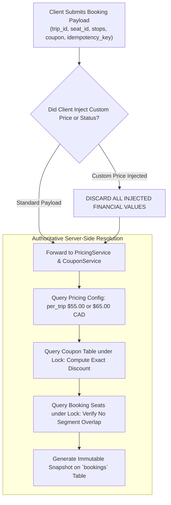

# 15 — Security Guidelines and Defensive Architecture

## 1. Document Purpose
This document specifies the security architecture, threat model, defensive coding standards, and vulnerability mitigations for Oliver Transport. It provides strict guidelines to protect passenger privacy, eliminate concurrency race conditions, prevent unauthorized data access, and safeguard transactional integrity.

---

## 2. Scope
* **In Scope:** Authentication security, session protection, CSRF defense, IDOR prevention, mass-assignment blocking, server-side financial validation, idempotency guards, rate limiting, and database concurrency locking for MVP.
* **Out of Scope:** Multi-factor authentication hardware keys (FIDO2/WebAuthn), PCI-DSS Level 1 compliance audits (no cardholder data processed), and Web Application Firewall (WAF) appliance management.

---

## 3. Relevant Requirements

| ID | Security Guideline | Classification | Implementation Requirement |
|---|---|---|---|
| SEC-01 | **Zero Client Trust Policy** | **`[CONFIRMED]`** | Fares, discounts, coupon validity, seat status, and payment state calculated strictly server-side. |
| SEC-02 | **Insecure Direct Object Reference (IDOR) Defense** | **`[CONFIRMED]`** | All passenger and rider queries constrained by ownership policies. |
| SEC-03 | **Pessimistic Concurrency Row Locking** | **`[CONFIRMED]`** | `SELECT ... FOR UPDATE` on `vehicle_seats` during booking to serialize reservation attempts. |
| SEC-04 | **Bcrypt Password Hashing (Cost 12)** | **`[CONFIRMED]`** | Passwords hashed using Bcrypt with 12 rounds. Plaintext never stored or logged. |
| SEC-05 | **Database Session Security** | **`[CONFIRMED]`** | Database session driver with `HttpOnly`, `SameSite=Lax`, and `Secure` cookie attributes. |
| SEC-06 | **Universal CSRF Protection** | **`[CONFIRMED]`** | Native CSRF token validation on all `POST`, `PUT`, `DELETE` routes. |
| SEC-07 | **Strict Mass-Assignment Whitelisting** | **`[CONFIRMED]`** | Explicit `$fillable` arrays on all Eloquent models; role fields excluded. |
| SEC-08 | **Passenger Data Privacy Protection** | **`[CONFIRMED]`** | Phone numbers accessible only to the Rider assigned to the specific trip. |
| SEC-09 | **Rate Limiting on Sensitive Endpoints** | **`[CONFIRMED]`** | Throttling applied to authentication, coupon checking, and booking creation. |
| SEC-10 | **Booking Idempotency Tokens** | **`[CONFIRMED]`** | UUID idempotency tokens prevent duplicate transactions on network retries. |
| SEC-11 | **Unified Login Defense & Role Tamper Prevention** | **`[CONFIRMED]`** | Single `/login` endpoint; prevents role probing; enforces server-side `403 Forbidden` on URL tampering. |

---

## 4. The Zero-Client-Trust Financial Architecture

Under no circumstances does the server accept pricing, discount, seat vacancy, or status values submitted in HTTP request payloads.



### 4.1 Prohibited Client Parameters
The following attributes must **NEVER** be bound directly from user input:
* `bookings.base_fare`
* `bookings.discount_amount`
* `bookings.final_fare`
* `bookings.status`
* `payments.amount`
* `payments.status`
* `payments.payment_method`
* `trips.rider_id`
* `users.role`

All values are determined deterministically by backend services.

---

## 5. Insecure Direct Object Reference (IDOR) Prevention

An IDOR vulnerability occurs when an application exposes a reference to an internal object without verifying the user's authorization to access that object.

### 5.1 Passenger Booking Protection
A malicious passenger attempting to access `/passenger/bookings/105` where booking `105` belongs to another customer must receive an immediate `HTTP 403 Forbidden`:

```php
// app/Policies/BookingPolicy.php
public function view(User $user, Booking $booking): bool
{
    return $user->id === $booking->user_id;
}
```

Controller implementation:
```php
public function show(Booking $booking): View
{
    $this->authorize('view', $booking);
    return view('passenger.bookings.show', compact('booking'));
}
```

### 5.2 Rider Manifest Protection
A rider attempting to view the passenger roster of another driver's trip via `/rider/trips/88` must be blocked:

```php
// app/Policies/TripPolicy.php
public function viewManifest(User $user, Trip $trip): bool
{
    return $user->role === 'rider' && $trip->rider_id === $user->id;
}
```

---

## 6. Form Request Validation & Defensive Controller Architecture

To prevent injection attacks, parameter tampering, and logic bypass vulnerabilities, all incoming HTTP requests must pass through dedicated Laravel Form Request classes before entering controller or service code.

### 6.1 Centralized Request Validation & Input Normalization

* **Strict Whitelisting:** Controllers must never read raw input from `$request->all()`. They must consume only `$request->validated()` from dedicated Form Requests.
* **Input Normalization:** Form Requests normalize inputs in `prepareForValidation()` (e.g. trimming whitespace, converting coupon codes to uppercase, casting strings to integer timestamps).
* **Request-Level Authorization:** Form Requests implement `authorize()` to verify basic authentication and role prerequisites before validation rules execute, returning `HTTP 403 Forbidden` if unauthorized.
* **Mass-Assignment Defense:** By validating only explicitly declared fields and keeping models configured with strict `$fillable` arrays (excluding `role`, `status`, `base_fare`, `final_fare`), attackers cannot overwrite privileged model attributes.

### 6.2 Thin Controller Security Posture

Controllers function strictly as thin HTTP coordinators:
* Controllers never invoke `DB::table()` or `DB::beginTransaction()` directly.
* Controllers never implement business logic, pricing math, or status transitions.
* If validation or authorization fails, the Form Request or middleware halts the request prior to any service or database execution.
* Database operations and pessimistic row locks are entirely encapsulated within Domain Services (`BookingService`, `PaymentService`, `CouponService`), ensuring that authorization, concurrency locking, and transaction rollback rules cannot be bypassed.

---

## 7. Concurrency & Race-Condition Safeguards

### 7.1 Threat: Automated Seat Double-Booking
When two requests for the same seat on overlapping segments arrive within milliseconds, standard read-then-write logic will result in both requests evaluating the seat as available and creating two overlapping records.

### 7.2 Defensive Mitigation: Pessimistic Row Locking
1. Inside Step 6 of the database transaction, the application acquires an exclusive row lock on the target seat:
   ```php
   $seat = VehicleSeat::where('id', $seatId)->lockForUpdate()->firstOrFail();
   ```
2. The segment-based overlap check (Step 7) is executed *after* the lock is acquired.
3. The second transaction is paused by the MySQL InnoDB engine until the first transaction commits.
4. When the second transaction acquires the lock, the re-executed overlap check detects the newly committed booking and immediately throws `SeatUnavailableException`.
5. The second user receives an `HTTP 409 Conflict` and is prompted to choose another seat.

---

## 8. Authentication, Passwords & Session Security

### 8.1 Password Hashing Standards
* Standard: Bcrypt with a minimum cost of 12 rounds (`BCRYPT_ROUNDS=12`).
* Password Policy: Minimum 8 characters, requiring at least one letter and one number (`Password::min(8)->letters()->numbers()`).
* Password reset tokens expire after 60 minutes and are hashed in `password_reset_tokens`.

### 8.2 Session Hardening
Configured in `config/session.php`:
* `driver`: `database` (enables instant revocation of active sessions).
* `lifetime`: `120` minutes of inactivity.
* `expire_on_close`: `false`.
* `encrypt`: `false` (session data encrypted at rest by DB layer).
* `http_only`: `true` (prevents JavaScript `document.cookie` theft via XSS).
* `same_site`: `lax` (mitigates CSRF exploits on third-party navigation).
* `secure`: `true` in production (enforces HTTPS-only transmission).

### 8.3 Unified Shared Login & Role Tamper Defense
* **Role Enumeration Mitigation:** By serving all roles (Passenger, Rider, Operator) from the identical `/login` endpoint with identical generic error messages (*"These credentials do not match our records."*), external attackers cannot determine whether an email belongs to a driver, an operator, or a customer.
* **Open Redirect Defense:** Post-login redirection uses Laravel's `redirect()->intended()`, strictly validated to internal named routes. If the intended route belongs to another role, `RoleMiddleware` intercepts the request and responds with `HTTP 403 Forbidden`.
* **Manual URL Tampering Rejection:** If an authenticated Passenger attempts to access `/rider/dashboard` or `/operator/dashboard` directly via the browser address bar, the server immediately rejects the request with `HTTP 403 Forbidden`. Under no circumstances is authorization determined client-side.

---

## 9. Rate Limiting & Denial-of-Service Defense

To prevent brute-force attacks and reservation denial-of-service, specific rate limiters are configured in `bootstrap/app.php`:

| Endpoint / Operation | Rate Limit Threshold | Penalty Response |
|---|---|---|
| **Passenger / Rider Login** | 5 attempts per minute per IP | `HTTP 429 Too Many Requests` (60s lockout) |
| **User Registration** | 5 registrations per hour per IP | `HTTP 429 Too Many Requests` |
| **Coupon Code Validation** | 20 checks per minute per user | `HTTP 429 Too Many Requests` |
| **Booking Submission** | 10 submissions per minute per user | `HTTP 429 Too Many Requests` |
| **Public Availability Queries** | 60 requests per minute per IP | `HTTP 429 Too Many Requests` |

---

## 10. Customer Privacy & Data Protection

* **Phone Number Access:** Passenger telephone numbers are collected strictly for day-of-travel trip coordination. They are rendered only on the manifest screen for the authenticated Rider assigned to that specific run.
* **Database Minimization:** The system does not collect or store credit card numbers, billing addresses, or social insurance numbers.
* **Sanitization:** All outputs in Blade templates use automatic HTML entity escaping (`{{ $user->name }}`) to neutralize Stored and Reflected Cross-Site Scripting (XSS).

---

## 11. Business Rules

* **BR-SEC-01 (Role Escalation Blocking):** The `role` column on the `users` table is excluded from `$fillable`. Role modifications can only be performed via internal commands or seeders.
* **BR-SEC-02 (SQL Injection Prohibition):** Direct string interpolation inside database queries (`DB::raw("... $var ...")`) is strictly forbidden. All queries must use parameterized bindings.
* **BR-SEC-03 (Idempotency Enforcement):** Every booking POST must validate an `idempotency_key` against the cache to prevent duplicate charging or reservation on network drop.

---

## 12. Related Documents
* [`05-user-roles-and-permissions.md`](./05-user-roles-and-permissions.md) — Role definitions.
* [`06-system-architecture.md`](./06-system-architecture.md) — Architectural layers.
* [`08-booking-workflow.md`](./08-booking-workflow.md) — 16-step transaction locking.
* [`16-testing-strategy.md`](./16-testing-strategy.md) — Concurrency and security test scenarios.
