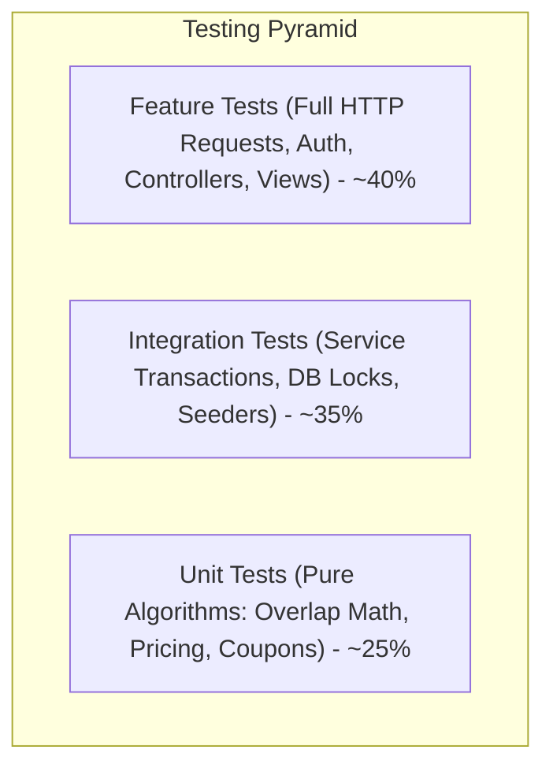
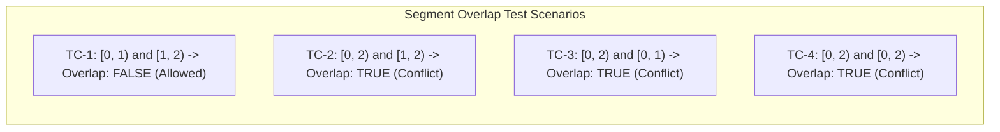

# 16 — Testing Strategy and Quality Assurance

## 1. Document Purpose
This document defines the comprehensive automated testing strategy, quality assurance benchmarks, and test scenarios for Oliver Transport. It establishes the testing methodology using the verified test harness (**Pest PHP 5.3** and `pest-plugin-laravel`) to guarantee data integrity, concurrency safety, and zero regression.

---

## 2. Scope
* **In Scope:** Automated Unit, Feature, Integration, Concurrency, and Boundary-Condition test specifications covering core domain services, controllers, policies, and database transactions for MVP.
* **Out of Scope:** Full-stack browser automation with Laravel Dusk (not installed in project dependencies) and third-party penetration testing audits.

---

## 3. Relevant Requirements

| ID | Quality & Testing Requirement | Classification | Specification Notes |
|---|---|---|---|
| TST-01 | Pest Test Suite Integration | **`[CONFIRMED]`** | Leverages installed `pestphp/pest` (^5.3) and `pest-plugin-laravel`. |
| TST-02 | 100% Coverage of Critical Business Math | **`[CONFIRMED]`** | Segment overlap theorem, coupon calculations, decimal precision. |
| TST-03 | Concurrency & Race Condition Verification | **`[CONFIRMED]`** | Automated verification of row locking under simulated concurrent booking. |
| TST-04 | Timezone & Daylight Saving Tests | **`[CONFIRMED]`** | Verified against `America/Toronto` Eastern Time. |
| TST-05 | Authorization & Role Sandbox Tests | **`[CONFIRMED]`** | Full policy coverage verifying IDOR prevention and role boundaries. |
| TST-06 | Verification of 4 Authoritative Decisions | **`[CONFIRMED]`** | Tests verifying `per_trip`, `both` coupons, `instant` booking, and `choose` seat. |

---

## 4. Test Pyramid & Execution Architecture



### Execution Commands
* **Run Entire Test Suite:**
  ```bash
  php artisan test
  # or directly via Pest:
  ./vendor/bin/pest
  ```
* **Run Specific Test Domain:**
  ```bash
  ./vendor/bin/pest tests/Feature/SeatAvailabilityTest.php
  ./vendor/bin/pest tests/Feature/BookingConcurrencyTest.php
  ./vendor/bin/pest tests/Unit/PricingServiceTest.php
  ```

---

## 5. Detailed Test Specifications by Domain

### 5.1 Authoritative Business Decisions Test Suite

| Test Identifier | Test Case Summary | Expected Behavior |
|---|---|---|
| `test_fare_model_is_strictly_per_trip_regardless_of_stops` | Books Montreal→Yorkdale, Montreal→Yonge, and Yorkdale→Yonge | All 3 bookings receive the exact same base fare ($65.00 regular or $55.00 promo CAD). No distance discounts. |
| `test_both_coupon_types_supported_percentage_and_fixed` | Validates 10% coupon and $10 CAD fixed coupon | Both calculate safe decimal deductions and persist on booking record. |
| `test_booking_is_instantly_confirmed_without_driver_approval` | Passenger submits valid booking | Immediately committed with `bookings.status = 'confirmed'` and `payments.status = 'unpaid'`. |
| `test_seat_selection_requires_manual_choice_no_auto_assignment` | Passenger selects S1; S1 claimed concurrently | Returns `HTTP 409 Conflict`; prompts user to pick another seat; does NOT auto-assign S2. |

---

### 5.2 Seat & Segment Overlap Tests (`tests/Unit/SeatAvailabilityTest.php`)



| Test Identifier | Test Case Summary | Expected Behavior |
|---|---|---|
| `test_empty_vehicle_has_six_available_seats` | Queries empty trip for segment `[0, 2)` | S1 through S6 all return `is_available = true`. |
| `test_sequential_adjacent_segment_reuse_permitted` | Booking 1 on `[0, 1)`; queries vacancy for `[1, 2)` on S1 | Seat S1 evaluated as **AVAILABLE**. |
| `test_overlapping_segment_detected_and_blocked` | Booking 1 on `[0, 2)`; queries vacancy for `[1, 2)` on S1 | Seat S1 evaluated as **UNAVAILABLE**. |
| `test_shared_trunk_segment_blocked_on_route_b` | Booking 1 on Yorkdale→Montreal `[0, 2)`; Booking 2 on Yonge→Montreal `[1, 2)` | Conflict detected; Seat evaluated as **UNAVAILABLE**. |
| `test_driver_seat_is_never_bookable` | Attempts to query or book seat with `is_driver_seat == 1` | System rejects request with `ModelNotFoundException`. |

---

### 5.3 Concurrency & Race-Condition Tests (`tests/Feature/BookingConcurrencyTest.php`)

```php
test('concurrent booking attempts for same seat result in exactly one booking and one conflict', function () {
    $trip = Trip::factory()->create();
    $seat = VehicleSeat::factory()->create(['vehicle_id' => $trip->vehicle_id, 'is_driver_seat' => false]);
    $passengerA = User::factory()->create(['role' => 'passenger']);
    $passengerB = User::factory()->create(['role' => 'passenger']);

    $resultA = null;
    $resultB = null;

    try {
        $resultA = app(BookingService::class)->createBooking([
            'user_id' => $passengerA->id,
            'trip_id' => $trip->id,
            'vehicle_seat_id' => $seat->id,
            'boarding_sequence' => 0,
            'dropoff_sequence' => 2,
            'idempotency_key' => (string) Str::uuid(),
        ]);
    } catch (\Throwable $e) {}

    try {
        $resultB = app(BookingService::class)->createBooking([
            'user_id' => $passengerB->id,
            'trip_id' => $trip->id,
            'vehicle_seat_id' => $seat->id,
            'boarding_sequence' => 1,
            'dropoff_sequence' => 2,
            'idempotency_key' => (string) Str::uuid(),
        ]);
    } catch (\Throwable $e) {}

    // Exactly one booking must succeed and one must fail
    expect(Booking::where('trip_id', $trip->id)->count())->toBe(1);
    expect($resultA xor $resultB)->toBeTrue();
});
```

---

### 5.4 16-Step Atomic Booking Transaction Tests (`tests/Feature/BookingTest.php`)

| Test Identifier | Test Case Summary | Expected Behavior |
|---|---|---|
| `test_16_step_booking_transaction_creates_all_records` | Submits valid booking request | Inserts `bookings`, `booking_seats`, `payments` (unpaid) atomically. |
| `test_multi_seat_booking_allocates_all_seats_atomically` | Reserves 2 seats (S1, S2) under 1 account | Creates 2 `booking_seats` records; calculates `base_fare = $110.00 CAD`; sets `seat_count = 2`. |
| `test_multi_seat_booking_rolls_back_if_any_seat_conflicts` | Requests S1 and S2, but S2 is occupied | Rolls back atomically; returns `HTTP 409 Conflict`; zero records created. |
| `test_transaction_rolls_back_if_payment_record_fails` | Simulates database error during payment step | Zero rows remain in `bookings` or `booking_seats`. |
| `test_booking_reference_is_unique_and_formatted` | Creates multiple bookings | All references match `OT-YYYY-XXXX` and exclude ambiguous characters. |
| `test_booking_preserves_historical_pricing_snapshot` | Price changes in config after booking created | Original booking retains initial booked fare snapshot. |
| `test_duplicate_submission_blocked_by_idempotency_key` | Submits identical payload twice with same key | Second submission returns `HTTP 409 Conflict`. |

---

### 5.5 Coupon & Pricing Tests (`tests/Unit/CouponServiceTest.php`)

| Test Identifier | Test Case Summary | Expected Behavior |
|---|---|---|
| `test_percentage_discount_calculated_safely` | Applies 10% coupon to $65.00 CAD base fare | Discount = $6.50 CAD; Net Fare = $58.50 CAD. |
| `test_fixed_discount_calculated_safely` | Applies $10.00 CAD coupon to $55.00 CAD base fare | Discount = $10.00 CAD; Net Fare = $45.00 CAD. |
| `test_discount_cannot_exceed_base_fare` | Applies $100.00 CAD coupon to $65.00 CAD fare | Discount capped at $65.00 CAD; Net Fare = $0.00 CAD. |
| `test_expired_coupon_rejected` | Submits coupon where `expires_at < now()` | Throws `CouponValidationException`. |
| `test_per_user_coupon_usage_limit_enforced` | User attempts to apply coupon for the 2nd time | Rejected when `max_uses_per_user = 1`. |
| `test_global_coupon_usage_limit_enforced` | Global usage reaches `max_total_uses` | Subsequent redemption attempts rejected under lock. |
| `test_failed_booking_does_not_consume_coupon` | Booking transaction fails during seat lock | `coupons.current_uses` remains unchanged. |

---

### 5.6 Payment & Cash Collection Tests (`tests/Feature/PaymentTest.php`)

| Test Identifier | Test Case Summary | Expected Behavior |
|---|---|---|
| `test_new_booking_defaults_to_unpaid_cash_payment` | Creates fresh booking | Associated `payments.status` is `'unpaid'`. |
| `test_rider_can_mark_cash_collected` | Rider clicks "Collect Cash" on assigned trip | Payment status updates to `'paid'`; logs `rider_id` & timestamp. |
| `test_rider_cannot_mark_cash_on_unassigned_trip` | Rider attempts to collect cash on another rider's trip | `HTTP 403 Forbidden` returned. |
| `test_paid_payment_cannot_be_re_collected` | Rider attempts duplicate collection on paid row | Rejected with validation conflict. |

---

### 5.7 Rider Portal & Manifest Tests (`tests/Feature/RiderTest.php`)

| Test Identifier | Test Case Summary | Expected Behavior |
|---|---|---|
| `test_rider_sees_only_assigned_trips_for_today` | Multiple trips exist; only 2 assigned to rider | Dashboard shows only the 2 assigned runs. |
| `test_manifest_displays_passengers_ordered_by_stops` | Manifest rendered for Route A | Metro Namur passengers listed before Yorkdale passengers. |
| `test_rider_can_transition_trip_to_in_progress` | Rider clicks "Start Trip" | `trips.status` updates to `'in_progress'`. |
| `test_rider_cannot_modify_scheduled_departure_time` | Rider sends POST to update trip time | Endpoint returns `HTTP 404` or `403` (Action not supported). |

---

### 5.8 Unified Authentication & Role Redirection Tests (`tests/Feature/AuthTest.php`)

| Test Identifier | Test Case Summary | Expected Behavior |
|---|---|---|
| `test_shared_login_page_renders_successfully` | Guest accesses `GET /login` | Returns `HTTP 200` with unified login form. |
| `test_shared_login_redirects_passenger_to_dashboard` | Passenger logs in via `/login` | `HTTP 302` redirect to `/passenger/dashboard`. |
| `test_shared_login_redirects_rider_to_rider_dashboard` | Rider logs in via `/login` | `HTTP 302` redirect to `/rider/dashboard`. |
| `test_shared_login_redirects_operator_to_operator_dashboard` | Operator logs in via `/login` | `HTTP 302` redirect to `/operator/dashboard`. |
| `test_unauthenticated_user_redirected_to_shared_login` | Guest attempts `/rider/dashboard` or `/passenger/dashboard` | Redirects to `/login`. |
| `test_passenger_cannot_access_rider_dashboard_returns_403` | Authenticated Passenger accesses `/rider/dashboard` | Intercepted by `RoleMiddleware`; returns `HTTP 403 Forbidden`. |
| `test_rider_cannot_access_passenger_booking_creation_returns_403` | Authenticated Rider accesses `/passenger/bookings/create` | Intercepted by `RoleMiddleware`; returns `HTTP 403 Forbidden`. |
| `test_legacy_rider_login_route_does_not_exist` | Request to `GET /rider/login` | Returns `HTTP 404 Not Found` (unified `/login` only). |

---

### 5.9 Mobile-First & iPhone Safari Quality Assurance Benchmarks (Implementation Guidance)

During feature development and prior to Sprint production sign-off, frontend acceptance testing must verify mobile-first ergonomics and iPhone Safari compatibility against the following benchmarks:

1. **Safe-Area Inset Inspection:** Confirm sticky headers and bottom checkout bars on iPhone (with notch, Dynamic Island, and home indicator bar) have proper padding (`env(safe-area-inset-*)`).
2. **Dynamic Viewport Height:** Ensure page heights use `100dvh` (with `100vh` fallback) so that scrolling and bottom CTAs are not concealed beneath the Safari URL bar.
3. **No Auto-Zoom Verification:** Verify that tapping into every text, date, and email input field does NOT cause the Safari viewport to auto-zoom (font size must be at least 16px / `text-base`).
4. **Touch Target Measurement:** Verify that all general interactive controls have a tap footprint of minimum 44 × 44 CSS pixels; seat selection tiles must target approximately 48 × 48 CSS pixels or larger.
5. **Horizontal Overflow Prevention:** Verify responsive layouts prevent unintended horizontal overflow on small screens (360px, 375px, 390px, 428px). Avoid global `overflow-x: hidden` that clips essential content or interactive elements; permit intentional horizontal scrolling only for components that genuinely require it (e.g., data tables).
6. **Physical / Simulator Device Testing:** Testing on real iPhone devices or Xcode iOS Simulator (Safari iOS 17+) is required as part of Sprint acceptance before release.

---

### 5.10 Layered Architecture, Form Requests & N+1 Query Elimination Tests

To maintain strict adherence to Oliver Transport's service-oriented Laravel architecture, dedicated tests enforce layer boundaries, request validation, and query performance:

#### 1. Form Request Validation Testing
Every Form Request class is tested independently to guarantee input sanitization and validation coverage:
* `CreateBookingRequestTest`: Validates required fields, stop sequence validity (`boarding < dropoff`), and UUID format.
* `ApplyCouponRequestTest`: Validates uppercase normalization, non-empty string format, and guest/passenger authorization.
* `CollectCashPaymentRequestTest`: Validates that non-riders or unassigned riders receive `HTTP 403 Forbidden` at the request level.

#### 2. Domain Service Isolation Testing
Services are tested directly without HTTP overhead to verify pure business logic and transaction boundaries:
* `BookingServiceTest`: Asserts that `BookingService::createBooking()` executes Steps 5–16 atomically, releasing locks on failure and persisting all 4 relational entities on success.
* `SeatAvailabilityServiceTest`: Tests pure mathematical interval-overlap logic across all route segments.
* `PricingServiceTest`: Asserts fixed $55.00 promo and $65.00 standard CAD base fare calculation under the `per_trip` model.

#### 3. Strict N+1 Query Elimination & Lazy Loading Tests
To guarantee compliance with `NFR-13`:
* **Lazy Loading Exception Guard:** In test environments, `Model::preventLazyLoading(true)` ensures any un-eager-loaded relation access immediately throws a `LazyLoadingViolationException`.
* **Query Count Assertions:** Key endpoints are benchmarked to enforce bounded query counts regardless of passenger or seat volume:

```php
test('trip search and seat picker execute bounded queries with zero N+1', function () {
    $trip = Trip::factory()->has(VehicleSeat::factory()->count(7))->create();
    Booking::factory()->count(5)->create(['trip_id' => $trip->id]);

    DB::enableQueryLog();

    $response = $this->get(route('trips.seats', [
        'trip' => $trip->id,
        'boarding_stop_id' => 1,
        'dropoff_stop_id' => 3,
    ]));

    $response->assertOk();

    // Query count must remain constant (<= 4 queries) regardless of booking/seat count
    expect(count(DB::getQueryLog()))->toBeLessThanOrEqual(4);
});
```

---

## 6. Continuous Integration & Quality Gate

Prior to deploying or merging any feature branch, the following automated quality checks must pass:

```bash
# 1. Enforce PSR-12 code style:
./vendor/bin/pint --test

# 2. Run complete Pest test suite:
php artisan test --parallel
```

---

## 7. Related Documents
* [`08-booking-workflow.md`](./08-booking-workflow.md) — 16-step transaction workflow.
* [`09-seat-management.md`](./09-seat-management.md) — Segment availability math.
* [`10-coupon-and-pricing.md`](./10-coupon-and-pricing.md) — Pricing and coupon business rules.
* [`15-security-guidelines.md`](./15-security-guidelines.md) — Security policies and validation.
