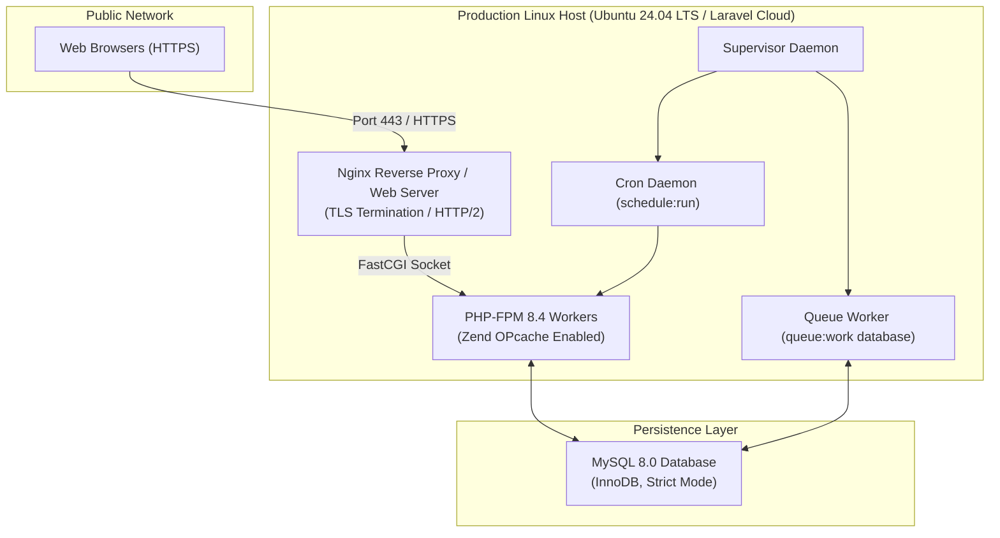

# 17 — Deployment and Operational Infrastructure Guide

## 1. Document Purpose
This document specifies the hosting requirements, environment configurations, automated deployment pipeline, background job workers, scheduler setup, and disaster recovery procedures for deploying **Oliver Transport** into a production environment.

---

## 2. Scope
* **In Scope:** Production stack specifications, server provisioning, environment variable hardening, build pipelines, database migrations, scheduler crons, and background workers for MVP.
* **Out of Scope:** Multi-region geo-redundancy, Kubernetes Helm charts, and containerized microservice service meshes.

---

## 3. Relevant Requirements

| ID | Operational Requirement | Classification | Specification Notes |
|---|---|---|---|
| DEP-01 | PHP 8.4 Production Runtime | **`[CONFIRMED]`** | PHP 8.4 with BCMath, PDO-MySQL, OPcache, Mbstring, OpenSSL. |
| DEP-02 | MySQL 8.0+ Database Server | **`[CONFIRMED]`** | InnoDB engine, strict mode enabled, UTF8mb4 encoding. |
| DEP-03 | Build Asset Compilation | **`[CONFIRMED]`** | Vite 8.0 with Tailwind CSS v4 assets compiled via `npm run build`. |
| DEP-04 | Native Task Scheduling | **`[CONFIRMED]`** | Single cron entry executing `php artisan schedule:run` every minute. |
| DEP-05 | Queue Worker Management | **`[CONFIRMED]`** | Supervisor-managed queue worker executing `php artisan queue:work database`. |
| DEP-06 | Production Caching | **`[CONFIRMED]`** | Config, route, and view caches compiled during deployment. |

---

## 4. Production Hosting Architecture



---

## 5. Production Environment Configuration (`.env`)

The production `.env` must be hardened with debugging disabled and strict operational parameters:

```ini
APP_NAME="Oliver Transport"
APP_ENV=production
APP_KEY=base64:GENERATE_NEW_UNIQUE_PRODUCTION_KEY_DO_NOT_REUSE_DEV
APP_DEBUG=false
APP_URL=https://olivertransport.ca
APP_TIMEZONE=America/Toronto

APP_LOCALE=en
APP_FALLBACK_LOCALE=en

BCRYPT_ROUNDS=12

LOG_CHANNEL=daily
LOG_LEVEL=warning

DB_CONNECTION=mysql
DB_HOST=127.0.0.1
DB_PORT=3306
DB_DATABASE=oliver_transport_prod
DB_USERNAME=oliver_db_user
DB_PASSWORD="SECURE_COMPLEX_DATABASE_PASSWORD"

SESSION_DRIVER=database
SESSION_LIFETIME=120
SESSION_ENCRYPT=false
SESSION_SECURE_COOKIE=true

QUEUE_CONNECTION=database
CACHE_STORE=database

MAIL_MAILER=smtp
MAIL_HOST=smtp.mailgun.org
MAIL_PORT=587
MAIL_USERNAME=postmaster@olivertransport.ca
MAIL_PASSWORD=SECURE_MAIL_PASSWORD
MAIL_ENCRYPTION=tls
MAIL_FROM_ADDRESS="info@olivertransport.ca"
MAIL_FROM_NAME="Oliver Transport"
```

---

## 6. Standard Deployment Pipeline

Deployments should execute through an automated script or CI/CD runner (GitHub Actions / Forge / Laravel Cloud):

```bash
#!/usr/bin/env bash
set -e

echo ">>> 1. Entering application directory..."
cd /var/www/oliver-transport

echo ">>> 2. Activating maintenance mode..."
php artisan down --render="errors::503" --secret="oliver-maintenance-bypass"

echo ">>> 3. Fetching latest release..."
git pull origin main

echo ">>> 4. Installing Composer dependencies..."
composer install --no-dev --optimize-autoloader --no-interaction

echo ">>> 5. Compiling frontend assets..."
npm ci --ignore-scripts
npm run build

echo ">>> 6. Executing database migrations..."
php artisan migrate --force

echo ">>> 7. Seeding initial baseline data (if fresh)..."
php artisan db:seed --class=BaselineProductionSeeder --force

echo ">>> 8. Rebuilding application caches..."
php artisan config:cache
php artisan route:cache
php artisan view:cache

echo ">>> 9. Restarting background queue workers..."
php artisan queue:restart

echo ">>> 10. Reloading PHP-FPM..."
sudo systemctl reload php8.4-fpm

echo ">>> 11. Deactivating maintenance mode..."
php artisan up

echo ">>> Deployment successfully completed!"
```

---

## 7. Automated Task Scheduling (Cron)

A single cron entry on the server drives all periodic operations:

```crontab
* * * * * cd /var/www/oliver-transport && php artisan schedule:run >> /dev/null 2>&1
```

### Scheduled Tasks Configured in `routes/console.php`:
* **`trips:generate --days=14`:** Runs daily at **00:05 AM America/Toronto**. Generates upcoming scheduled trips to maintain a rolling 14-day reservation window.
* **`model:prune`:** Runs daily at **02:00 AM America/Toronto**. Cleans expired password reset tokens and stale database sessions.
* **`backup:run`:** Runs daily at **03:00 AM America/Toronto**. Generates encrypted database snapshots.

---

## 8. Background Queue Worker (Supervisor Configuration)

Queue workers process asynchronous notifications, emails, and logging tasks using the database queue driver:

```ini
[program:oliver-worker]
process_name=%(program_name)s_%(process_num)02d
command=php /var/www/oliver-transport/artisan queue:work database --sleep=3 --tries=3 --timeout=90 --max-time=3600
autostart=true
autorestart=true
stopasgroup=true
killasgroup=true
user=www-data
numprocs=2
redirect_stderr=true
stdout_logfile=/var/log/supervisor/oliver-worker.log
stopwaitsecs=3600
```

---

## 9. Backup & Disaster Recovery Strategy

1. **Automated Daily Backups:**
   * Compressed mysqldump of `oliver_transport_prod` executed every night at 03:00 AM.
   * Backups copied offsite to an S3-compatible cold storage bucket.
   * Retention: Keep daily backups for 30 days, weekly backups for 12 weeks.
2. **Point-In-Time Recovery:**
   * MySQL binary logging (`binlog`) enabled on production server.
   * Allows recovery of transactional data up to the exact minute of failure.

---

## 10. Related Documents
* [`06-system-architecture.md`](./06-system-architecture.md) — Technical layers and dependencies.
* [`07-database-design.md`](./07-database-design.md) — Database schema requirements.
* [`18-notification-strategy.md`](./18-notification-strategy.md) — Notification queue configuration.

