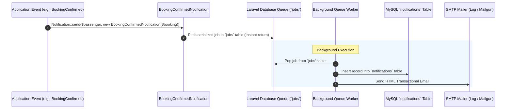

# 18 — Notification Strategy

## 1. Document Purpose
This document defines the notification architecture, event triggers, delivery channels, and transactional message templates for Oliver Transport. It outlines a lean, reliable strategy utilizing native Laravel notification capabilities without incurring paid third-party messaging costs during the MVP launch.

---

## 2. Scope
* **In Scope:** Native Laravel notifications utilizing `database` and `mail` (via log / standard SMTP) channels, queued asynchronous dispatch, and passenger dashboard alert bells for MVP.
* **Out of Scope:** Paid SMS delivery gateways (Twilio, Vonage), WhatsApp Business Cloud API, push notifications, and automated telematics dispatch alerts (deferred to Phase 3).

---

## 3. Relevant Requirements

| ID | Notification Requirement | Classification | Specification Notes |
|---|---|---|---|
| NTF-01 | Native Laravel Notification Infrastructure | **`[CONFIRMED]`** | Uses `Illuminate\Notifications\Notification` with `ShouldQueue`. |
| NTF-02 | Zero Paid External API Dependencies in MVP | **`[CONFIRMED]`** | No Twilio, WhatsApp, or paid SMS integrations in Phase 1. |
| NTF-03 | Database & Email Delivery Channels | **`[CONFIRMED]`** | Stores alerts in `notifications` table; sends transactional emails. |
| NTF-04 | Booking Confirmation Notification | **`[CONFIRMED]`** | Delivers booking reference, seat number, station, time, and cash amount due. |
| NTF-05 | Cash Payment Collection Notification | **`[CONFIRMED]`** | Dispatched to passenger when Rider logs physical cash payment. |
| NTF-06 | Booking Cancellation Notification | **`[PROPOSED]`** | Dispatched when a reservation is cancelled. |
| NTF-07 | Day-Of Departure Reminder | **`[PROPOSED]`** | Scheduled reminder 2 hours prior to scheduled departure. |

---

## 4. Notification Architecture & Queueing

To preserve high performance and keep booking transactions under 350 ms, all notifications implement `ShouldQueue` and are processed asynchronously by the background database queue worker.

---

## 5. Transactional Notification Catalog

### 5.1 `BookingConfirmedNotification`
* **Trigger:** Dispatched immediately upon commit of the 16-step booking transaction.
* **Recipient:** Authenticated Passenger (`User`).
* **Channels:** `['database', 'mail']`
* **Content Elements:**
  * Greeting: *"Hello [Passenger Name], your seat on Oliver Transport is confirmed!"*
  * Unique Booking Reference: `OT-2026-XXXX`
  * Date of Travel: `YYYY-MM-DD`
  * Route: *Montreal (Metro Namur) → Toronto (Yorkdale / Yonge)*
  * Scheduled Departure: `06:30 AM Eastern Time`
  * Assigned Cabin Seat: `Seat S1 (Front Passenger)`
  * Settlement Due: `CAD $55.00 (Cash upon boarding)`
  * Boarding Instructions: *"Please arrive at Station Metro Namur 15 minutes prior to departure."*

---

### 5.2 `PaymentReceivedNotification`
* **Trigger:** Dispatched when the assigned Rider marks the passenger's cash payment as `paid`.
* **Recipient:** Authenticated Passenger (`User`).
* **Channels:** `['database', 'mail']`
* **Content Elements:**
  * Greeting: *"Payment Receipt — Oliver Transport"*
  * Message: *"Your cash payment of CAD $55.00 has been collected by your driver. Thank you for traveling with us!"*
  * Booking Reference: `OT-2026-XXXX`
  * Status: `PAID (Cash)`

---

### 5.3 `BookingCancelledNotification`
* **Trigger:** Dispatched when a reservation is cancelled prior to cutoff.
* **Recipient:** Authenticated Passenger (`User`).
* **Channels:** `['database', 'mail']`
* **Content Elements:**
  * Subject: *"Booking Cancellation Notice — Oliver Transport"*
  * Message: *"Your reservation OT-2026-XXXX for [Date] has been successfully cancelled. Your seat has been released."*

---

### 5.4 `TripDepartureReminderNotification` `[PROPOSED]`
* **Trigger:** Scheduled task runs 2 hours prior to scheduled departure.
* **Recipient:** All passengers on today's upcoming trip.
* **Channels:** `['mail']`
* **Content Elements:**
  * Subject: *"Reminder: Your Oliver Transport Shuttle departs in 2 hours"*
  * Details: Departure station map, pickup time, exact cash preparation reminder.

---

## 6. Email Layout & Visual Template

Emails are styled cleanly using Laravel's Markdown Mail components styled to reflect the Oliver Transport brand:
* Header: Dark green `#08140E` banner with white Oliver Transport logo.
* Callout Card: Highlighted reservation voucher block with neon green border `#00FF66`.
* Details Table: Monospaced seat numbers, timestamps, station names, and cash due.
* Footer: Contact telephone line and support email (`info@olivertransport.ca`).

---

## 7. Business Rules

* **BR-NTF-01 (Non-Blocking Dispatch):** Mail or network failures must never block or roll back a completed database booking transaction.
* **BR-NTF-02 (Zero Spam Policy):** Transactional notifications must strictly communicate operational travel information. No unsolicited promotional emails may be dispatched without user opt-in.

---

## 8. Related Documents
* [`08-booking-workflow.md`](./08-booking-workflow.md) — Booking transaction event dispatch.
* [`11-rider-management.md`](./11-rider-management.md) — Rider cash collection trigger.
* [`17-deployment-guide.md`](./17-deployment-guide.md) — Queue worker and mail server configuration.

