# 19 — Future Roadmap & Strategic Evolution

## 1. Document Purpose
This document defines the strategic post-MVP evolution roadmap for Oliver Transport. It delineates the phased release cycles across Phase 2 (Administrative Control), Phase 3 (Commercial Payments & Messaging), and Phase 4 (Fleet Scaling & Telematics), ensuring the MVP database and architecture remain forward-compatible without structural rework.

---

## 2. Scope
* **In Scope:** Strategic capability planning, phased architecture migration paths, architectural forward-compatibility rules, and feature allocations for Phases 2, 3, and 4.
* **Out of Scope:** Implementation commitments or engineering allocation for post-MVP phases during the current MVP sprint.

---

## 3. Phased Strategic Roadmap

```mermaid
flowchart LR
    subgraph P1["Phase 1: MVP (Launch)"]
        direction TB
        P1A["Fixed 3 Stations & 2 Routes"]
        P1B["1 Vehicle (6 Passenger Seats)"]
        P1C["Cash-Only Settlement"]
        P1D["Instant Booking Engine"]
        P1E["Mobile Rider Manifest Panel"]
    end

    subgraph P2["Phase 2: Governance"]
        direction TB
        P2A["Web Admin CMS Panel"]
        P2B["Dynamic Route & Stop Manager"]
        P2C["Dynamic Timetable Scheduler"]
        P2D["Web Coupon & Rider Manager"]
    end

    subgraph P3["Phase 3: Commerce"]
        direction TB
        P3A["Stripe / Moneris Online Payments"]
        P3B["Automated Electronic Refunds"]
        P3C["Twilio SMS & WhatsApp Dispatch"]
        P3D["Customer Loyalty Engine"]
    end

    subgraph P4["Phase 4: Fleet & Apps"]
        direction TB
        P4A["Multi-Vehicle Dispatching"]
        P4B["Live GPS Vehicle Map Tracking"]
        P4C["Native iOS & Android Apps"]
        P4D["Corridor Expansion (Ottawa / QC)"]
    end

    P1 --> P2 --> P3 --> P4
```

---

## 4. Phase 2: Administrative Control & Governance

### 4.1 Web-Based Admin Management Panel
* **Purpose:** Eliminate reliance on Artisan CLI commands and database seeders by providing business operators with a comprehensive web portal.
* **Proposed Stack:** Laravel Filament 4 or a dedicated Blade administrative module.
* **Key Capabilities:**
  * **Dashboard Analytics:** Daily revenue KPIs, passenger volume, vehicle occupancy percentages, and coupon redemption statistics.
  * **Dynamic Route & Station Manager:** Create and edit stations, modify GPS coordinates, configure stop sequence hierarchies, and define allowed boarding/drop-off rules.
  * **Schedule & Timetable Manager:** Configure recurring daily, weekly, or seasonal timetable templates.
  * **Fleet Management Interface:** Add new vehicles, register license plates, configure seat layouts (e.g., 6-seat van vs. 12-seat mini-coach).
  * **Rider Management Portal:** Onboard new drivers, issue credentials, and assign riders to specific dated trips.
  * **Coupon Management UI:** Interactive coupon creator with real-time redemption counters, date pickers, and instant deactivation toggles.
  * **Manual Booking Intervention:** Customer support tools to reschedule passengers, change seat assignments, or issue administrative cancellations.

---

## 5. Phase 3: Commercial Scaling & Online Payments

### 5.1 Online Payment Gateway Integration
* **Gateways:** Stripe, Moneris (Canadian domestic leader), Apple Pay, Google Pay, and Interac e-Transfer.
* **Dual Settlement Options:** Allow passengers to choose between **"Pay Now Online (Card)"** or **"Pay Cash upon Boarding"**.
* **Merchant Settlement:** Automated end-of-day reconciliation and payout tracking.

### 5.2 Automated Cancellation & Electronic Refunds
* Integration with payment gateway APIs to automatically execute partial or full refunds based on customer cancellation timing:
  * Cancel > 24 hours prior: 100% automated refund.
  * Cancel 2 to 24 hours prior: 80% refund (20% late cancellation fee).
  * Cancel < 2 hours prior: No refund.

### 5.3 SMS & WhatsApp Messaging Dispatch
* **Twilio SMS / WhatsApp Business Cloud API Integration:**
  * Automated SMS confirmation voucher with direct link to digital boarding pass.
  * Automated driver dispatch alert: *"Your driver John is 10 minutes away from Metro Namur in van QC 123-ABC"*.
  * Automated delay notices in the event of highway traffic.

---

## 6. Phase 4: Fleet Scaling, Live Telematics & Mobile Apps

### 6.1 Live GPS Vehicle Tracking & Real-Time Mapping
* IoT OBD-II telematics device or driver smartphone GPS streaming.
* Real-time WebSocket connection (Laravel Reverb / Pusher) pushing van coordinates to the passenger web dashboard.
* Dynamic Google Maps / Mapbox display showing real-time ETA based on Highway 401 / Autoroute 20 traffic conditions.

### 6.2 Multi-Vehicle Fleet Dispatching
* Ability to operate multiple shuttle vans departing simultaneously during peak Friday/Sunday demand windows.
* Intelligent load balancing allocating passenger bookings across Van 1, Van 2, and Van 3.

### 6.3 Native Mobile Applications (iOS & Android)
* Cross-platform mobile apps built with React Native or Flutter.
* Push notifications for trip updates, offline mobile boarding passes with Apple Wallet and Google Wallet passes.

### 6.4 Geographic Intercity Corridor Expansion
* Expansion beyond Montreal ↔ Toronto to include:
  * Montreal ↔ Ottawa
  * Toronto ↔ Kingston
  * Montreal ↔ Quebec City

---

## 7. Architectural Forward-Compatibility Checklist

The MVP database design and service architecture were specifically engineered to absorb future phases without breaking changes:

| Future Requirement | MVP Schema Preparation |
|---|---|
| Multiple Vehicles | `trips` and `schedules` already hold `vehicle_id` foreign keys; ready for multi-van expansion without schema alteration. |
| Dynamic Routes & Stops | `route_stops` uses indexed integer sequences; new stations can be added dynamically without altering booking queries. |
| Online Card Payments | `payments` entity stores `payment_method` (`'cash'` currently, ready for `'stripe'`) and status fields; gateway transaction IDs can be added via simple migration. |
| Admin Governance | `users.role` enum/column already reserves `'operator'` / `'admin'`; policies ready for role expansion. |

---

## 8. Related Documents
* [`01-project-scope.md`](./01-project-scope.md) — Scope matrix and MVP boundaries.
* [`06-system-architecture.md`](./06-system-architecture.md) — Monolithic architectural foundation.
* [`07-database-design.md`](./07-database-design.md) — Relational schema compatibility.

