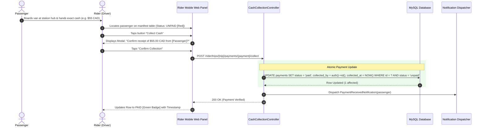

# Workflow: Cash Payment Collection and Logging

## 1. Workflow Purpose
This document specifies the operational procedure, mobile UI interactions, database audit updates, and error handling for in-person cash payment collection by Oliver Transport drivers ("Riders").

---

## 2. Participants
* **Passenger:** Traveler boarding the shuttle van with physical cash.
* **Rider (Driver):** Authenticated fleet driver operating the shuttle van.
* **Rider Panel UI:** Mobile web interface displaying the live manifest.
* **Cash Collection Controller (`Rider\CashCollectionController`):** Backend endpoint coordinator.
* **Database (MySQL):** Persistence layer auditing the payment transaction.

---

## 3. Sequence Diagram



---

## 4. Detailed Step-by-Step Execution

1. **Boarding Verification:**
   * Passenger arrives at the scheduled station (Metro Namur, Yorkdale, or Yonge Station).
   * Driver checks passenger name and assigned cabin seat (`S1` to `S6`).
2. **Cash Tendering:**
   * Passenger provides cash matching the exact net fare recorded on the manifest.
3. **Driver Confirmation:**
   * Driver opens `/rider/trips/{trip}` on their smartphone.
   * The passenger's row displays a prominent red badge: `UNPAID ($55.00 CAD)`.
   * Driver taps the green action button: **"Collect Cash"**.
4. **Modal Safeguard:**
   * A confirmation dialog prevents accidental taps: *"Confirm receipt of $55.00 CAD cash from Alice Tremblay?"*
5. **Database Audit Update:**
   * The system verifies that the authenticated user is the assigned driver (`trip.rider_id === auth()->id()`).
   * The payment record is updated:
     ```sql
     UPDATE payments
     SET status = 'paid',
         collected_by = :rider_user_id,
         collected_at = NOW()
     WHERE id = :payment_id AND status = 'unpaid';
     ```
6. **Instant UI Feedback:**
   * The red `UNPAID` badge transforms into a green `PAID` badge displaying the collection time (e.g., *"Paid at 06:28 AM"*).
7. **Customer Receipt:**
   * Asynchronous notification dispatched to the passenger's dashboard and email confirming physical settlement.

---

## 5. Discrepancy & Exception Handling
* **Duplicate Tap Protection:** If a driver accidentally double-taps the button, the SQL update condition `status = 'unpaid'` prevents double processing.
* **No-Show Passenger:** If a passenger fails to arrive, the payment status remains permanently `unpaid`. The driver can proceed without collecting cash, and the record remains flagged for operator audit.

---

## 6. Related Documents
* [`07-database-design.md`](../07-database-design.md) — Table schema for `payments`.
* [`11-rider-management.md`](../11-rider-management.md) — Comprehensive Rider module specifications.
* [`12-payment-and-cancellation.md`](../12-payment-and-cancellation.md) — Cash payment lifecycle.

