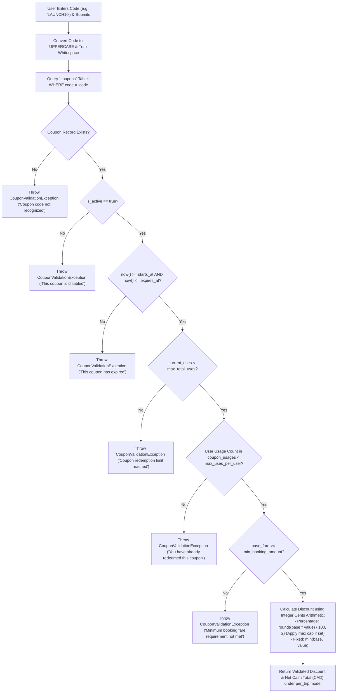

# Workflow: Coupon Validation and Redemption

## 1. Workflow Purpose
This document specifies the validation workflow, boundary condition evaluation, decimal discount calculation, and concurrency controls governing promotional coupon redemption in Oliver Transport.

---

## 2. Validation Flowchart



---

## 3. Two-Stage Coupon Execution

The coupon engine operates across two distinct stages:

### Stage 1: Public Preview (AJAX Endpoint `/api/coupons/validate`)
* **Purpose:** Provides instantaneous feedback in the booking UI when the user types a coupon code.
* **Mode:** Read-only evaluation (no database locks acquired; no usage counters incremented).
* **Response:** Returns JSON containing discount amount and adjusted final fare under the `per_trip` model.

### Stage 2: Transactional Redemption (Step 9 & 14 of `BookingService`)
* **Purpose:** Authoritatively redeems the coupon during the 16-step atomic booking transaction.
* **Execution:**
  1. In Step 9, acquires row lock: `SELECT * FROM coupons WHERE code = ? FOR UPDATE`.
  2. Re-verifies all limit criteria under active lock.
  3. In Step 14, increments `coupons.current_uses = current_uses + 1`.
  4. Inserts row into `coupon_usages` capturing `coupon_id`, `booking_id`, `user_id`, and exact `discount_applied`.
  5. Commits alongside the booking record. If the transaction rolls back, the increment and usage row automatically roll back.

---

## 4. Decimal-Safe Discount Calculation Logic

```php
public function calculateDiscount(Coupon $coupon, float $baseFare): array
{
    $baseCents = (int) round($baseFare * 100);

    if ($coupon->discount_type === 'percentage') {
        $discountCents = (int) round($baseCents * ($coupon->discount_value / 100));
        
        if ($coupon->max_discount_amount) {
            $maxCents = (int) round($coupon->max_discount_amount * 100);
            $discountCents = min($discountCents, $maxCents);
        }
    } else {
        $discountCents = (int) round($coupon->discount_value * 100);
    }

    // Floor guard: discount cannot exceed base fare
    $discountCents = min($discountCents, $baseCents);
    $finalCents    = $baseCents - $discountCents;

    return [
        'discount_amount' => round($discountCents / 100, 2),
        'final_fare'      => round($finalCents / 100, 2),
    ];
}
```

---

## 5. Related Documents
* [`07-database-design.md`](../07-database-design.md) — Schemas for `coupons` and `coupon_usages`.
* [`08-booking-workflow.md`](../08-booking-workflow.md) — 16-step transaction lifecycle.
* [`10-coupon-and-pricing.md`](../10-coupon-and-pricing.md) — Comprehensive pricing and discount rules.
* [`16-testing-strategy.md`](../16-testing-strategy.md) — Automated coupon test cases.
