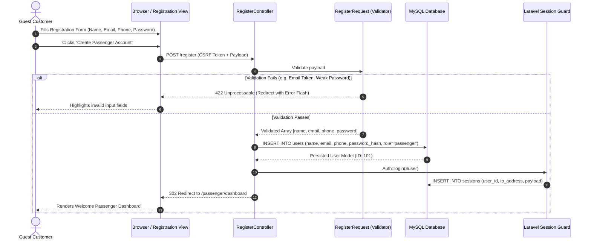

# Workflow: Passenger Registration and Authentication

## 1. Workflow Purpose
This document specifies the step-by-step sequential workflow, validation rules, state transitions, and error handling for customer account registration, authentication, session establishment, and password recovery in Oliver Transport.

---

## 2. Participants
* **Customer / Guest:** Unauthenticated public user on mobile or desktop browser.
* **Registration Controller (`app/Http/Controllers/Auth/RegisterController`):** HTTP request coordinator.
* **RegisterRequest (`app/Http/Requests/Auth/RegisterRequest`):** Server-side input validation.
* **User Model (`app/Models/User`):** Persistence entity in MySQL database.
* **Laravel Auth Guard:** Session manager storing credentials in database sessions.

---

## 3. Sequence Diagram

---

## 4. Detailed Step-by-Step Execution

1. **Guest Access:** Customer navigates to `/register` or is directed there after configuring travel details on the homepage.
2. **Form Presentation (Mobile-First / iPhone Safari Ergonomics):** Browser renders registration fields:
   * Full Name (`name`): `type="text" autocomplete="name"`.
   * Email Address (`email`): `type="email" inputmode="email" autocomplete="email" autocapitalize="none"`.
   * Mobile Telephone (`phone`): `type="tel" inputmode="tel" autocomplete="tel"`.
   * Password (`password`) & Confirmation (`password_confirmation`): `type="password"`.
   * *iOS Safari Standard:* All inputs enforce `font-size: 16px` (`text-base`) to prevent auto-zooming.
3. **Input Validation (`RegisterRequest`):**
   * `name`: `['required', 'string', 'max:255']`
   * `email`: `['required', 'string', 'email:rfc,dns', 'max:255', 'unique:users,email']`
   * `phone`: `['required', 'string', 'regex:/^(\+?1[ -]?)?\(?([0-9]{3})\)?[ -]?([0-9]{3})[ -]?([0-9]{4})$/']` (Canadian/US format)
   * `password`: `['required', 'confirmed', Password::min(8)->letters()->numbers()]`
4. **Account Creation:**
   * Password hashed using Bcrypt (`Hash::make($password)` with 12 rounds).
   * User record created with strict default: `role = 'passenger'`.
5. **Session Establishment & Unified Auth Integration:**
   * Session ID regenerated (`$request->session()->regenerate()`) to prevent session fixation attacks.
   * User ID bound to session in the `sessions` database table.
   * On subsequent sessions, passenger logs in via the unified `/login` page alongside other roles, and the system automatically redirects to `/passenger/dashboard`.
6. **Redirect:** User redirected to `/passenger/dashboard` (or intended booking checkout) with success flash message: *"Your account has been created successfully."*

---

## 5. Security & Error Handling
* **Rate Limiting:** IP-level throttling limits registration attempts to 5 per hour (`throttle:5,60`).
* **Mass-Assignment Guard:** Role field is hardcoded in the controller and excluded from `$fillable`.
* **Session Invalidation:** Logging out (`POST /logout`) flushes session tokens and invalidates the database session row.

