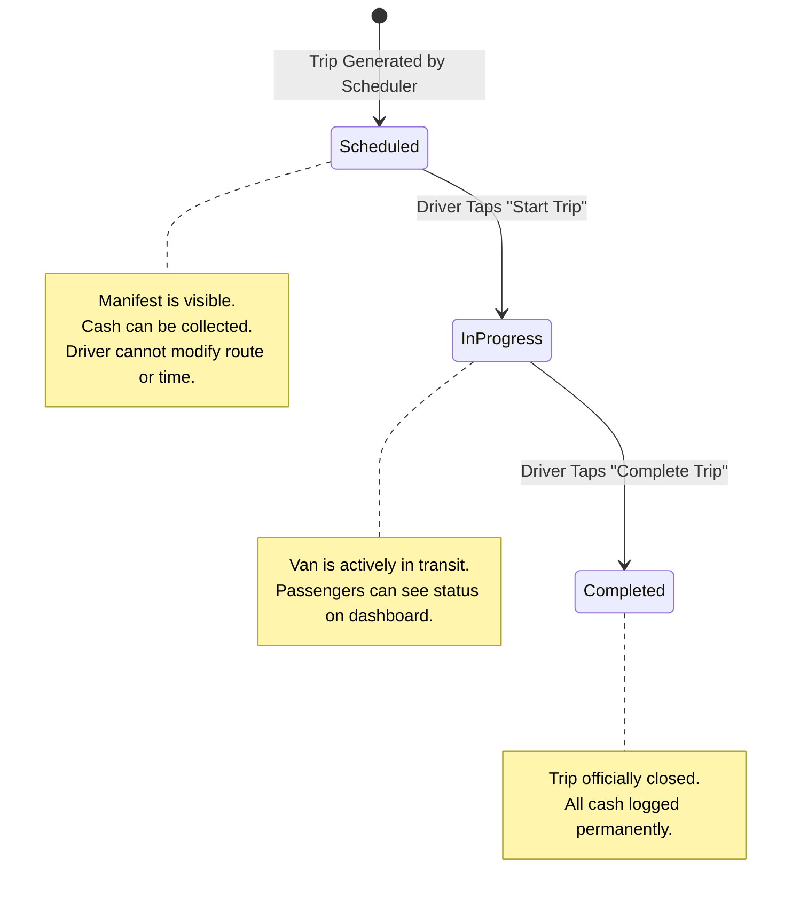

# Workflow: Rider Trip Operations and Manifest Management

## 1. Workflow Purpose
This document specifies the operational lifecycle followed by commercial shuttle drivers ("Riders") during daily operations, covering morning departure, passenger manifest coordination, route stop progression, and end-of-day trip completion.

---

## 2. Participants
* **Rider (Commercial Driver):** Assigned operator of the shuttle van.
* **Rider Dashboard (`Rider\DashboardController`):** Daily overview of assigned runs.
* **Trip Manifest Controller (`Rider\TripManifestController`):** Stop-by-stop passenger coordinator.
* **Trip Status Controller (`Rider\TripStatusController`):** State transition coordinator.
* **Database (MySQL):** Source of truth for trips, manifests, and payments.

---

## 3. Daily Operational Flowchart

```mermaid
flowchart TD
    Login["1. Driver Logs In at /login (Unified Login) -> Auto-redirects to /rider/dashboard"] --> Dash["2. Opens Rider Dashboard: Views Today's Assigned Trips"]
    
    subgraph RouteA["Morning Service: Route A (Montreal -> Toronto)"]
        Dash --> OpenManifestA["3. Opens Manifest for Route A (Departs 06:30 AM)"]
        OpenManifestA --> InspectPaxA["4. Reviews Manifest: 5 Passengers (Names, Seats S1-S6, Phones)"]
        InspectPaxA --> BoardA["5. Passengers Board at Metro Namur -> Collect Cash ($55 CAD each)"]
        BoardA --> StartTripA["6. Driver Taps 'Start Trip' (Status: in_progress) -> Drives Hwy 401"]
        StartTripA --> DropYorkdale["7. Arrives Yorkdale Mall (~11:45 AM) -> Discharges Passenger"]
        DropYorkdale --> DropYonge["8. Arrives Yonge Station (~12:30 PM) -> Discharges Remaining Passengers"]
        DropYonge --> CompleteA["9. Driver Taps 'Complete Trip' (Status: completed)"]
    end

    subgraph RouteB["Afternoon Service: Route B (Toronto -> Montreal)"]
        CompleteA --> RestBreak["Midday Break (12:30 PM - 01:00 PM)"]
        RestBreak --> OpenManifestB["10. Opens Manifest for Route B (Pickups 12:15 PM & 1:15 PM)"]
        OpenManifestB --> PickupYorkdale["11. Pickups at Yorkdale Mall (12:15 PM) -> Collect Cash"]
        PickupYorkdale --> PickupYonge["12. Pickups at Yonge Station (1:15 PM) -> Collect Cash"]
        PickupYonge --> StartTripB["13. Driver Taps 'Start Trip' (Status: in_progress) -> Drives Hwy 401 East"]
        StartTripB --> ArriveMtl["14. Arrives Montreal Terminus (~07:15 PM) -> Discharges All Passengers"]
        ArriveMtl --> CompleteB["15. Driver Taps 'Complete Trip' (Status: completed)"]
    end

    CompleteB --> Reconcile["16. End-of-Day Cash Reconciliation: Total Cash Collected Audited"]
```

---

## 4. Operational Trip State Machine

---

## 5. Detailed Operational Procedures

### 5.1 Morning Pre-Trip Inspection (06:00 AM)
1. Driver logs in at `https://olivertransport.ca/login` (Unified Login). System inspects the driver's role and immediately redirects to `/rider/dashboard`.
2. Inspects Route A manifest:
   * Verifies total booked passenger count (e.g., 5 of 6 seats).
   * Checks for specific boarding requests or notes.
   * Confirms total expected cash collection (e.g., $275.00 CAD).

### 5.2 Boarding & Passenger Check-In (06:15 AM – 06:30 AM)
1. Shuttle van arrives at Station Metro Namur, Montreal.
2. Driver welcomes passengers, checks their name, and directs them to their reserved seat (S1 front passenger or S2–S6 rear cabin).
3. Driver collects cash ($55.00 or $65.00 CAD) and immediately taps **"Collect Cash"** on the mobile manifest screen.
4. If a passenger is late at 06:25 AM, the driver taps the passenger's phone link directly on screen (`<a href="tel:...">`) to verify arrival.

### 5.3 En Route & Stop Execution
1. At 06:30 AM sharp, the driver taps **"Start Trip"**. Trip status updates to `in_progress`.
2. Upon reaching Yorkdale Mall, Toronto:
   * Manifest indicates passengers scheduled to disembark at Stop 1.
   * Luggage discharged; passengers exit.
3. Upon reaching Yonge Station, Toronto:
   * Final passengers disembark.
   * Driver taps **"Complete Trip"**. Route A is marked `completed`.

### 5.4 Afternoon Route B Execution (12:15 PM – 07:15 PM)
1. At 12:15 PM, driver executes first pickup at Yorkdale Mall, collects cash, and departs for Yonge Station.
2. At 1:15 PM, driver executes second pickup at Yonge Station, collects remaining cash, taps **"Start Trip"**, and embarks eastbound along Highway 401 toward Montreal.
3. Arrives in Montreal at approximately 7:15 PM. All passengers discharged. Driver taps **"Complete Trip"**.

---

## 6. End-of-Day Reconciliation
The manifest header displays a running financial audit:
* **Total Expected Cash:** $\sum(\text{final\_fare})$ for all confirmed bookings.
* **Total Collected Cash:** $\sum(\text{amount})$ for all payments where `status = 'paid'`.
* **Variance / Outstanding:** Difference between expected and collected (identifies no-shows).

---

## 7. Related Documents
* [`11-rider-management.md`](../11-rider-management.md) — Comprehensive Rider module specifications.
* [`12-payment-and-cancellation.md`](../12-payment-and-cancellation.md) — Cash payment lifecycle.
* [`workflows/cash-payment.md`](./cash-payment.md) — Detailed cash payment collection workflow.

