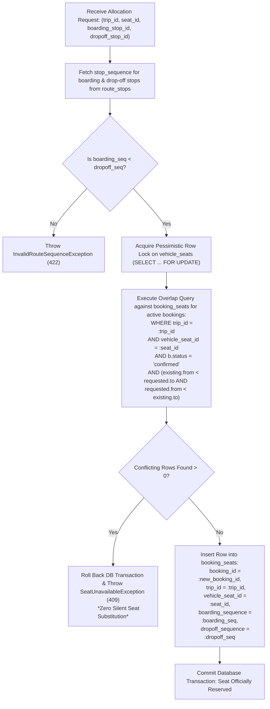

# Workflow: Segment-Based Seat Allocation Engine

## 1. Workflow Purpose
This document provides the low-level algorithmic workflow and database interaction specification for the **Oliver Transport Segment-Based Seat Allocation Engine**. It explains how stop sequence ranges are mapped, how pessimistic locks are acquired on physical seats, how conflict detection queries are formed, and how seat reservations are committed.

---

## 2. Algorithmic Flowchart



---

## 3. Detailed Step-by-Step Execution

### Step 1: Sequence Index Resolution
Given `boarding_stop_id` and `dropoff_stop_id`:
```php
$boardingStop = RouteStop::where('id', $boardingStopId)->firstOrFail();
$dropoffStop  = RouteStop::where('id', $dropoffStopId)->firstOrFail();

$fromSeq = $boardingStop->stop_sequence;
$toSeq   = $dropoffStop->stop_sequence;

if ($fromSeq >= $toSeq) {
    throw new InvalidRouteSequenceException("Drop-off station must follow boarding station.");
}
```

### Step 2: Pessimistic Row Lock Acquisition (Step 6 of Transaction)
To ensure total serialization across concurrent booking requests on the same seat:
```php
$seat = VehicleSeat::where('id', $seatId)
    ->where('is_driver_seat', false)
    ->lockForUpdate()
    ->firstOrFail();
```

### Step 3: Overlap Collision Evaluation (Step 7 of Transaction)
The core mathematical query evaluates whether any existing confirmed booking on this trip and seat shares an overlapping segment:
```php
$conflicts = DB::table('booking_seats')
    ->join('bookings', 'booking_seats.booking_id', '=', 'bookings.id')
    ->where('booking_seats.trip_id', $tripId)
    ->where('booking_seats.vehicle_seat_id', $seatId)
    ->where('bookings.status', 'confirmed')
    ->where(function ($query) use ($fromSeq, $toSeq) {
        $query->where('booking_seats.boarding_sequence', '<', $toSeq)
              ->where('booking_seats.dropoff_sequence', '>', $fromSeq);
    })
    ->count();

if ($conflicts > 0) {
    throw new SeatUnavailableException("Seat {$seat->seat_number} is occupied on this journey segment.");
}
```

### Step 4: Record Insertion (Step 12 of Transaction)
Upon verification, the reservation interval is recorded:
```php
BookingSeat::create([
    'booking_id'        => $booking->id,
    'trip_id'           => $tripId,
    'vehicle_seat_id'   => $seatId,
    'boarding_sequence' => $fromSeq,
    'dropoff_sequence'  => $toSeq,
]);
```

---

## 4. Deallocation Workflow (Cancellation)
If a booking is cancelled:
1. `bookings.status` is updated to `'cancelled'`.
2. Because the conflict query filters strictly for `bookings.status = 'confirmed'`, the cancelled seat interval is immediately excluded from collision queries.
3. The seat segments return instantaneously to available inventory without requiring row deletion.

---

## 5. Related Documents
* [`07-database-design.md`](../07-database-design.md) — Table schema for `booking_seats`.
* [`08-booking-workflow.md`](../08-booking-workflow.md) — 16-step transaction lifecycle.
* [`09-seat-management.md`](../09-seat-management.md) — Mathematical specification of segment overlap.
